# Introduction

This guide is for PeopleDisplay administrators: the people who manage staff, users, locations and settings. How the check-in screen itself works is described in the **User Guide**. Installing and updating PeopleDisplay on your own hosting is covered in the **Installation Guide**.

> **About the screen labels** — The PeopleDisplay interface is in Dutch. This guide shows the Dutch label in **bold**, with its meaning where that helps.

> **About the examples** — The screenshots were taken in a demo environment with fictional names, locations and an Unlimited licence. With a Starter licence some parts are not available (see [Licence](#licence)).

## Staff members and users

PeopleDisplay has two kinds of people. It helps to know the difference:

| | **Staff member** (*medewerker*) | **User** (*gebruiker*) |
|---|---|---|
| What is it? | Someone with a card on the check-in screen | An account someone logs in with |
| Managed under | **Medewerkers** | **Gebruikers** |
| Example | Teacher Anna, caretaker Daan | The reception account, the screen in the hall, the administrator |

A shared screen in the hall is therefore one *user* showing the cards of many *staff members*.

## Roles

| Role | May |
|---|---|
| **User** | Use the check-in screen, overview and own profile |
| **Medewerker Beheerder** (staff manager) | Additionally manage staff members |
| **Gebruiker Beheerder** (user manager) | Additionally manage staff members and users |
| **Admin** | Use the admin dashboard; a SuperAdmin can restrict per function what an admin may do |
| **SuperAdmin** | Everything, including backups, the licence and other administrators |

# The admin dashboard

Administrators arrive at the admin dashboard right after logging in. From the check-in screen you get there with the **Admin Dashboard** button at the bottom, or via **Beheer** on the welcome screen.

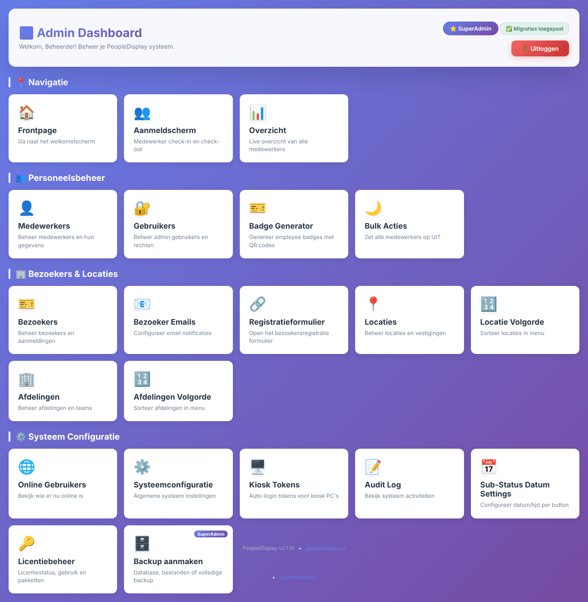

The dashboard has four groups:

- **Navigatie** (navigation) — to the welcome screen, the check-in screen and the overview.
- **Personeelsbeheer** (staff management) — staff, users, the badge generator and bulk actions.
- **Bezoekers & Locaties** (visitors & locations) — visitors, visitor emails, the registration form, locations and departments (and their order).
- **Systeem Configuratie** (system configuration) — online users, system configuration, kiosk tokens, audit log, sub-status dates, licence management and backup.

At the top right you see your role and **Migraties toegepast** (migrations applied) or **Database schema gecontroleerd** (database schema checked): every time the dashboard opens, PeopleDisplay checks that the database matches the installed version and updates it itself if needed. The version is shown at the bottom.

When a new version is available, an update notice appears at the top (see [Updates](#updates)).

# Staff members

Under **Medewerkers** you manage every card on the check-in screen.

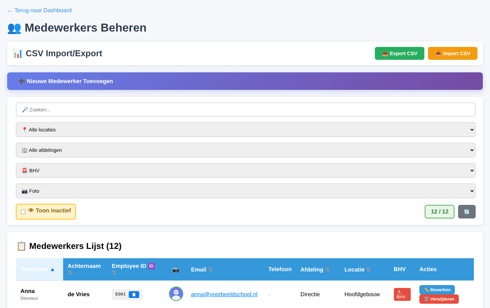

Above the list you search and filter by name, location, department, emergency responder (BHV) and photo. **Toon inactief** (show inactive) also lists staff members that were deleted. On the right you see how many are shown. Click a column header to sort.

## Adding a staff member

Click **Nieuwe Medewerker Toevoegen** (add new staff member).

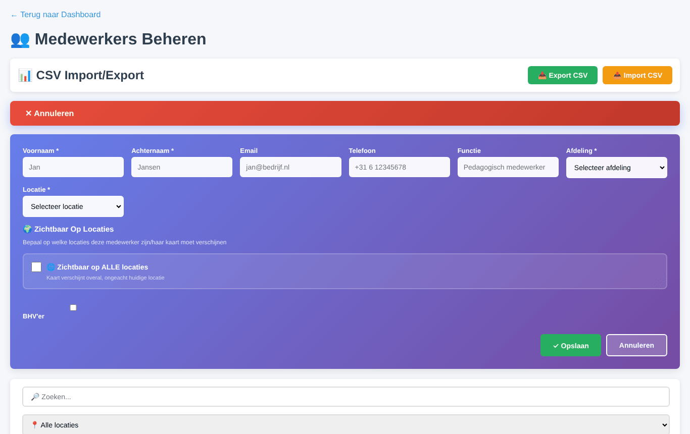

1. Enter **first name**, **last name**, **department** and **location** (required).
2. Optionally enter email, phone and job title. The email address is used for visitor notifications.
3. Under **Zichtbaar op locaties** (visible at locations) choose where the card appears. With **Zichtbaar op ALLE locaties** the card appears everywhere, regardless of the current location.
4. Tick **BHV'er** for staff with an emergency-response role.
5. Click **Opslaan** (save).

## Editing a staff member

Click **Bewerken** (edit) on the staff member's row. The form opens directly below that row.

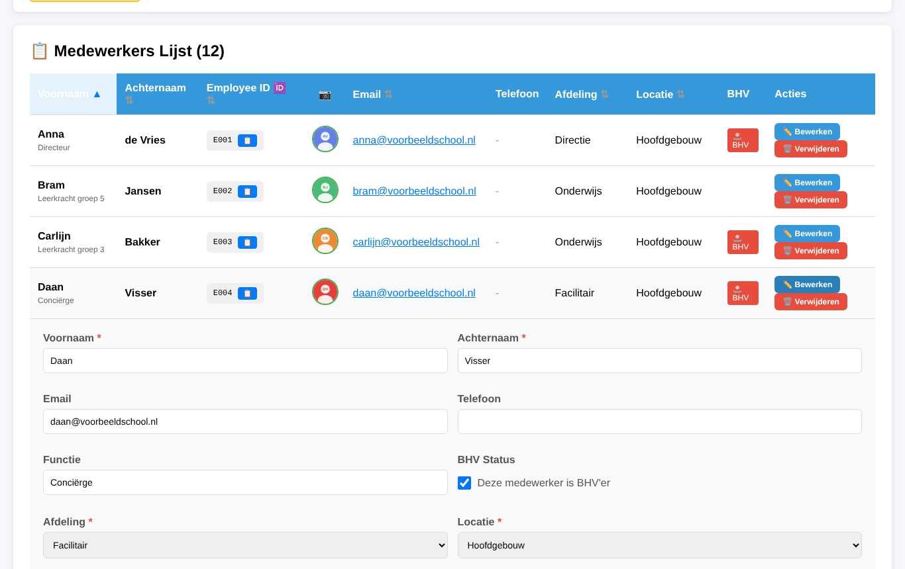

This is also where you set the photo and whether the person may use the **"Pion" (📍)** to check in at another location.

## Deleting and restoring

**Verwijderen** (delete) makes a staff member inactive: the card disappears from all screens, but the data and history are kept. Tick **Toon inactief** and click **♻️ Herstellen** (restore) to bring someone back.

## Import and export (CSV)

- **Export CSV** downloads all staff members as a CSV file (opens in Excel).
- **Import CSV** adds staff members in one go. The file needs at least the columns `voornaam` (first name) and `achternaam` (last name); the columns `functie`, `afdeling`, `locatie`, `bhv` (Ja/Nee), `foto_url`, `notities` and `status` are used when present. Choose the file below the list and click **Importeren**.

> **Tip** — Export the existing staff first. That gives you an example file with the right columns.

# Users

Under **Gebruikers** you manage all accounts.

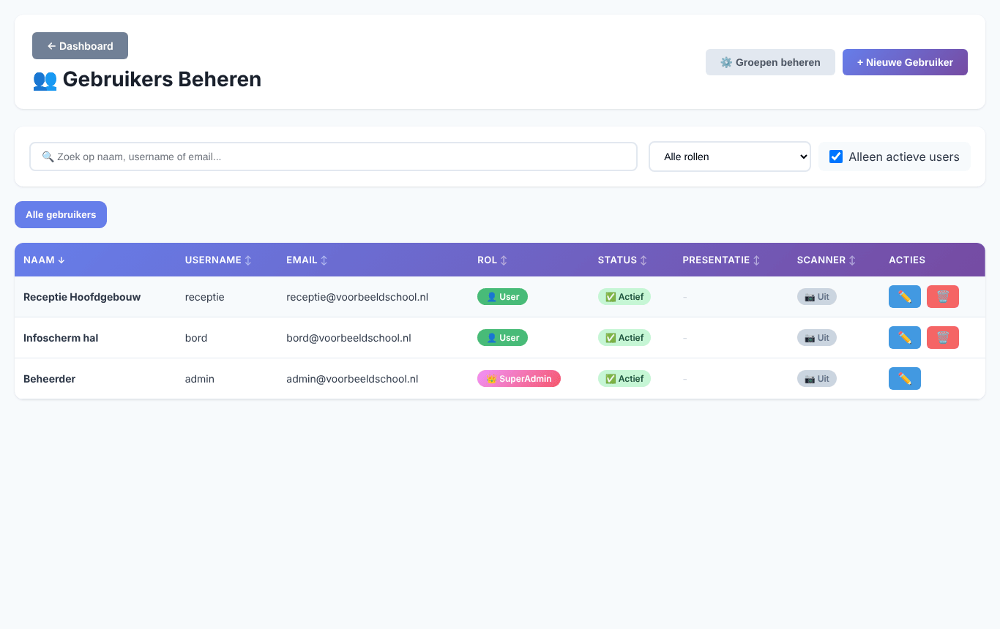

Search by name, username or email, or filter by role. **+ Nieuwe Gebruiker** creates an account; **Groepen beheren** (manage groups) creates groups to organise users (for example per location).

## Editing a user

Click the pencil (✏️) behind a user. The edit panel has four tabs.

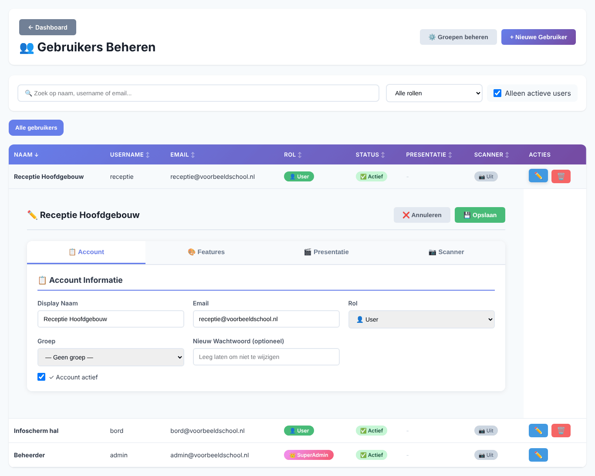

- **Account** — display name, email, role, group, a new password (leave empty to keep the current one) and whether the account is active.
- **Features** — what this user sees and may do on the check-in screen (see below).
- **Presentatie** (presentation) — a Google Slides presentation that starts automatically after the screen has not been touched for a while, with the number of seconds to wait. Handy for an information screen in the hall.
- **Scanner** — whether the user may scan badges to check staff in and out.

Click **Opslaan** (save) to keep the changes.

## Features per user

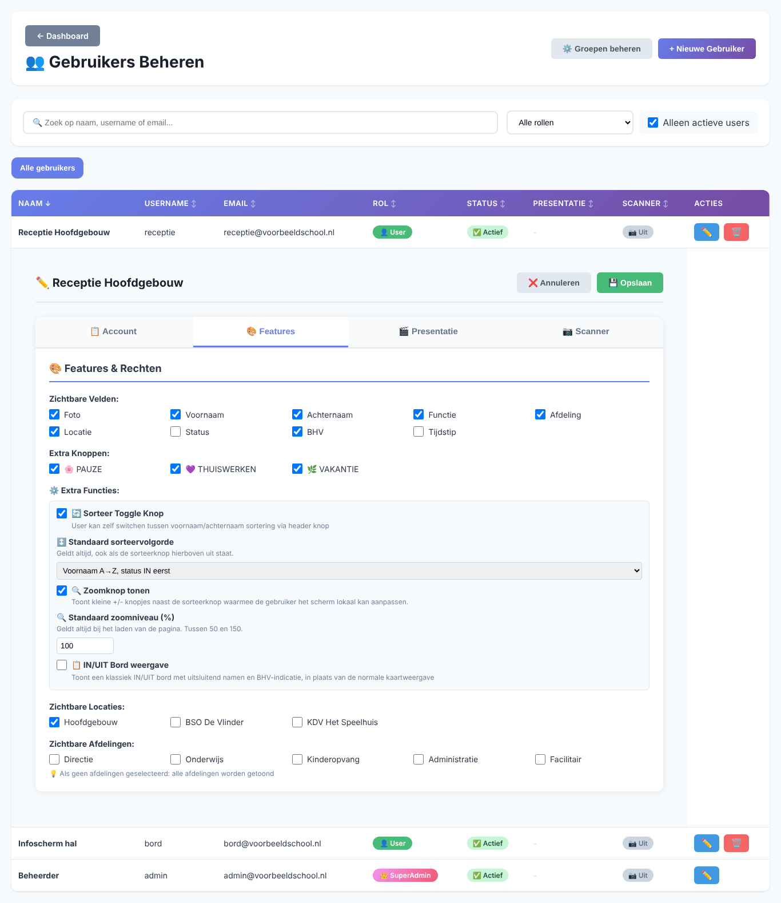

- **Zichtbare Velden** (visible fields) — which details are on the cards: photo, first name, last name, job title, department, location, status, emergency responder and time.
- **Extra Knoppen** (extra buttons) — which of the three extra status buttons the user sees.
- **Sorteer Toggle Knop** — shows the sort button (A) so the user can switch between first and last name.
- **Standaard sorteervolgorde** (default sort order) — always applies, also without the sort button: *first name A→Z, status IN first*, *first name* or *last name*.
- **Zoomknop tonen** (show zoom buttons) and **Standaard zoomniveau** (default zoom, 50–150%).
- **IN/UIT Bord weergave** — the user sees the IN/OUT board instead of the cards. Suitable for a large screen.
- **Zichtbare Locaties** and **Zichtbare Afdelingen** (visible locations and departments) — which cards this user sees. No department ticked means: all departments.

If the role is **Admin**, this tab also lists the management functions (locations, departments, kiosk tokens, visitors, badges, bulk actions, audit log, system configuration, sub-status dates, users, backup). Only the ticked functions are available to that admin.

# Locations

Under **Locaties** you manage your sites.

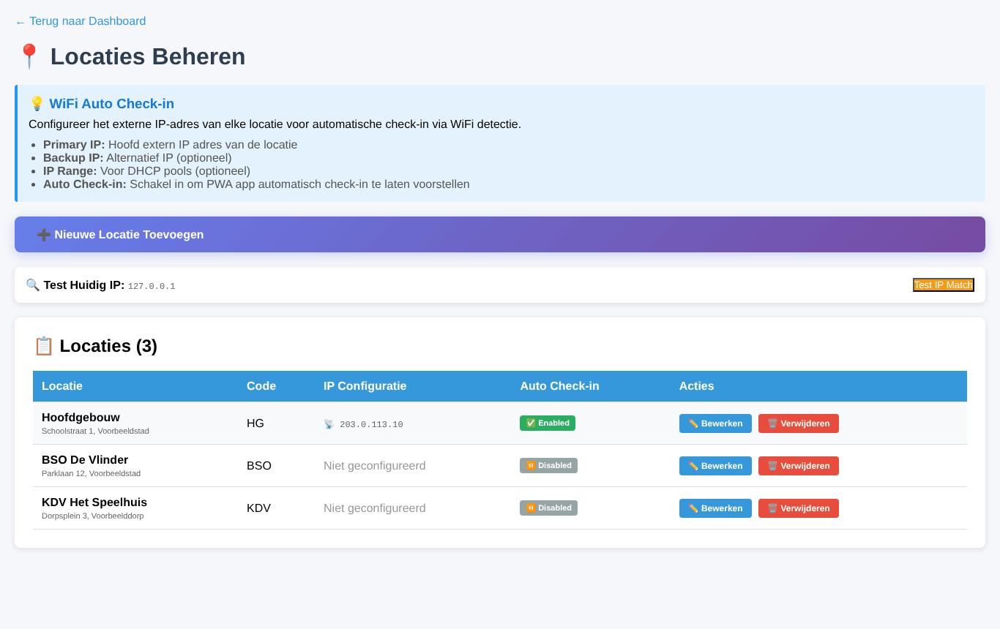

- **Nieuwe Locatie Toevoegen** — name, short code and address.
- **Bewerken** — change a location. A new name is automatically applied to all staff at that location.
- **IP configuration and Auto Check-in** — enter the location's external IP address (and optionally a backup IP or IP range) and switch on **Auto Check-in**. Staff who installed PeopleDisplay as an app on their phone are then offered an automatic check-in as soon as they are on that location's network. **Test IP Match** shows which IP address you have right now.

## Location order

Under **Locatie Volgorde** (location order) you set the order of locations in the menu and filters. Drag the locations into the order you want and save.

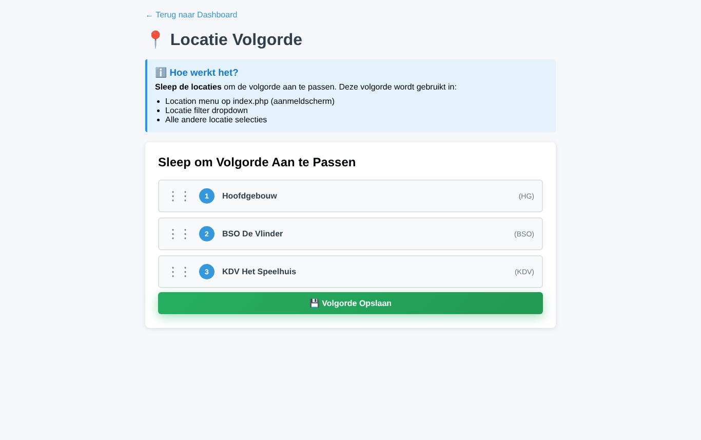

# Departments

Under **Afdelingen** you manage departments or teams. The check-in screen can be filtered by department. A new name is automatically applied to all staff. **Afdelingen Volgorde** sets their order.

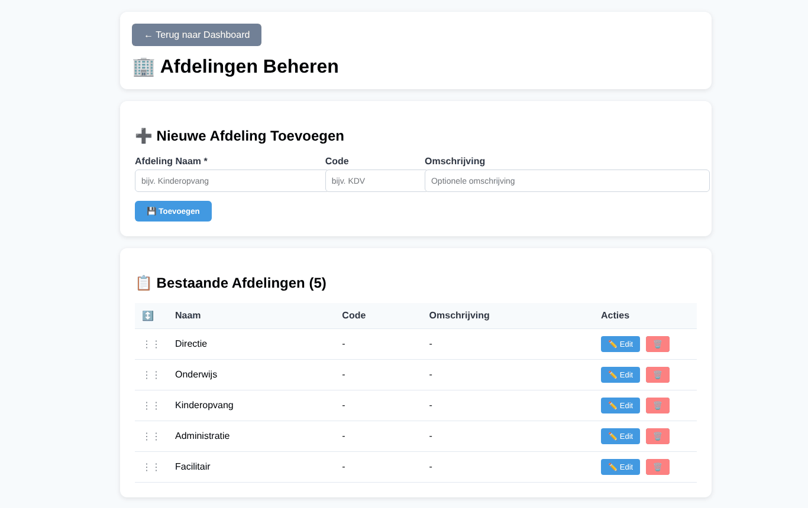

# Visitors

## Managing visitors

Under **Bezoekers** you see who registered today, who is inside and who has left.

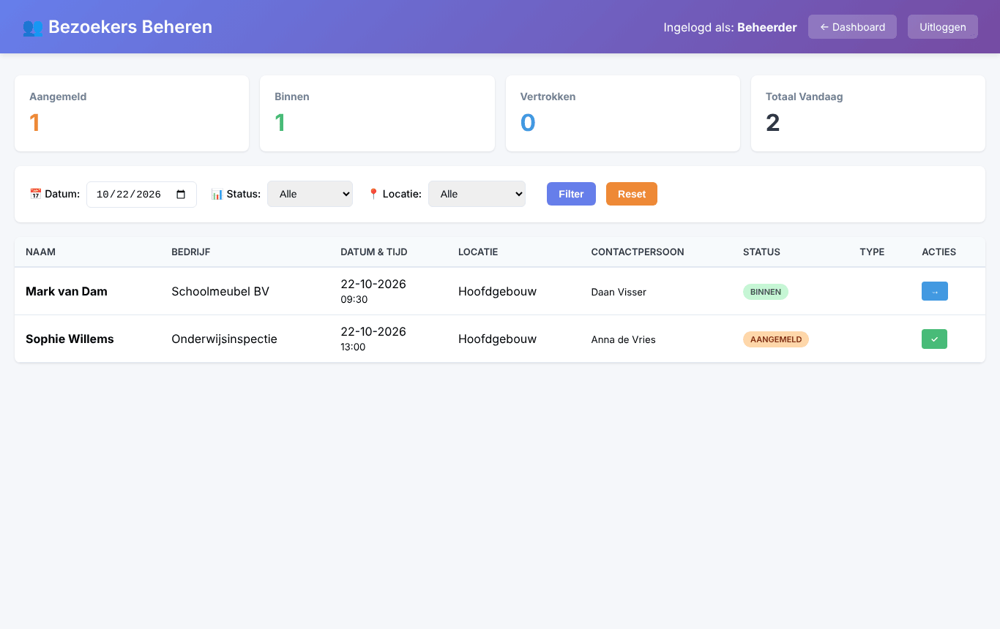

Filter by date, status and location. The button in the **Acties** column checks a visitor in (✓) or out (→).

## The registration form

**Registratieformulier** opens the form visitors use to register themselves (`/visitor_register.php`). Put the link on your website or a QR code with that link at the entrance. The form is described in the User Guide.

## Visitor emails

When a visitor registers and when they check in, the contact person receives an email. Under **Bezoeker Emails** you set a **fallback address** (for example reception) that receives the notification when the contact person has no email address.

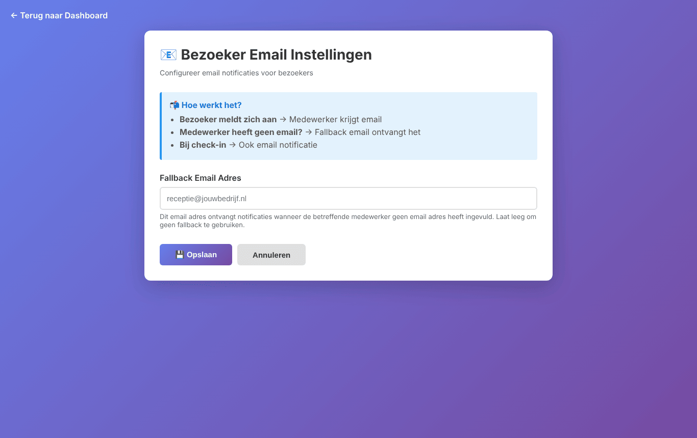

> **Note** — PeopleDisplay sends email through your hosting's mail function. If emails do not arrive, check the spam folder and ask your hosting provider whether outgoing mail is allowed.

# Badge generator

The **Badge Generator** creates name badges with a QR code or barcode, for example for the scanner.

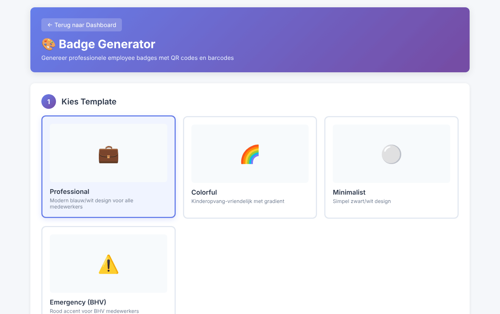

1. Choose a template: **Professional**, **Colorful**, **Minimalist** or **Emergency (BHV)**.
2. Choose which details go on the badge.
3. Select the staff members.
4. Download the badges as a **PDF** to print, or as **PNG** images in a ZIP file.

# Bulk actions

**Bulk Acties** resets statuses in one go.

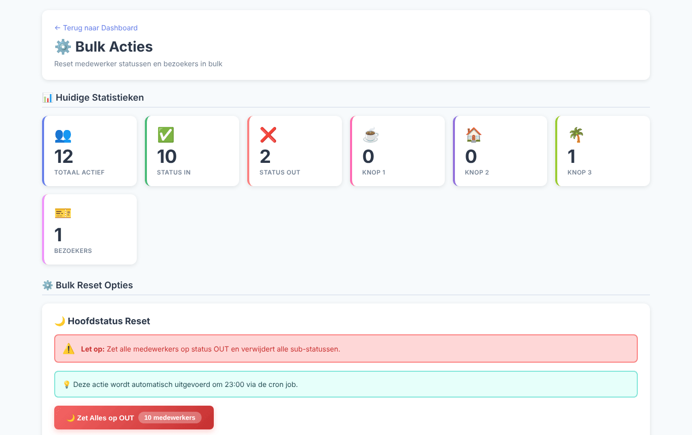

- **Zet Alles op OUT** (set everything to OUT) — all staff out and all extra statuses cleared. This also happens automatically every evening at 23:00 when the cron job is set up (see the Installation Guide).
- **Sub-Status Reset** — clear only the extra status of button 1, 2 or 3, without changing IN/OUT.
- **Bezoekers Reset** — set all visitors to departed.

The current numbers are shown at the top.

# System configuration

## Extra buttons and display

Under **Systeemconfiguratie** you name the three extra buttons (by default PAUZE, THUISWERKEN and VAKANTIE — break, working from home, holiday). Tick **Gebruikers mogen eigen button namen instellen** if users may choose their own names in their profile. **Auto-fullscreen toestaan** lets kiosk screens open in full screen automatically.

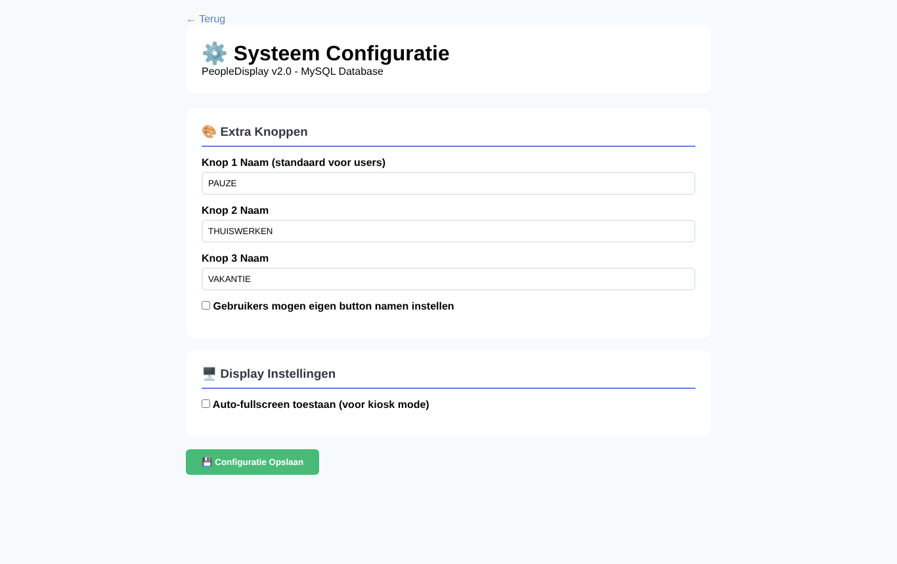

## Date and time for extra buttons

Under **Sub-Status Datum Settings** you decide per extra button whether PeopleDisplay asks **until when** the status applies. At that moment the status is reset automatically (by the cron job). The top shows how many statuses have an end date, are still active or have expired.

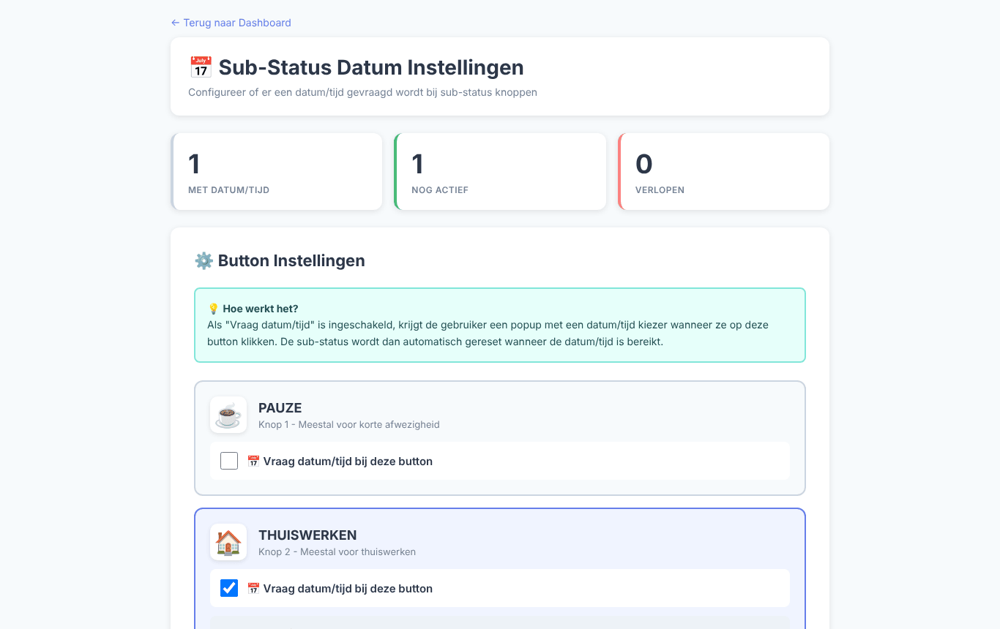

## Name display

Under **Naam Weergave Configuratie** you choose how names appear on the cards: full name, first name only, last name only, or initial + last name.

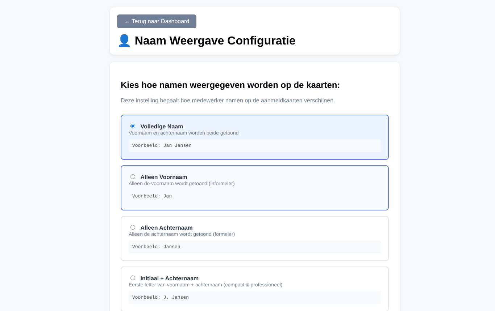

# Kiosk tokens

A kiosk token is a permanent login link for a screen without a keyboard, such as a tablet at the entrance. With it the screen opens PeopleDisplay automatically, also after a restart.

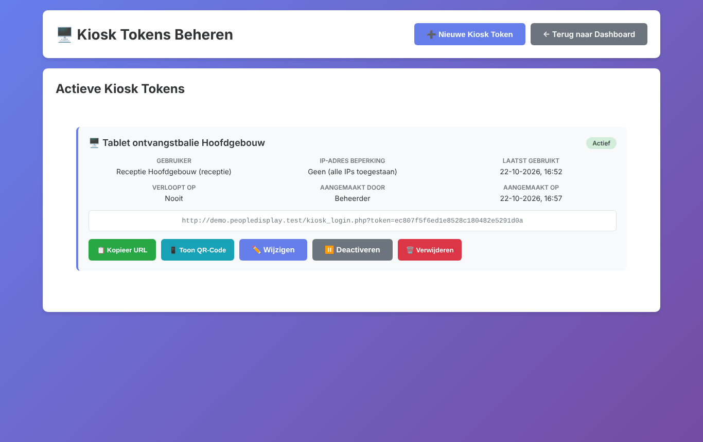

## Creating a kiosk token

1. First create a **user** for the screen, with the right locations and features.
2. Click **Nieuwe Kiosk Token**.
3. Choose that user, add a description (for example *Reception tablet*), and optionally an **IP restriction** and an expiry.
4. Click **Kopieer URL** (copy URL) or **Toon QR-Code** (show QR code) and open that link on the screen.

**Deactiveren** (deactivate) or **Verwijderen** (delete) stops the link working immediately, for example when a tablet is lost.

> **Tip for a fixed kiosk PC** — Start Chrome with `--kiosk` followed by the token URL. Chrome then opens full screen, without an address bar. The emergency overview has its own **Venster sluiten** (close window) button, so you can also get back in kiosk mode.

# Online users

**Online Gebruikers** shows who is logged in right now, on which device, with which browser, from which IP address and for how long.

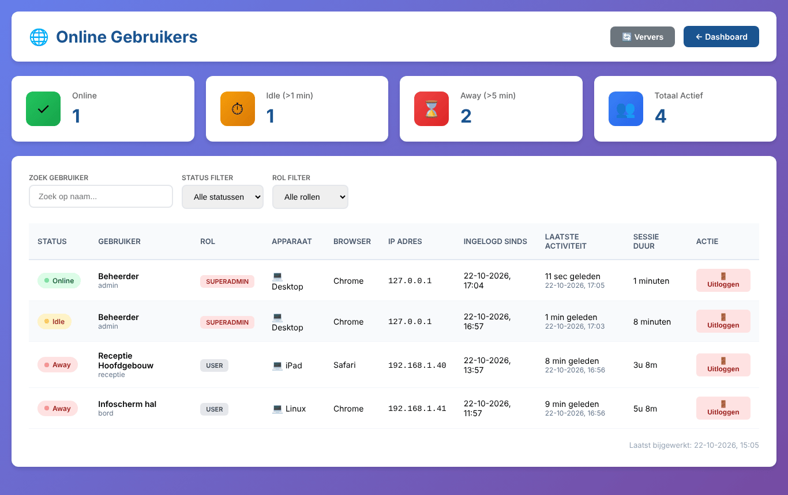

- **Online** = active in the last minute, **Idle** = no activity for over 1 minute, **Away** = over 5 minutes.
- **Uitloggen** (log out) ends a session remotely, for example for a lost tablet. The user sees a notice within seconds and is taken to the login screen. They can simply log in again afterwards.

# Audit log

The **Audit Log** records who changed what: staff members added, changed and deleted, and status changes, with time, old and new value, who did it and from which IP address.

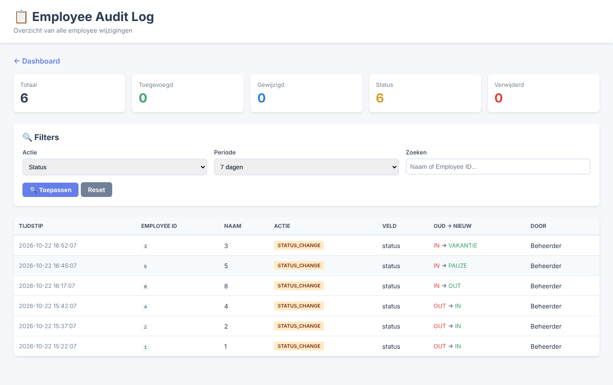

Filter by action (added, changed, status, deleted), period and name or staff number. **MIGRATION** rows are the automatic database checks when the dashboard opens.

# Licence

**Licentiebeheer** (licence management) shows which plan is active, for which domain, how much you use and which features are available.

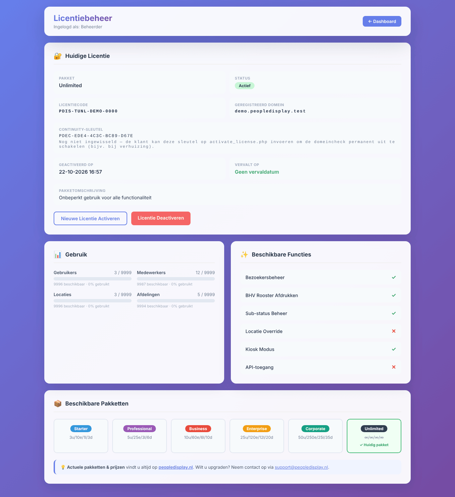

- **Starter** is free and works without a licence key: up to 10 staff members, 1 location and 3 users. Visitor management, kiosk mode, bulk actions and the audit log are in the paid plans.
- **Nieuwe Licentie Activeren** (activate new licence) — enter a licence key (format `PDIS-…`). The licence is bound to this installation's domain.
- **Licentie Deactiveren** (deactivate licence) — releases the binding, for example before moving. Starter limits then apply until you activate again.
- **Continuity key** (Unlimited and Corporate) — with this key your licence keeps working after moving to another domain or hosting, even without help from peopledisplay.nl. Keep it somewhere safe. You redeem it via `activate_license.php` on the new environment.

Current plans and prices are on [peopledisplay.nl](https://peopledisplay.nl).

# Backup

Only a SuperAdmin can download a backup as a ZIP file under **Backup aanmaken**.

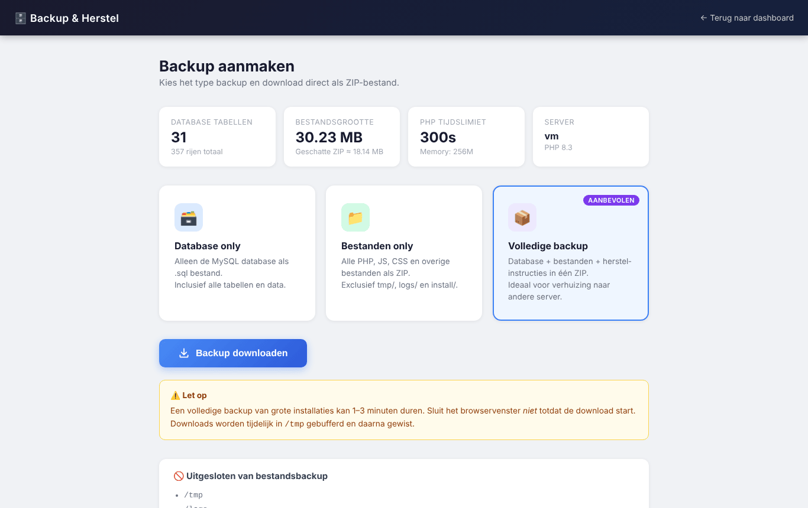

- **Database only** — all tables and data as a `.sql` file.
- **Bestanden only** (files only) — all program files (without `tmp/`, `logs/` and `install/`).
- **Volledige backup** (full backup, recommended) — database and files, with restore instructions. Use it to move PeopleDisplay to another server.

A full backup of a large installation can take 1 to 3 minutes. Do not close the window before the download starts. Restoring a backup is described in the Installation Guide.

# Updates

PeopleDisplay checks for new versions itself. When one is available, a notice appears at the top of the dashboard with the version number and the main changes.

1. Click **Wat is nieuw?** (what's new) for all changes.
2. Click **Update downloaden** (download update). You get a small ZIP file with only the changed files.
3. Unzip it and upload its contents by FTP to your PeopleDisplay folder, overwriting the existing files. Your settings, photos and data stay in place.
4. Open the admin dashboard. Any database changes are applied automatically.

The cross hides the notice until the next version. Open screens and installed apps load the new version by themselves within a few minutes.

# Frequently asked questions

**A staff member does not appear on a particular user's screen.**
Check that user's *Features* tab → *Zichtbare Locaties* and *Zichtbare Afdelingen*, and the staff member's location and *Zichtbaar op locaties*.

**I can no longer add staff, locations or users.**
You have reached your plan's limit. See **Licentiebeheer** for your usage.

**Extra statuses are not reset automatically.**
That is done by cron jobs. Check that they are set up (see the Installation Guide).

**How do I reset a user's password?**
Open the user with ✏️, enter a new password on the *Account* tab and click **Opslaan**.

**How do I move PeopleDisplay to another hosting provider?**
Make a full backup and restore it on the new hosting with `restore.php` (see the Installation Guide). With an Unlimited or Corporate licence, redeem your continuity key afterwards.
