# Introduction

This guide is for PeopleDisplay administrators: the people who manage staff, users, locations and settings. How the check-in screen itself works is described in the **User Guide**. Installing and updating PeopleDisplay on your own hosting is covered in the **Installation Guide**.

> **About the screen labels** — The PeopleDisplay interface is in Dutch. This guide shows the Dutch label in **bold**, with its meaning where that helps.

> **About the examples** — The screenshots were taken in a demo environment with fictional names, locations and an Unlimited licence. With a Starter licence some parts are not available (see [Licence](#licence)).

## Staff members and users

PeopleDisplay has two kinds of people. It helps to know the difference:

| | **Staff member** (*medewerker*) | **User** (*gebruiker*) |
|---|---|---|
| What is it? | Someone with a card on the check-in screen | An account someone logs in with |
| Managed under | **Medewerkers** | **Gebruikers** |
| Example | Teacher Anna, caretaker Daan | The reception account, the screen in the hall, the administrator |

A shared screen in the hall is therefore one *user* showing the cards of many *staff members*.

## Roles

| Role | May |
|---|---|
| **User** | Use the check-in screen, overview and own profile |
| **Medewerker Beheerder** (staff manager) | Additionally manage staff members |
| **Gebruiker Beheerder** (user manager) | Additionally manage staff members and users |
| **Admin** | Use the admin dashboard; a SuperAdmin can restrict per function what an admin may do |
| **SuperAdmin** | Everything, including backups, the licence and other administrators |

# The admin dashboard

Administrators arrive at the admin dashboard right after logging in. From the check-in screen you get there with the **Admin Dashboard** button at the bottom, or via **Beheer** on the welcome screen.

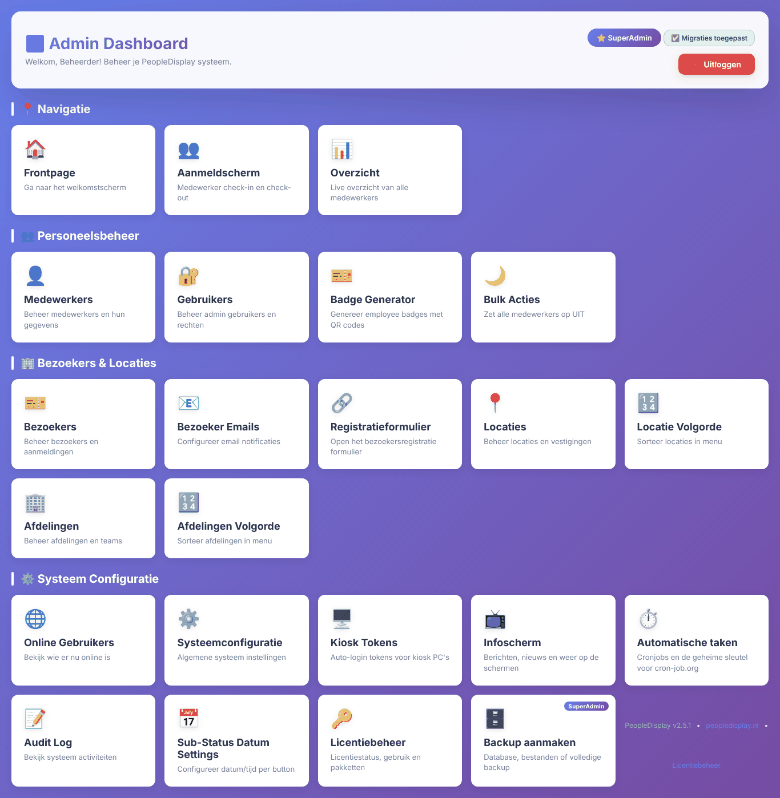

The dashboard has four groups:

- **Navigatie** (navigation) — to the welcome screen, the check-in screen and the overview.
- **Personeelsbeheer** (staff management) — staff, users, the badge generator and bulk actions.
- **Bezoekers & Locaties** (visitors & locations) — visitors, visitor emails, the registration form, locations and departments (and their order).
- **Systeem Configuratie** (system configuration) — online users, system configuration, kiosk tokens, infoscreen, audit log, sub-status dates, licence management and backup.

At the top right you see your role and **Migraties toegepast** (migrations applied) or **Database schema gecontroleerd** (database schema checked): every time the dashboard opens, PeopleDisplay checks that the database matches the installed version and updates it itself if needed. The version is shown at the bottom.

When a new version is available, an update notice appears at the top (see [Updates](#updates)).

# Staff members

Under **Medewerkers** you manage every card on the check-in screen.

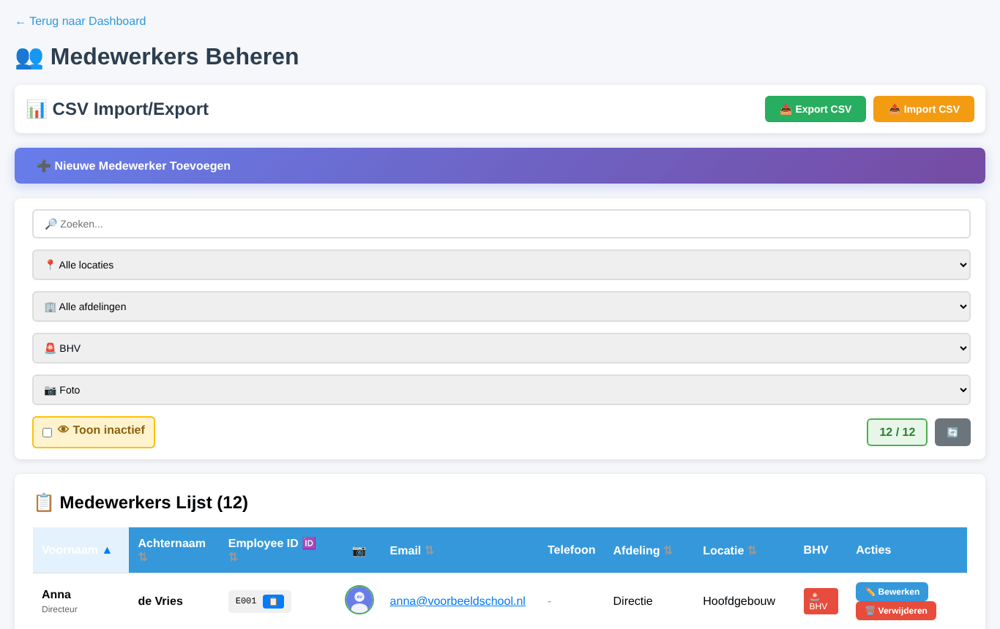

Above the list you search and filter by name, location, department, emergency responder (BHV) and photo. **Toon inactief** (show inactive) also lists staff members that were deleted. On the right you see how many are shown. Click a column header to sort.

## Adding a staff member

Click **Nieuwe Medewerker Toevoegen** (add new staff member). The form is laid out in clear blocks: Basic details, Organisation and Photo side by side, with Visibility at locations below.

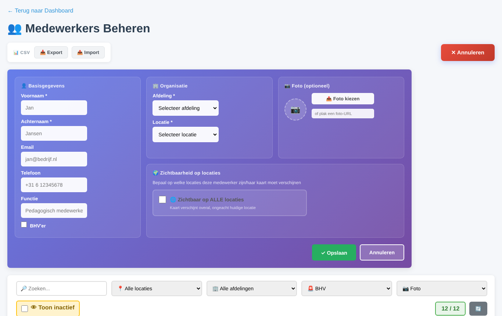

1. Under **Basisgegevens** (basic details) enter **first name** and **last name** (required), and optionally email, phone, **birthday** (*Verjaardag*) and job title. The birthday (day and month only, for example *14-03*; the year is not stored) is only filled in when the staff member wants to appear under *Vandaag jarig* (birthdays today) on the infoscreen. The email address is used for visitor notifications. Tick **BHV'er** for staff with an emergency-response role.
2. Under **Organisatie** (organisation) choose **department** and **location** (required).
3. Under **Foto** (photo) add a photo with **Foto kiezen** (choose photo) — PeopleDisplay compresses it automatically — or paste a photo URL.
4. Under **Zichtbaarheid op locaties** (visibility at locations) decide where the card appears. With **Zichtbaar op ALLE locaties** (visible at ALL locations) the card appears everywhere, regardless of the current location; also tick **Mag handmatig locatie kiezen bij check-in** (may choose location manually at check-in) if this staff member should be able to use the "Pion" (📍) to check in at another location themselves.
5. Click **Opslaan** (save).

## Editing a staff member

Click **Bewerken** (edit) on the staff member's row. The form opens directly below that row, in the same blocks as when adding a staff member.

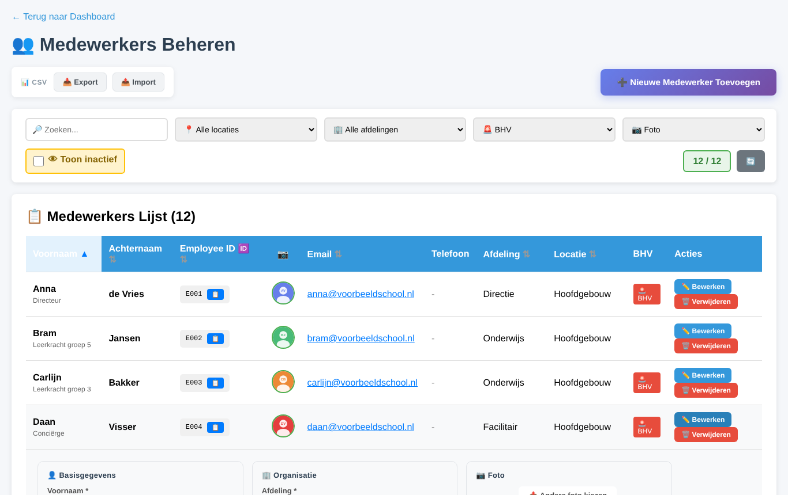

This is also where you change the photo — upload a new one (compressed automatically) or paste a photo URL — and set whether the staff member may check in at another location with the **"Pion" (📍)**: under **Zichtbaarheid op locaties** (visibility at locations) tick **Zichtbaar op ALLE locaties** (visible at ALL locations) first, then **Mag handmatig locatie kiezen bij check-in** (may choose location manually at check-in).

## Deleting and restoring

**Verwijderen** (delete) makes a staff member inactive: the card disappears from all screens, but the data and history are kept. Tick **Toon inactief** and click **♻️ Herstellen** (restore) to bring someone back.

## Import and export (CSV)

- **Export CSV** downloads all staff members as a CSV file (opens in Excel).
- **Import CSV** adds staff members in one go. The file needs at least the columns `voornaam` (first name) and `achternaam` (last name); the columns `functie`, `afdeling`, `locatie`, `bhv` (Ja/Nee), `foto_url`, `notities`, `status` and `verjaardag` (day-month) are used when present. Choose the file below the list and click **Importeren**.

> **Tip** — Export the existing staff first. That gives you an example file with the right columns.

# Users

Under **Gebruikers** you manage all accounts.

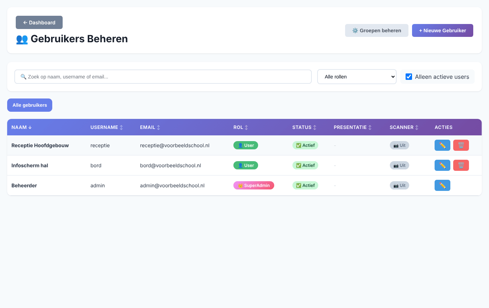

Search by name, username or email, or filter by role. **+ Nieuwe Gebruiker** creates an account; **Groepen beheren** (manage groups) creates groups to organise users (for example per location).

## Editing a user

Click the pencil (✏️) behind a user. The edit panel has four tabs.

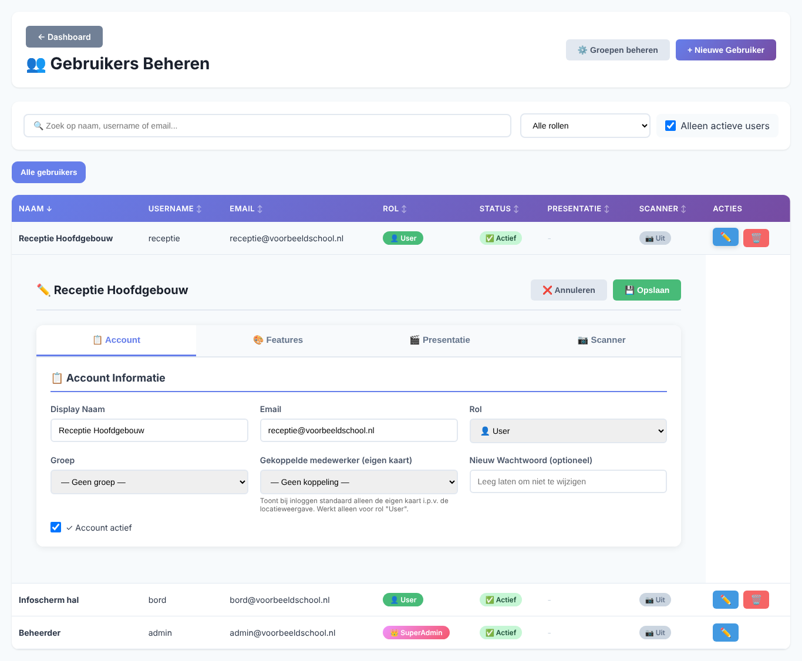

- **Account** — display name, email, role, group, **gekoppelde medewerker** (linked staff member — optional: links this account to one staff card, so the user sees that own card right after logging in instead of the location view or the admin dashboard — works for every role), a new password (leave empty to keep the current one; at least 10 characters), the checkbox **Gebruiker moet bij de eerstvolgende inlog een nieuw wachtwoord kiezen** (user must choose a new password at next login) and whether the account is active. This is also where the checkbox **Tweestapsverificatie (2FA) verplicht voor deze gebruiker** is, and (if the user has 2FA) the button **🔄 2FA resetten (telefoon kwijt)**; see *Two-step verification (2FA)* below.
- **Features** — what this user sees and may do on the check-in screen (see below).
- **Presentatie** (presentation) — what the screen shows after it has not been touched for a while: a Google Slides presentation, the [Infoscreen](#infoscreen) or both, with the number of seconds to wait. Handy for a screen in the hall.
- **Scanner** — whether the user may scan badges to check staff in and out.

Click **Opslaan** (save) to keep the changes.

## Passwords and logging in

- **Forced new password.** With the checkbox *Gebruiker moet bij de eerstvolgende inlog een nieuw wachtwoord kiezen* ticked, that person can only continue after choosing a new password themselves. The box is ticked by default when you set a password or create a user, so only the user knows the password. The overview shows who still has to change (🔑 *nieuw ww*) and when someone last logged in.
- **Everyone at once.** The button **Wachtwoord wijzigen verplichten** at the top lets you pick roles and switch the requirement on (or off) for all active accounts with those roles. Kiosk and tablet accounts (accounts with a kiosk token) are skipped. People who are already logged in are sent to the change page within 5 minutes.
- **Password policy.** A new password has at least 10 characters. A phrase of three or four words is strong and easy to remember.
- **Too many failed attempts.** After 5 failed attempts with the same username from the same address, logging in is blocked for 15 minutes; repeat offences wait longer (up to 24 hours). Even the correct password does not work until the wait is over. Other users on the same address can still log in. All attempts are kept for 90 days (table `login_attempts`). Wrong two-step verification codes count here too.

## Two-step verification (2FA)

With two-step verification a user enters, besides the password, a 6-digit code from an authenticator app on their phone (Google Authenticator, Microsoft Authenticator, Authy, 1Password and the like) when logging in. A stolen or spied-on password is then not enough to get in. Users set it up themselves under **Mijn Profiel** → **Tweestapsverificatie** → **Instellen** (see the User Guide). It takes about two minutes and needs no extra subscription or service: the QR code is made on your own server. Users who only have PeopleDisplay on their phone can set it up on that same phone: instead of the QR code they see an **Open in je authenticator-app** button and a **Sleutel kopiëren** button (see the User Guide). Mention this in your announcement, so nobody thinks a computer is needed.

- **Recommended or required.** Every user can switch 2FA on themselves. To enforce it, make it required, per user or for whole roles (see below). We recommend making 2FA required for at least all administrator roles.
- **Required per user.** Open the user with ✏️ and tick **Tweestapsverificatie (2FA) verplicht voor deze gebruiker** (two-step verification required for this user) on the *Account* tab.
- **Required for roles at once.** The button **🔐 2FA verplichten** at the top lets you pick roles and click **✓ Verplichten** (or **Verplichting opheffen** to lift it). Note: all roles are ticked by default. To require it for administrators only, untick **User**. You are included yourself if your role is ticked. Only active accounts are affected.
- **7 days of grace.** Someone who is required to use 2FA but has not set it up yet may postpone it for 7 days. At login that person sees the setup screen with a **Later instellen** (set up later) button and the number of days left (at most once per 24 hours per session). After those 7 days the user can only continue once 2FA is set up. The grace period starts the moment you make it required and is not extended if you switch it on again later. Users who ticked *Blijf ingelogd* also have to set up 2FA after the 7 days.
- **Kiosk and tablet accounts never take part.** An account with a kiosk token is never asked for 2FA, even if the box is ticked; such a screen has no phone. The list shows **📺 kiosk: geen 2FA** for these accounts.
- **Status in the list.** A badge **🔐 2FA aan** (on) shows who has set it up; **🔐 2FA verplicht** (required) means required but not set up yet (hover for the end date of the grace period).
- **Lost phone or new phone.** A user who lost their phone logs in with one of the 10 **recovery codes** received at setup. Each recovery code works once. If the recovery codes are gone too, you reset 2FA: open the user with ✏️ and click **🔄 2FA resetten (telefoon kwijt)** (reset 2FA, phone lost). The user can then log in with just the password and sets up 2FA again (with a new 7 days of grace if it is required). An ordinary administrator cannot do this for a SuperAdmin; only a SuperAdmin can.
- **Locked out yourself.** If you cannot get in and no other administrator can reset your 2FA, create a file `twofa_uit.txt` (empty is fine) in the root folder of the site via FTP. As long as that file exists nobody needs a code, and the login screen shows an orange warning. Log in with your password, reset 2FA where needed and **delete the file again**.
- **Trusting a device.** When entering the code a user can tick *Dit apparaat 30 dagen vertrouwen* (trust this device for 30 days); on that device no code is needed for 30 days. *Blijf ingelogd* is something else and does not bypass 2FA: someone with 2FA must enter a code again after logging out (or when the session expires), unless the device is trusted. Users can sign out all trusted devices themselves; a password change also signs them all out.
- **Wrong codes.** A wrong code counts towards the automatic block (5 attempts, then 15 minutes and longer). In addition there is a limit of 10 wrong codes per 15 minutes per user, from any address.
- **The phone's clock must be right.** A code only works if the phone's time is correct (automatic time on). If the clock is off, the user gets a message while setting up.

> **Important for the administrator (backup and moving)** — The secret keys of the authenticator apps are stored encrypted in the database. The key used for that is in the file `data/twofa_key.php` on the server. It is created automatically, is never part of updates and cannot be reached through the browser. A **Volledige backup** (full backup) includes the folder `data/` automatically (so keep that ZIP file safe: the key is in it) and `restore.php` puts it back when you move. If you back up or move by hand via FTP, copy the folder `data/` yourself, together with the database. If the file is lost, 2FA stops working for everybody until you reset 2FA per user (or temporarily create `twofa_uit.txt`).

## Features per user

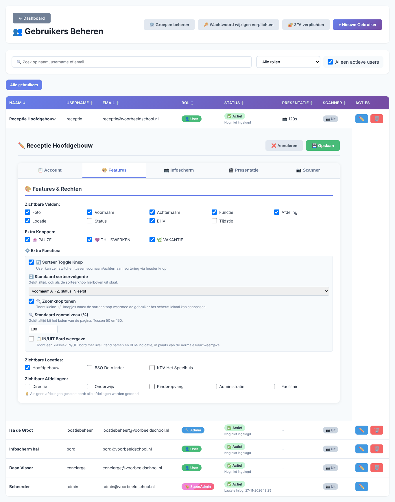

- **Zichtbare Velden** (visible fields) — which details are on the cards: photo, first name, last name, job title, department, location, status, emergency responder and time.
- **Extra Knoppen** (extra buttons) — which of the three extra status buttons the user sees.
- **Sorteer Toggle Knop** — shows the sort button (A) so the user can switch between first and last name.
- **Standaard sorteervolgorde** (default sort order) — always applies, also without the sort button: *first name A→Z, status IN first*, *first name* or *last name*.
- **Zoomknop tonen** (show zoom buttons) and **Standaard zoomniveau** (default zoom, 50–150%).
- **IN/UIT Bord weergave** — the user sees the IN/OUT board instead of the cards. Suitable for a large screen.
- **Zichtbare Locaties** and **Zichtbare Afdelingen** (visible locations and departments) — which cards this user sees. No department ticked means: all departments.

## An admin's permissions

When the user has the role **Admin**, there is an extra tab **🔐 Rechten** (permissions). There you tick which management functions this admin may use: locations, departments, kiosk tokens, visitors, badges, bulk actions, audit log, system configuration, sub-status dates, users and backup. The infoscreen permissions are on the **📺 Infoscherm** tab (see [Infoscreen permissions](#infoscreen-permissions)). **Alles aan** and **Alles uit** (all on / all off) set them in one go. A SuperAdmin may always do everything. The tab appears once you have saved the role Admin.

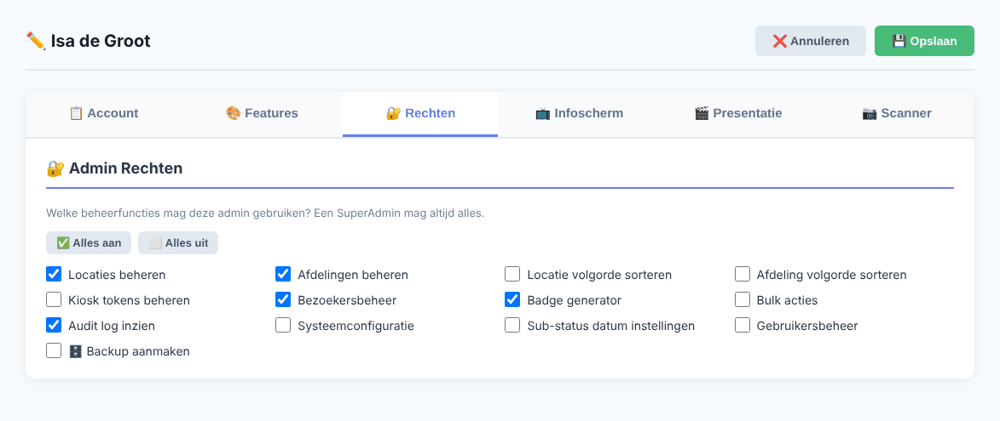

# Locations

Under **Locaties** you manage your sites.

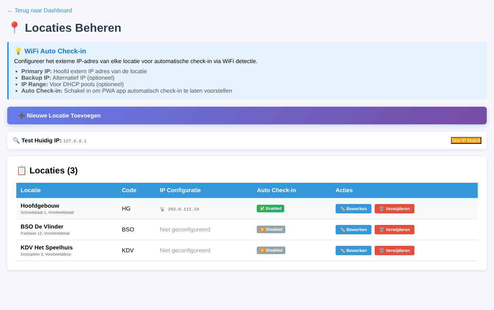

- **Nieuwe Locatie Toevoegen** — name, short code and address.
- **Bewerken** — change a location. A new name is automatically applied to all staff at that location.
- **IP configuration and Auto Check-in** — enter the location's external IP address (and optionally a backup IP or IP range) and switch on **Auto Check-in**. Staff who installed PeopleDisplay as an app on their phone are then offered an automatic check-in as soon as they are on that location's network. **Test IP Match** shows which IP address you have right now.

## Location order

Under **Locatie Volgorde** (location order) you set the order of locations in the menu and filters. Drag the locations into the order you want and save.

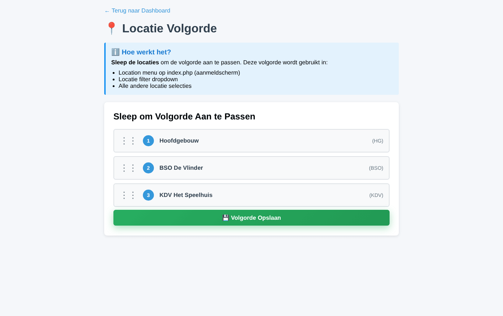

# Departments

Under **Afdelingen** you manage departments or teams. The check-in screen can be filtered by department. A new name is automatically applied to all staff. **Afdelingen Volgorde** sets their order.

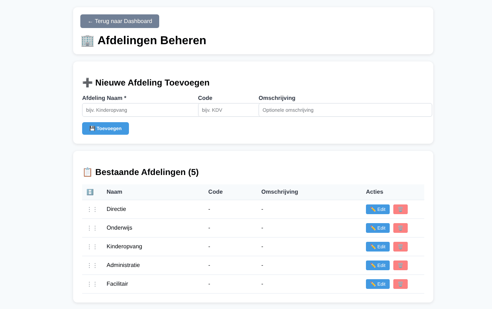

# Visitors

## Managing visitors

Under **Bezoekers** you see who registered today, who is inside and who has left.

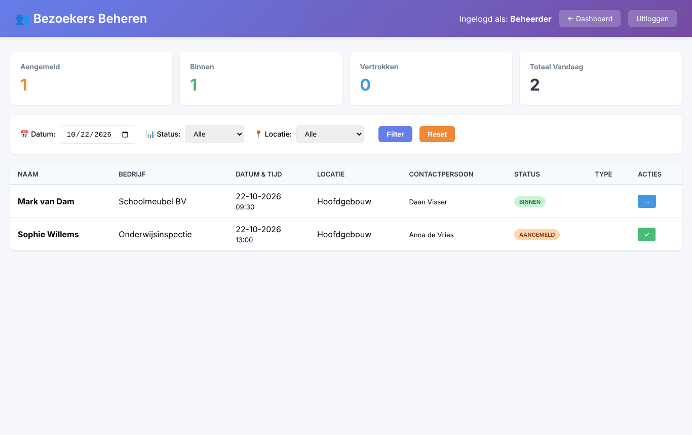

Filter by date, status and location. The button in the **Acties** column checks a visitor in (✓) or out (→).

## The registration form

**Registratieformulier** opens the form visitors use to register themselves (`/visitor_register.php`). Put the link on your website or a QR code with that link at the entrance. The form is described in the User Guide.

## Visitor emails

When a visitor registers and when they check in, the contact person receives an email. Under **Bezoeker Emails** you set a **fallback address** (for example reception) that receives the notification when the contact person has no email address.

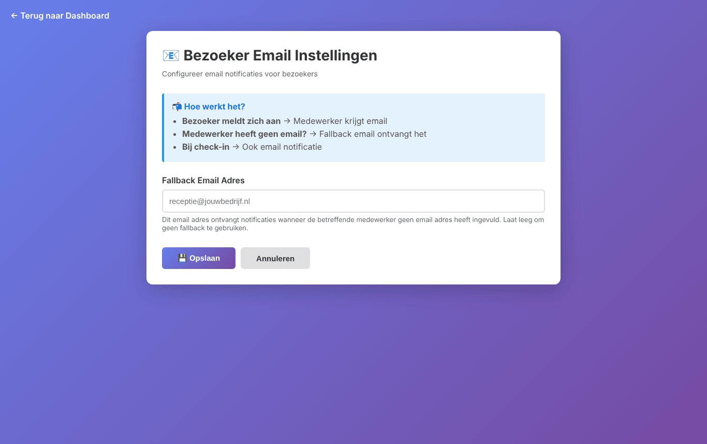

> **Note** — PeopleDisplay sends email through your hosting's mail function. If emails do not arrive, check the spam folder and ask your hosting provider whether outgoing mail is allowed.

# Badge generator

The **Badge Generator** creates name badges with a QR code or barcode, for example for the scanner.

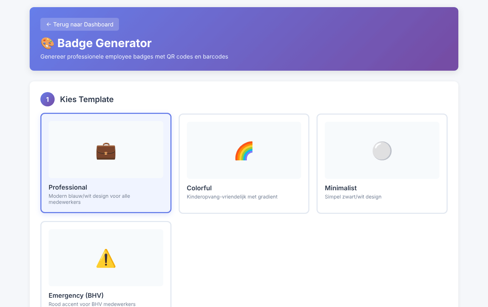

1. Choose a template: **Professional**, **Colorful**, **Minimalist** or **Emergency (BHV)**.
2. Choose which details go on the badge.
3. Select the staff members.
4. Download the badges as a **PDF** to print, or as **PNG** images in a ZIP file.

# Bulk actions

**Bulk Acties** resets statuses in one go.

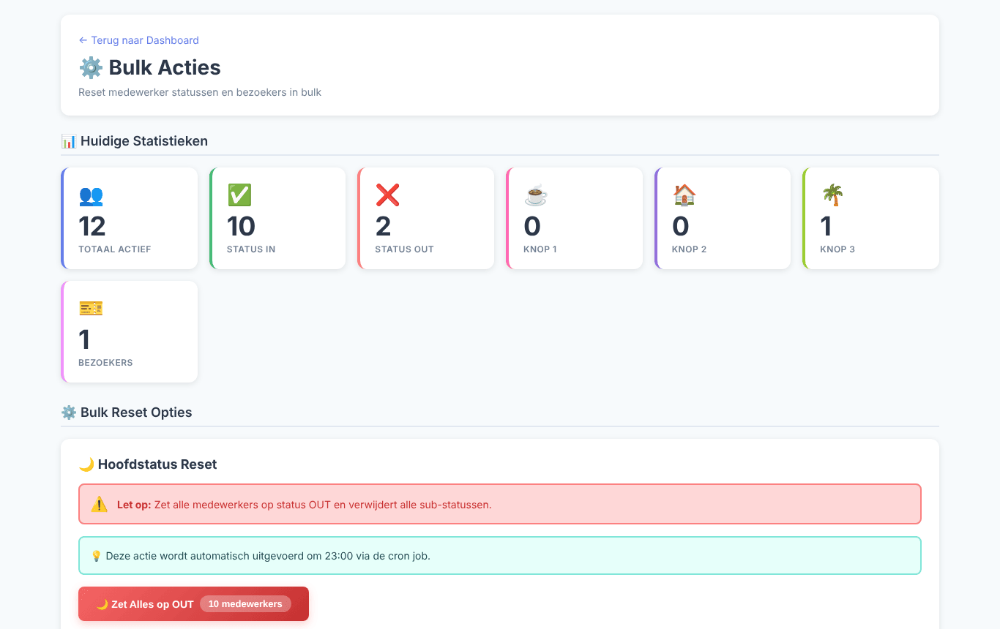

- **Zet Alles op OUT** (set everything to OUT) — all staff out and all extra statuses cleared. This also happens automatically every evening at 23:00 when the cron job is set up (see the Installation Guide).
- **Sub-Status Reset** — clear only the extra status of button 1, 2 or 3, without changing IN/OUT.
- **Bezoekers Reset** — set all visitors to departed.

The current numbers are shown at the top.

# System configuration

## Extra buttons and display

Under **Systeemconfiguratie** you name the three extra buttons (by default PAUZE, THUISWERKEN and VAKANTIE — break, working from home, holiday). Tick **Gebruikers mogen eigen button namen instellen** if users may choose their own names in their profile. **Auto-fullscreen toestaan** lets kiosk screens open in full screen automatically.

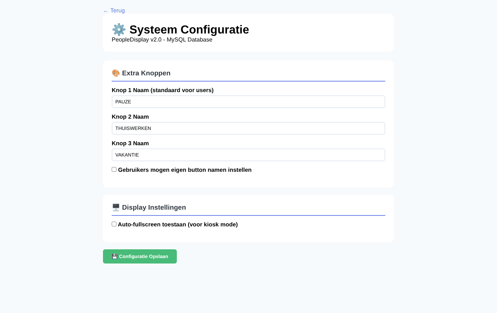

## Date and time for extra buttons

Under **Sub-Status Datum Settings** you decide per extra button whether PeopleDisplay asks **until when** the status applies. At that moment the status is reset automatically (by the cron job). The top shows how many statuses have an end date, are still active or have expired.

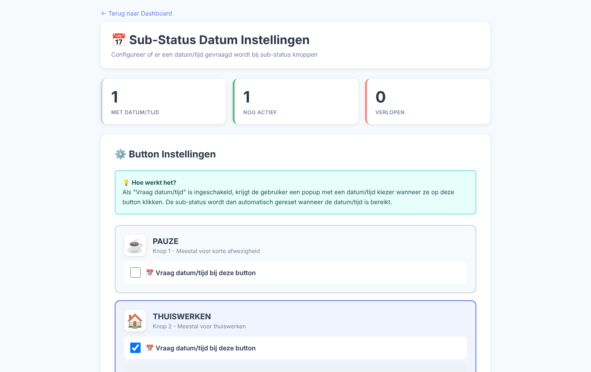

## Name display

Under **Naam Weergave Configuratie** you choose how names appear on the cards: full name, first name only, last name only, or initial + last name.

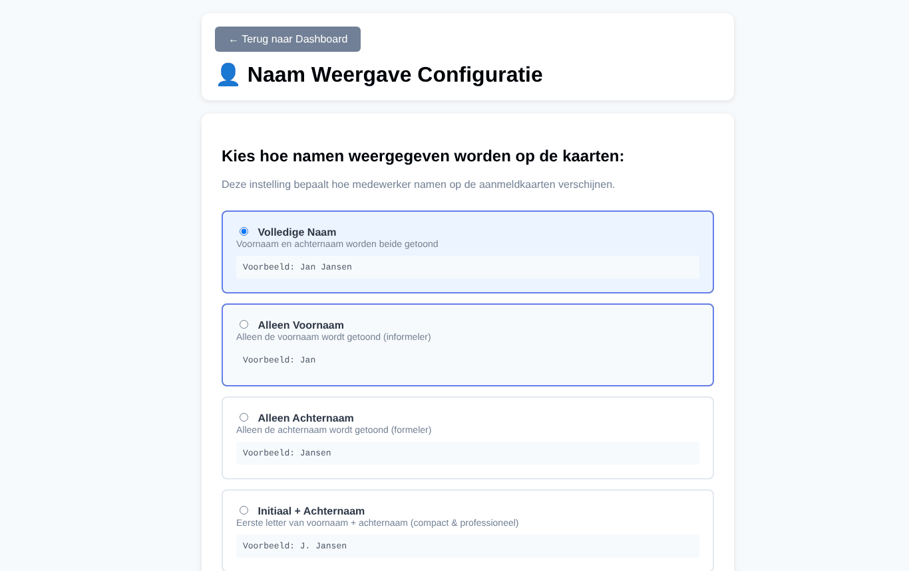

# Kiosk tokens

A kiosk token is a permanent login link for a screen without a keyboard, such as a tablet at the entrance. With it the screen opens PeopleDisplay automatically, also after a restart.

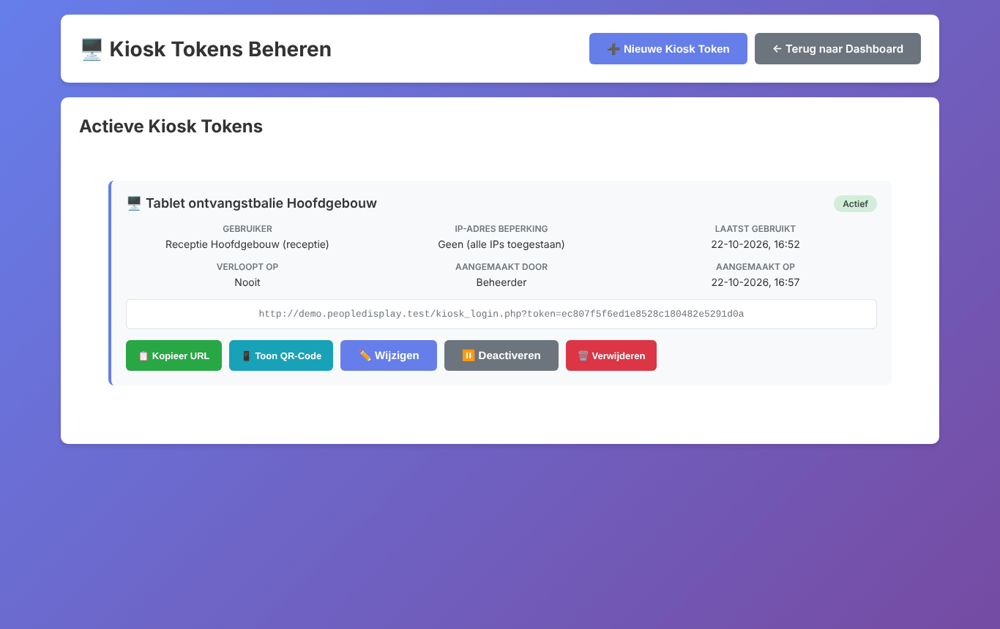

## Creating a kiosk token

1. First create a **user** for the screen, with the right locations and features.
2. Click **Nieuwe Kiosk Token**.
3. Choose that user, add a description (for example *Reception tablet*), and optionally an **IP restriction** and an expiry.
4. Click **Kopieer URL** (copy URL) or **Toon QR-Code** (show QR code) and open that link on the screen.

**Deactiveren** (deactivate) or **Verwijderen** (delete) stops the link working immediately, for example when a tablet is lost.

> **Tip for a fixed kiosk PC** — Start Chrome with `--kiosk` followed by the token URL. Chrome then opens full screen, without an address bar. The emergency overview has its own **Venster sluiten** (close window) button, so you can also get back in kiosk mode.

# Infoscreen

The infoscreen shows **your own messages, news, the weather and the agenda** on a screen, with the date and time. Colleagues can also post a message from **Teams**. You use it instead of the Google Slides presentation, or together with it. It is available in every package, Starter included. You manage it under **Infoscherm** on the dashboard (group *Systeem Configuratie*); who may do so, and for which locations, is described under [Infoscreen permissions](#infoscreen-permissions).

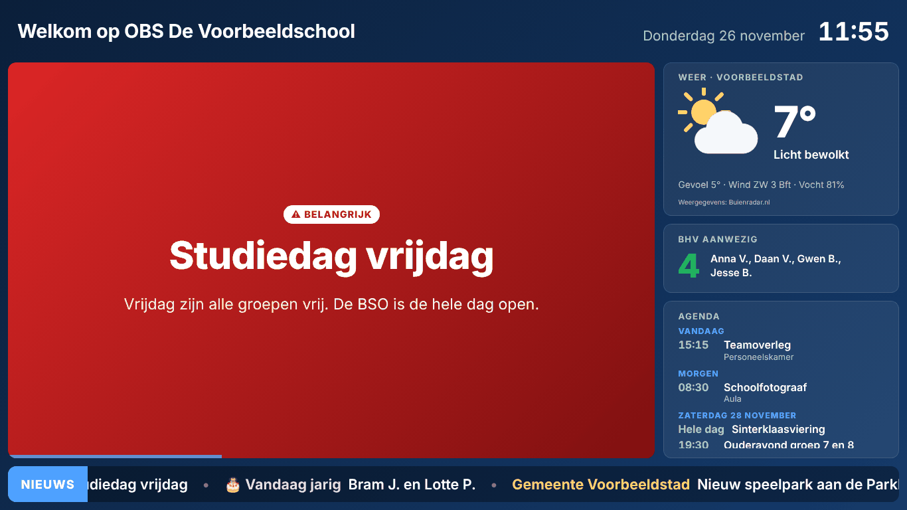

The screen has three parts:

- **Slides in the middle** — your own messages, news with an image as a large slide, and once per round a weather slide with the five-day forecast. With several news sources they take turns, and every round shows the next items.
- **The sidebar** — the current weather and the coming days, and the agenda when one is connected. Without a weather place it shows a large clock.
- **The news ticker at the bottom** — all news headlines scroll by, with the name of the source. Important messages are in it too.

## Messages

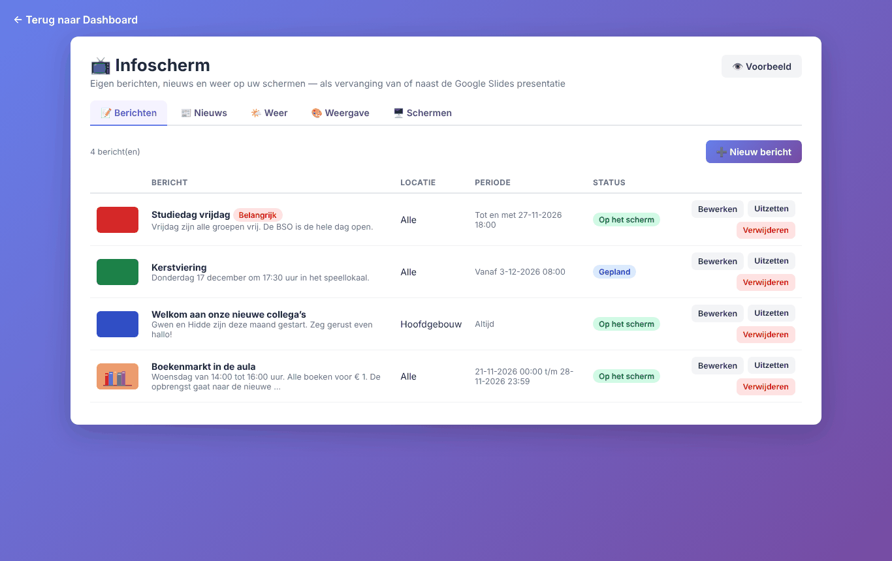

Click **Nieuw bericht** (new message) and fill in:

- **Titel** (title) and a short **Tekst** (text). A message with only an image and no text shows the image large, for example a poster. Below the text you see how many characters you used and the advice (about 250 with an image, about 450 without). When a message does not fit the screen, the screen makes the text smaller by itself, so the title and *Belangrijk* always stay visible.
- **Afbeelding** (image: JPG, PNG, GIF or WEBP, at most 5 MB), with its **place** (left, right, top, or across the whole slide with the text on top), whether it **fills** the space or is shown **completely**, and its **size** (30 to 70% of the slide). A landscape photo that is cut off at the sides: choose *Boven* (top) or *Helemaal tonen* (show completely). A small sketch on the right of the form shows the result right away.
- **Achtergrondkleur** (background colour) — a fixed colour, or **Huisstijl** or **Accent**: then every screen shows the message in the colours of its own [huisstijl](#huisstijl-house-style). New messages get *Huisstijl* by default.
- **Tonen vanaf** and **Tonen tot en met** (show from / until; empty = now and indefinitely) and **Tijd in beeld** (time on screen).
- **Locaties** (locations) — tick **🌐 Alle locaties** (all locations) for a message that must be everywhere, or tick one or more locations. A screen shows the messages of the locations set for its user account.
- **Belangrijk** (important) — the message gets a red label, appears more often and is also shown in the news ticker.

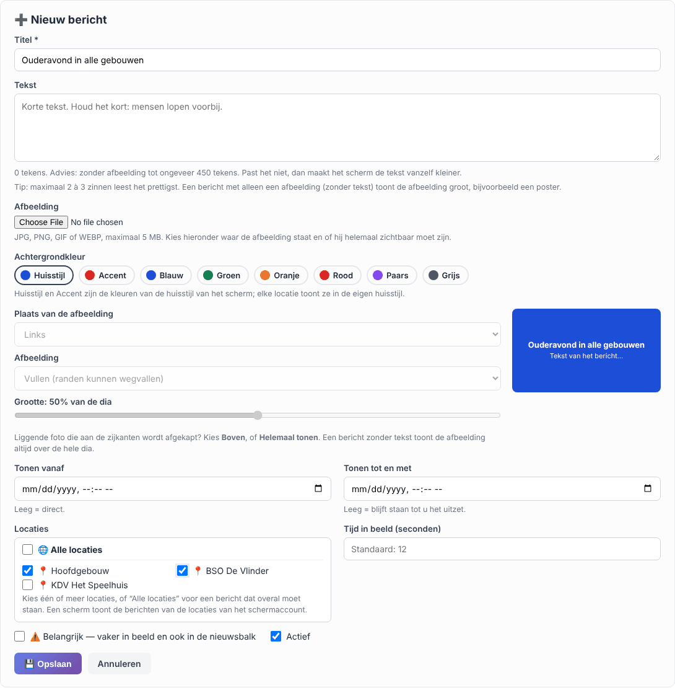

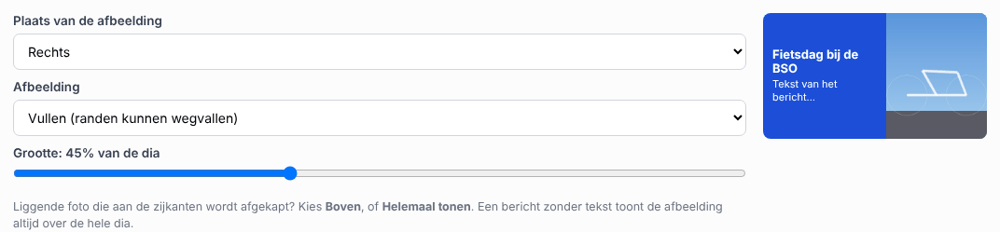

The list shows for each message its locations and whether it is **Op het scherm** (on screen), **Gepland** (scheduled), **Verlopen** (expired) or **Uit** (off). **Uitzetten** (switch off) removes a message from the screens without deleting it.

After each message and source, **📺** shows how many infoscreens show it; point at it to see their names. When choosing locations, that number is shown per location. News sources, weather places, agendas and connections can also be linked to one, several or all locations. When you rename a location, messages, sources and connections follow automatically.

## Infoscreen permissions

Who may do what on the infoscreen is set per user in one place: **Gebruikers** (users) › ✏️ › tab **📺 Infoscherm**. This works for every role, also for a plain *User*. For example, the head teacher of one school can manage the messages, news and house style of that school, without access to the other schools and without other management rights.

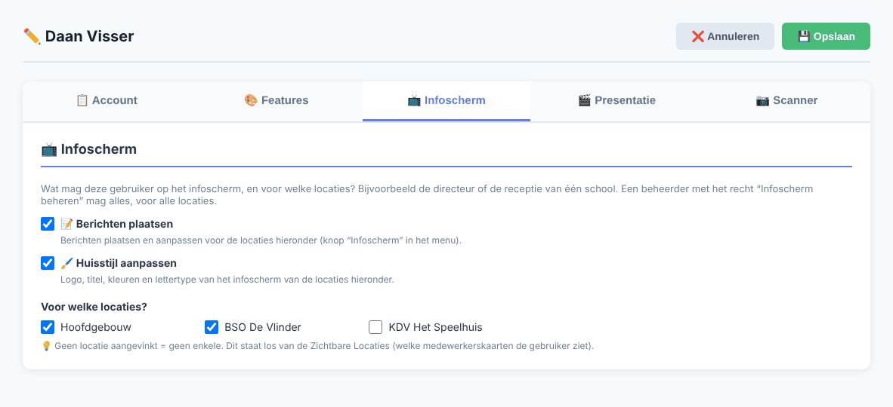

1. **Voor welke locaties?** (for which locations?) Choose *Alleen de aangevinkte locaties* (only the ticked locations) and tick them, or *🌐 Alle locaties* (all locations). These locations are separate from the *Zichtbare locaties* (visible locations) on the Features tab.
2. **Wat mag deze gebruiker?** (what may this user do?) Tick the parts, or use a quick choice and adjust it if needed:

| Part | What it covers |
|---|---|
| 📝 Berichten (messages) | post, edit, switch off and delete messages |
| 📰 Nieuws (news) | link news sources and websites |
| 🌤️ Weer (weather) | choose a weather place |
| 📅 Agenda | link agendas |
| 🖌️ Huisstijl (house style) | logo, title, colours and font |
| 🖥️ Schermen (screens) | choose per screen what it shows, its house style, birthdays and emergency responders, with a preview; the locations of a screen stay with the administrator |
| 🎨 Weergave (display) | settings for all screens (only with all locations) |
| 🔗 Koppelingen (connections) | Teams and the Berichten-API (only with all locations) |

| Quick choice | Permissions |
|---|---|
| **Redacteur** (editor) | messages only, for the own locations |
| **Hoofdredacteur** (chief editor) | everything for the own locations (messages, news, weather, agenda, house style, screens) |
| **Beheerder infoscherm** (infoscreen administrator) | everything, for all locations |

At the bottom, one sentence sums up what the user may do and for which locations. Click **Opslaan** (save).

On the welcome screen the user gets the button **📝 Infoscherm** (an admin also the tile on the dashboard) and only sees the tabs they have permissions for. The top shows for which locations. Everything that also applies to other locations, or to all locations, is marked **🔒 Alleen lezen** (read only). A SuperAdmin may always do everything.

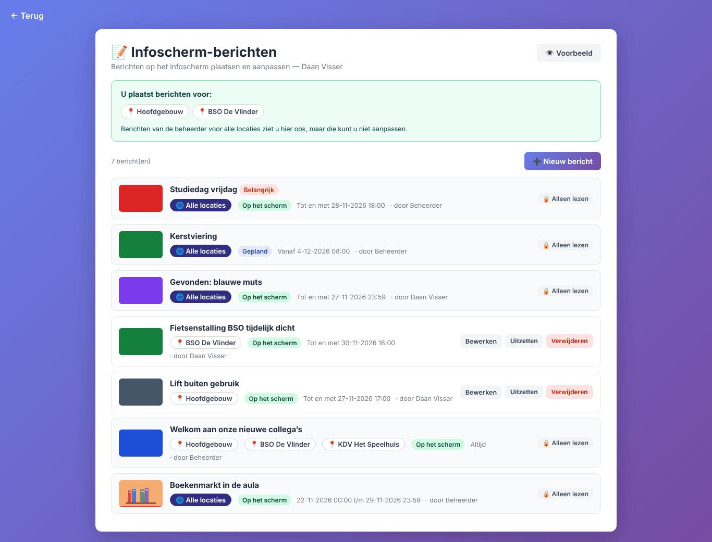

From before version 2.10.0: an admin with the old permission *Infoscherm beheren* now has *Beheerder infoscherm, all locations*, and an editor keeps their rights and locations. The tab shows this; it is stored as soon as you save the user.

## News

On the **Nieuws** tab you add RSS or Atom feeds: a name, the address of the feed, the locations, the number of items and whether images are shown. The feed is fetched as soon as you save it, so you see right away whether it works. Feeds of your own organisation are handy: a WordPress website has one at `https://yourwebsite.com/feed/`, even when the site does not show it anywhere.

### A website without an RSS feed

If a website has no feed, click **➕ Website zonder feed** (website without a feed). PeopleDisplay then fetches the news page itself and takes the title, a short text, the image, the date and the link of each item.

1. Fill in a name and the address of the **overview page** with all items, for example the page *Nieuws* or *Actueel*. Do not use the address of a single item.
2. Click **🔍 Zoek berichten** (find items). You see what PeopleDisplay finds on the page:
   - **📡 Feed gevonden (aanbevolen)** — the site does have a feed after all. That is the most reliable.
   - **📋 Lijst 1, Lijst 2 …** — lists of items on the page, with their first titles. Choose the list with the news.
3. Choose the locations and click **Opslaan en ophalen** (save and fetch).

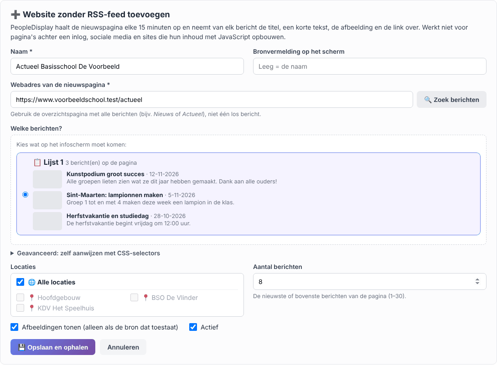

Does PeopleDisplay not find the right items? Open **Geavanceerd: zelf aanwijzen met CSS-selectors** (advanced: CSS selectors) and fill in what one item is (for example `.nieuws-item` or `ul.news > li`). PeopleDisplay looks for the title, link, image and date inside it; you can also point them out. Click **Testen met deze selectors** (test) to see the result. If you do not know a page's selectors, find them with *Inspect* in the browser (right-click an item), or ask the website's maker.

This does not work for pages behind a login (such as Social Schools or Parro), for Facebook, Instagram, X and LinkedIn, or for sites that build their items with JavaScript in the browser. In that last case **Zoek berichten** says so. If a website later changes its layout, PeopleDisplay picks the best matching list itself; if that fails too, the source shows an error and you choose again.

> **Mind the terms of a news source** — Many news sites only allow their feed for personal, non-commercial use, sometimes only the headlines, and always with credit to the source. The infoscreen shows the source with every item. Check the terms before you add a source and switch off **Afbeeldingen tonen** (show images) when needed. Images are never copied to your own server.

## Weather

On the **Weer** tab you add a place. Type its name and click **Zoek plaats** (find place); the coordinates are filled in. Then choose the weather source:

- **Buienradar** — current measurements from the nearest KNMI weather station, the five-day forecast and the weather report. The Netherlands only.
- **Open-Meteo** — works for any place, without a weather report.

Both are free for non-commercial use, with credit to the source (always shown on the screen). You can set one place for all screens, or a place per location (or group of locations).

## Agenda

On the **Agenda** tab you connect a calendar through an iCal link (.ics). Today's and the coming days' appointments then show in the sidebar, and once per round an agenda slide appears. Repeating, moved and cancelled appointments are shown correctly; **private appointments are not shown**.

- **Outlook / Microsoft 365** — Outlook on the web → **Settings** → **Calendar** → **Shared calendars** → *Publish a calendar*. Choose the calendar and *Can view titles and locations*, click **Publish** and copy the **ICS** link.
- **Google Calendar** — **Settings** → choose the calendar → *Secret address in iCal format* → copy.

Fill in a name and the link and click **Opslaan en ophalen** (save and fetch): you see right away how many appointments were found. Anyone with the link can read the calendar, so do not pass it on. How many days ahead the screen shows (default 7) is set under **Weergave**. An agenda can also be linked to one or more locations.

## Connections: Teams and other systems

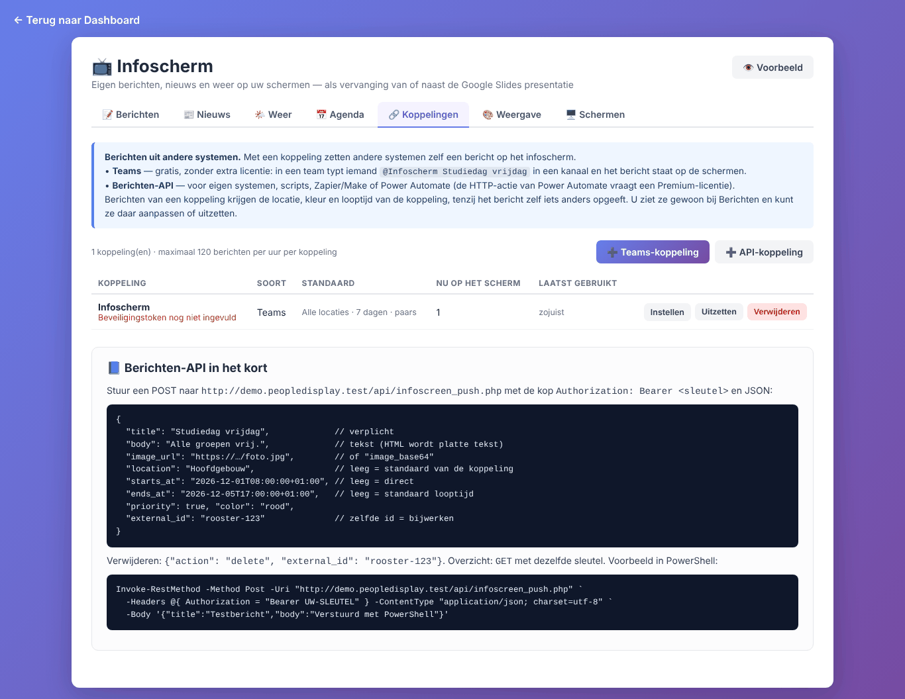

With a connection, colleagues or other systems put a message on the infoscreen themselves. Such a message gets the connection's default locations, colour and duration (default 7 days), and appears under **Berichten** with *Teams* or *API* and the sender's name. You can change, switch off or delete it there. Each connection can post at most 120 messages per hour.

**Teams (free, no extra licence)**

1. Click **➕ Teams-koppeling**, keep the name *Infoscherm* (or choose another short name) and click **Aanmaken** (create).
2. In Teams open the team → **⋯** → **Manage team** → **Apps** → **Create an outgoing webhook**. Enter the same name and the **callback URL** PeopleDisplay shows, and click **Create**. If the button is missing, the Microsoft 365 administrator must allow custom apps.
3. Teams shows a **security token**. Paste it in PeopleDisplay and click **Token opslaan** (save token).

After that, someone types in a channel of that team, for example:

```
@Infoscherm Schoolreis groep 6
Vertrek 8:15 bij de bus.
tot vrijdag
belangrijk
```

The first line becomes the title, the rest the text. `tot …` (e.g. *tot vrijdag*, *tot 12-12*, *tot morgen 16:00*) is the end date, `belangrijk` makes it an important message, and `kleur rood` or `locatie Hoofdgebouw` (or `locaties Hoofdgebouw, BSO De Vlinder`) work too. Teams replies right away with the message number. `@Infoscherm lijst` shows what is on the screen now, `@Infoscherm stop 12` removes message 12 and `@Infoscherm help` shows the instructions. It works in public channels of that team, not in chats or private channels; images from Teams are not taken along.

**Berichten-API (for own systems and scripts)**

Click **➕ API-koppeling**. You see a key once: copy and keep it. A system then sends a POST to `/api/infoscreen_push.php` with the header `Authorization: Bearer <key>` and JSON with at least a `title`, and optionally `"locations": ["Hoofdgebouw"]`. The tab shows a complete example, also for PowerShell. The same `external_id` updates a message, `"action": "delete"` removes it. Power Automate can do this too, but its HTTP action needs a Premium licence.

## Display

On the **Weergave** tab you set the colour scheme (dark or light; used when no own colours are set under [Huisstijl](#huisstijl-house-style)), the time per slide, the number of news slides per round, the speed of the news ticker, how many days ahead the agenda goes and which parts are shown (sidebar, news ticker, news slides, weather slide, agenda in the sidebar, agenda slide). **Voorbeeld** (preview) opens the result in a new window. Open screens pick up changes within 5 minutes.

Under **BHV en verjaardagen** (emergency response and birthdays) there are two extra parts. Both are off by default. What you choose here is the default for all screens; per screen you switch them on or off under [Screens](#screens).

- **BHV aanwezig** (emergency responders present) — a block in the sidebar with the number of emergency responders (BHV'ers) checked in at the screen's location(s), optionally with their first name and the initial of their last name. It counts staff with BHV = Ja and status IN. Anyone with an extra status (for example Pauze, Thuiswerken or Vakantie) is not counted: the screen would rather show too few than too many. When nobody is there, the block turns red with *Geen BHV'er ingecheckt*. A screen with this block refreshes every 2 minutes. Without a sidebar the notice goes into the news ticker. The block is an aid and does not replace the BHV overview.
- **Vandaag jarig** (birthdays today) — once per round a festive slide with the names, and a notice in the news ticker (also in *Slides + infoscherm*). Only staff with a birthday filled in take part. For privacy, fill it in only with the staff member's consent; clearing it takes them off again. A screen shows only the birthdays of its own location(s) (the staff member's home location).

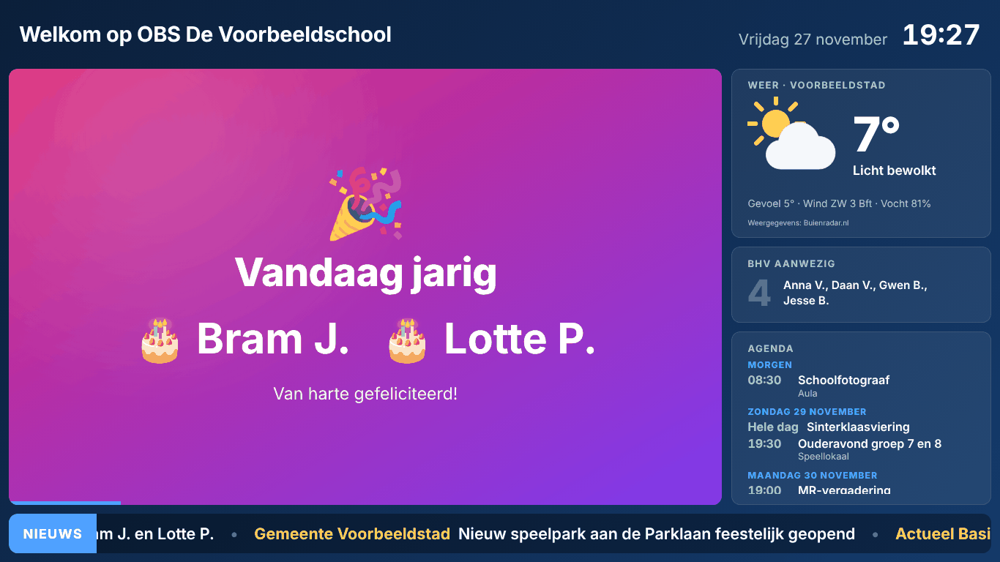

## Huisstijl (house style)

On the **🖌️ Huisstijl** tab you put the infoscreen in the house style of the organisation, and optionally per location, for example per school within a foundation.

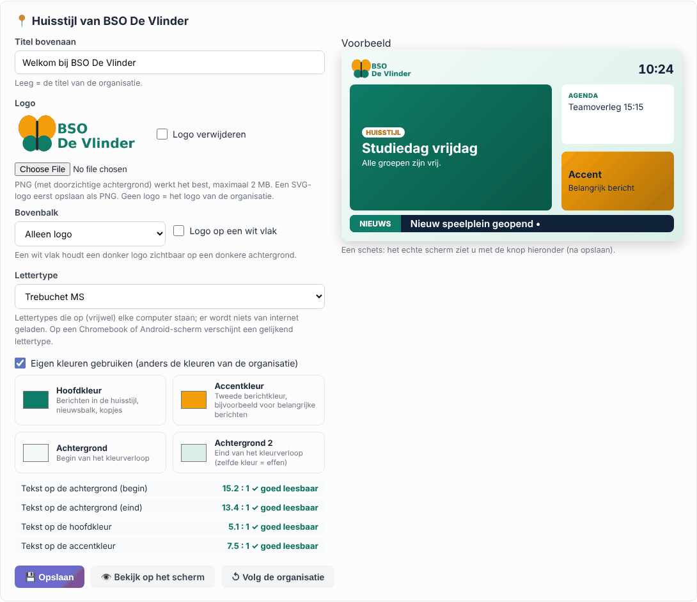

1. At the top, choose **🌐 Hele organisatie** (whole organisation) or a location. A ✓ means: it has its own house style.
2. **Titel bovenaan** (title at the top) — for example *Welkom op OBS De Linde*.
3. **Logo** — preferably a PNG with a transparent background, at most 2 MB (save an SVG as PNG first). Under **Bovenbalk** (top bar) choose *Logo en titel* (logo and title), *Alleen logo* (logo only) or *Alleen titel* (title only). **Logo op een wit vlak** (logo on a white panel) keeps a dark logo visible on a dark background.
4. **Lettertype** (font) — one of the standard fonts (Segoe UI, Arial, Calibri, Verdana, Tahoma, Trebuchet MS or Georgia). Nothing is loaded from the internet; a Chromebook or Android screen shows a similar font.
5. **Eigen kleuren gebruiken** (use own colours) — the **main colour** (messages in the house style, the news ticker and headings), the **accent colour** (a second message colour, for example for important messages) and two **background colours** (a gradient; the same colour twice is plain). On a light background the text turns dark by itself, on a dark background white.
6. Below the colours is the **readability check**: ✓ easy to read, ⚠ fair or ✗ hard to read. A **preview** on the right updates right away. Click **Opslaan** (save); **Bekijk op het scherm** (view on screen) shows the real screen of that location.

Empty fields of a location follow the organisation: without its own title or logo it shows those of the organisation, and without *Eigen kleuren* the colours of the organisation. **↺ Volg de organisatie** (follow the organisation) removes the own house style of a location.

Which house style a screen uses: a screen with **one location** gets the house style of that location, a screen with **more locations** that of the organisation. Under [Screens](#screens) you choose another one per screen.

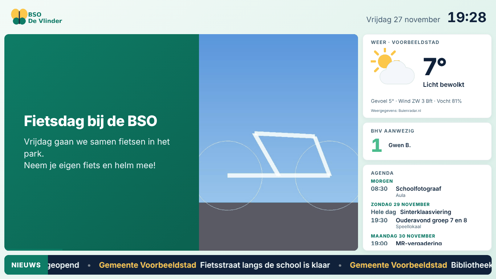

## Screens

Every screen (TV, kiosk or tablet) is a user account. On the **Schermen** tab you see the **locations** of each account and choose what its screen shows: **Google Slides**, **Infoscherm** or **Slides + infoscherm** (the presentation large, with the weather, notices and the news ticker around it). The same choice is also on the user's *Presentatie* tab.

**What a screen shows is decided by the locations of the account** (Gebruikers › Features › *Zichtbare locaties*, set by the administrator). With no location ticked it says **🌐 Alle locaties** and the screen shows everything. Someone with the permission *Schermen* only sees the screens of their own locations and cannot change their locations.

| | Screen with 1 location | More locations (e.g. a multi-purpose building or a kiosk for several locations) | 🌐 All locations |
|---|---|---|---|
| Messages, news, agenda | of that location + what is for all locations | of all its locations together + what is for all locations | everything |
| Emergency responders, birthdays | that location | all its locations together | everyone |
| Weather | weather place of that location, otherwise the general one | the first of its locations with its own weather place | the general one |
| House style | of the location, otherwise the organisation | the organisation, or choose one | the organisation, or choose |

A **kiosk** with staff cards for several locations always shows the content of all its locations on the infoscreen, also when one location is chosen on the kiosk.

In the column **Infoscherm** you choose per screen the **Huisstijl** (*Automatisch* (automatic), *Organisatie* (organisation) or a location with its own house style). For **Vandaag jarig** (birthdays) and **BHV aanwezig** (emergency responders) you choose per screen **Standaard** (follows the setting under Weergave), **Aan** (on) or **Uit** (off). For example, the screen in the school shows birthdays and the screen of the childcare does not. A screen always shows only the birthdays and emergency responders of its own locations. An account without ticked locations sees all locations, so always tick the location(s) for a screen in a building.

**👁️ Voorbeeld** (preview) next to an account opens, in a new window, exactly what that screen shows: the messages, news, weather and emergency responders of that account's locations. For a screen with Google Slides only, **👁️ Slides** opens the presentation. The preview shows the saved choice, so save first after a change.

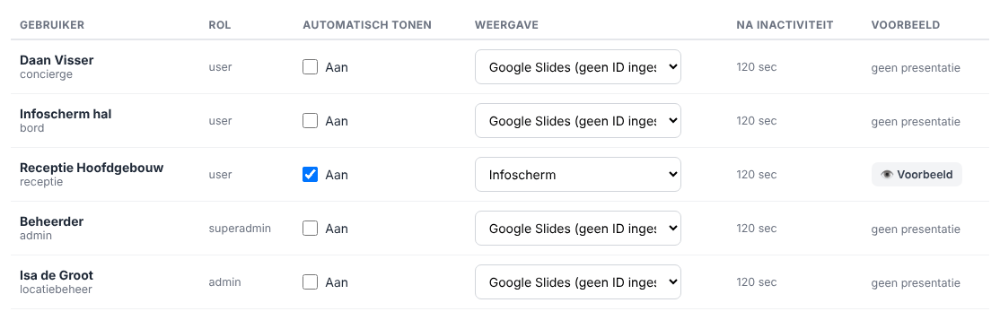

- **On a touch screen with staff cards** the infoscreen appears after the set time without touches (checkbox *Automatisch tonen*). A touch closes it.
- **A screen that only shows the infoscreen** (a TV in the hall): log in on that screen with the screen account, tick *Blijf ingelogd* (stay logged in) and open `infoscherm.php`. With a kiosk token the screen opens by itself, also after a restart: add `&page=infoscherm` to the token URL. The tab shows the full addresses.

The infoscreen fetches new data every 5 minutes, keeps showing the last data during a short internet outage and reloads itself after an update.

> **Updating news and weather** — News and weather are updated every 15 minutes, as soon as a screen asks for data. With the cron job `cron/cron_infoscreen.php` (see [Scheduled tasks](#scheduled-tasks)) a screen never has to wait for it.

# Scheduled tasks

Some tasks run at fixed times through cron jobs: everybody OUT at 23:00, checking out visitors, deleting old visitor data, resetting expired statuses and updating the infoscreen. Under **Automatische taken** (scheduled tasks) on the dashboard (group *Systeem Configuratie*, only with the permission *System configuration*) you see per task when it should run, the command for the hosting panel and the web link for [cron-job.org](https://cron-job.org).

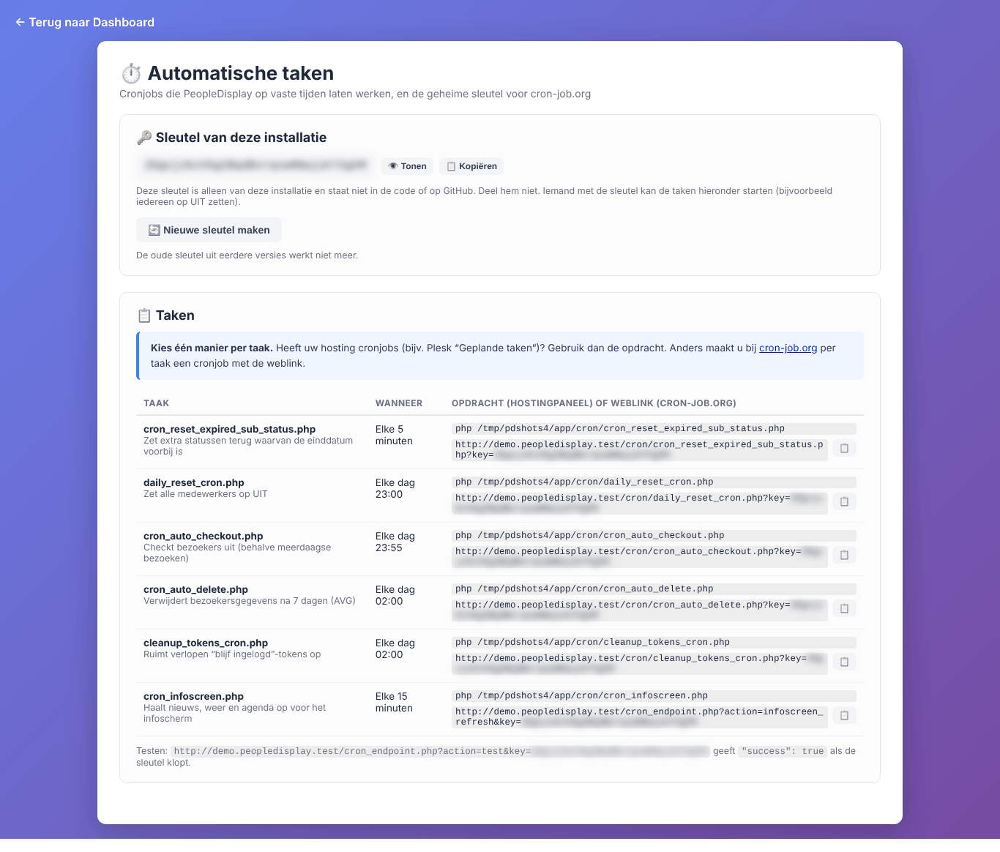

- **Sleutel van deze installatie** (this installation's key) — a web link only works with this secret key. Every installation has its own key; it is not in the code. **Tonen** (show) shows it, **Kopiëren** (copy) copies it. **Nieuwe sleutel maken** (new key) makes a new one (the old links stop working; update them in cron-job.org).
- **Moving from version 2.5 or older** — up to 2.5 every installation used the same, public key. It keeps working for 30 days after the update, so your cron jobs keep running. As long as a cron job uses the old key, the dashboard shows a warning. Replace the links in cron-job.org with the ones on this page and then click **Oude sleutel nu uitzetten** (switch off the old key now).

# Online users

**Online Gebruikers** shows who is logged in right now, on which device, with which browser, from which IP address and for how long.

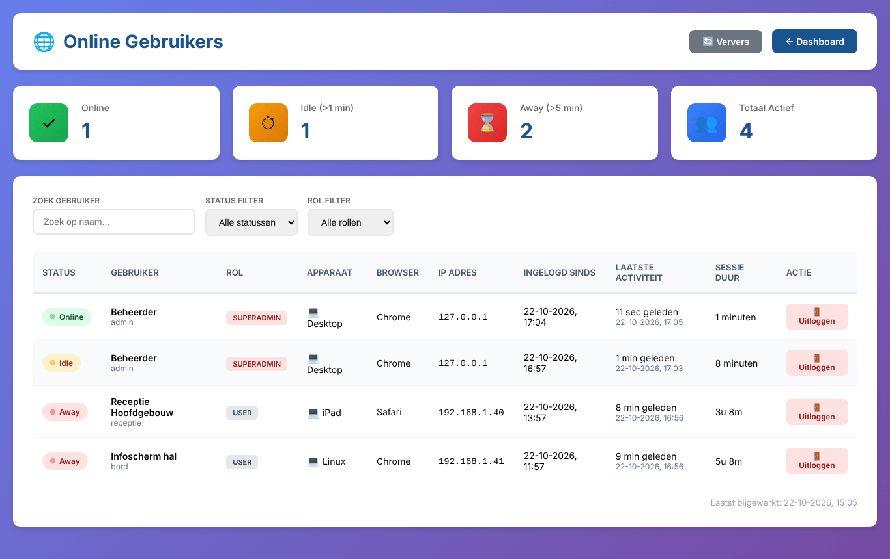

- **Online** = active in the last minute, **Idle** = no activity for over 1 minute, **Away** = over 5 minutes.
- **Uitloggen** (log out) ends a session remotely, for example for a lost tablet. The user sees a notice within seconds and is taken to the login screen. They can simply log in again afterwards.

# Audit log

The **Audit Log** records who changed what: staff members added, changed and deleted, and status changes, with time, old and new value, who did it and from which IP address.

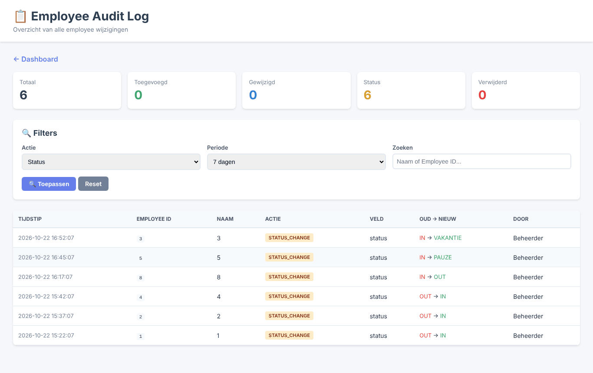

Filter by action (added, changed, status, deleted), period and name or staff number. **MIGRATION** rows are the automatic database checks when the dashboard opens.

# Licence

**Licentiebeheer** (licence management) shows which plan is active, for which domain, how much you use and which features are available.

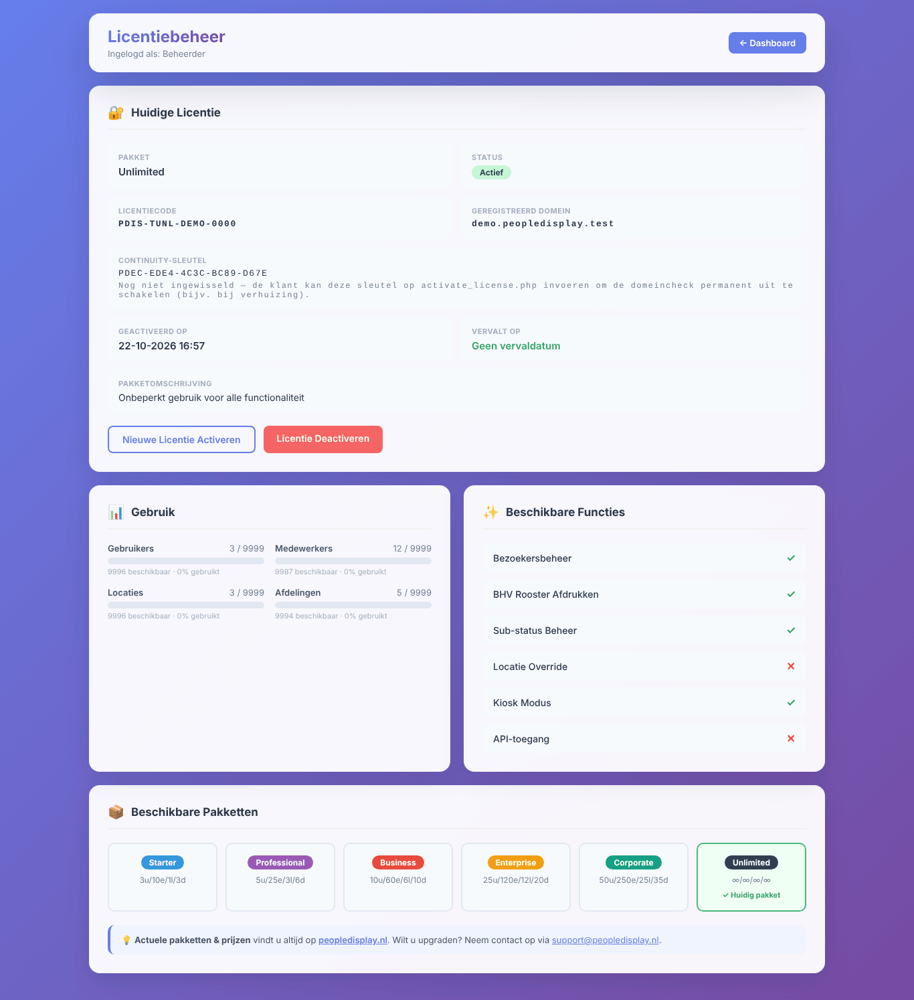

- **Starter** is free and works without a licence key: up to 10 staff members, 1 location and 3 users. Visitor management, kiosk mode, bulk actions and the audit log are in the paid plans.
- **Nieuwe Licentie Activeren** (activate new licence) — enter a licence key (format `PDIS-…`). The licence is bound to this installation's domain.
- **Licentie Deactiveren** (deactivate licence) — releases the binding, for example before moving. Starter limits then apply until you activate again.
- **Continuity key** (Unlimited and Corporate) — with this key your licence keeps working after moving to another domain or hosting, even without help from peopledisplay.nl. Keep it somewhere safe. You redeem it via `activate_license.php` on the new environment.

Current plans and prices are on [peopledisplay.nl](https://peopledisplay.nl).

# Backup

Only a SuperAdmin can download a backup as a ZIP file under **Backup aanmaken**.

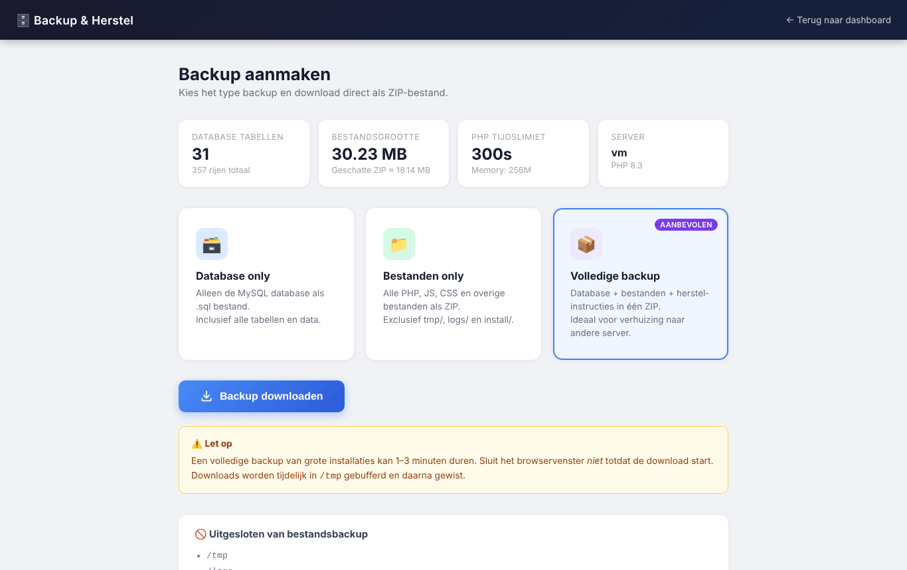

- **Database only** — all tables and data as a `.sql` file.
- **Bestanden only** (files only) — all program files (without `tmp/`, `logs/` and `install/`).
- **Volledige backup** (full backup, recommended) — database and files, with restore instructions. Use it to move PeopleDisplay to another server.

A full backup of a large installation can take 1 to 3 minutes. Do not close the window before the download starts. Restoring a backup is described in the Installation Guide.

# Updates

PeopleDisplay checks for new versions itself. When one is available, a notice appears at the top of the dashboard with the version number and the main changes.

1. Click **Wat is nieuw?** (what's new) for all changes.
2. Click **Update downloaden** (download update). You get a small ZIP file with only the changed files.
3. Unzip it and upload its contents by FTP to your PeopleDisplay folder, overwriting the existing files. Your settings, photos and data stay in place.
4. Open the admin dashboard. Any database changes are applied automatically.

The cross hides the notice until the next version. Open screens and installed apps load the new version by themselves within a few minutes.

# Frequently asked questions

**A staff member does not appear on a particular user's screen.**
Check that user's *Features* tab → *Zichtbare Locaties* and *Zichtbare Afdelingen*, and the staff member's location and *Zichtbaar op locaties*.

**I can no longer add staff, locations or users.**
You have reached your plan's limit. See **Licentiebeheer** for your usage.

**Extra statuses are not reset automatically.**
That is done by cron jobs. Check under **Automatische taken** (scheduled tasks) that they are set up and that the links have the right key.

**How do I reset a user's password?**
Open the user with ✏️, enter a new password on the *Account* tab and click **Opslaan**.

**A user lost their phone and has no recovery codes left.**
Open the user with ✏️ and click **🔄 2FA resetten (telefoon kwijt)**. After that the person can log in with just the password and sets up 2FA again. See *Two-step verification (2FA)*.

**I cannot get in myself because of 2FA.**
Create an empty file `twofa_uit.txt` in the root folder of the site via FTP. Log in with your password, reset 2FA and delete the file again.

**The code from the app does not work.**
Usually the phone's clock is off: switch on automatic time. In Google Authenticator that is *Settings → Time correction for codes → Sync now*. If the app holds two accounts with almost the same name (from an earlier attempt), use the one that belongs to the current QR code and delete the old one.

**How do I move PeopleDisplay to another hosting provider?**
Make a full backup and restore it on the new hosting with `restore.php` (see the Installation Guide). With an Unlimited or Corporate licence, redeem your continuity key afterwards.
