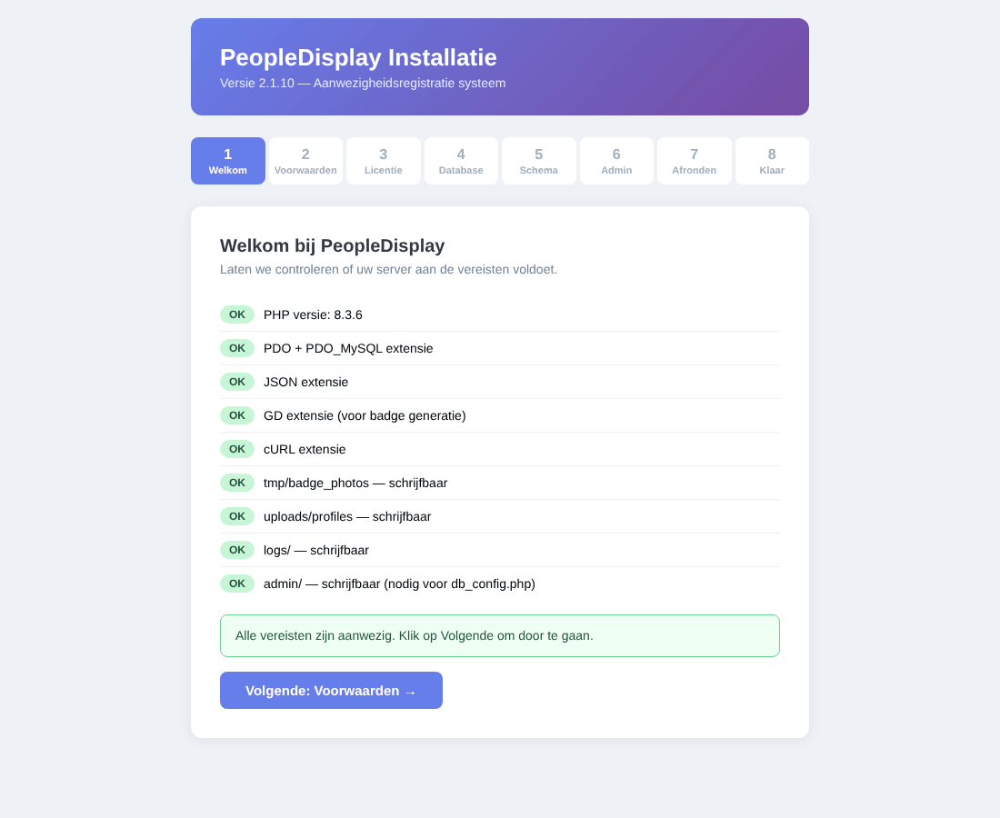
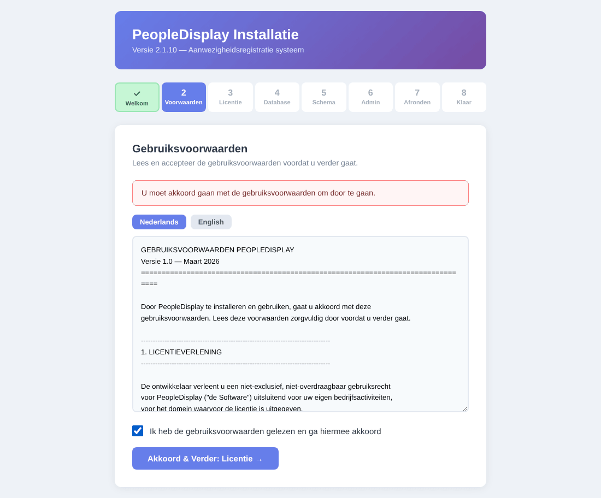
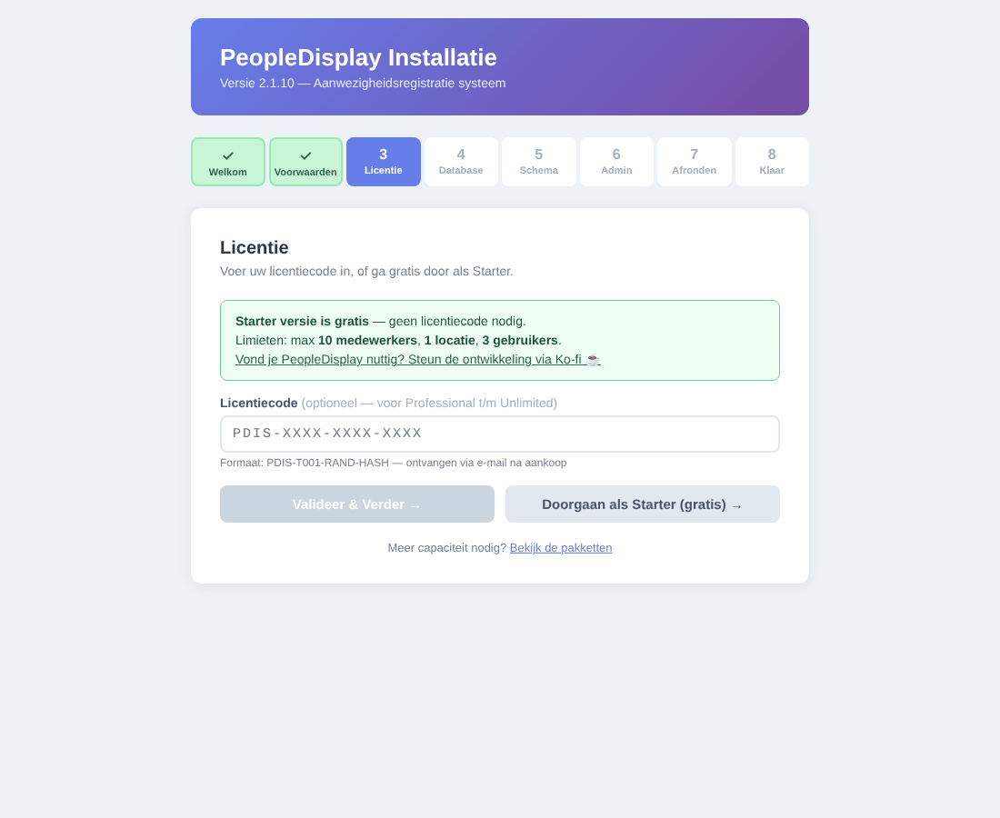
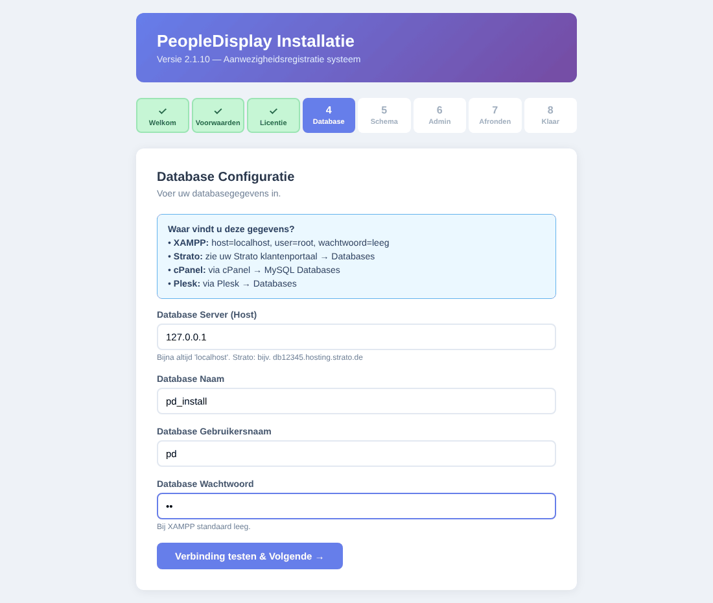
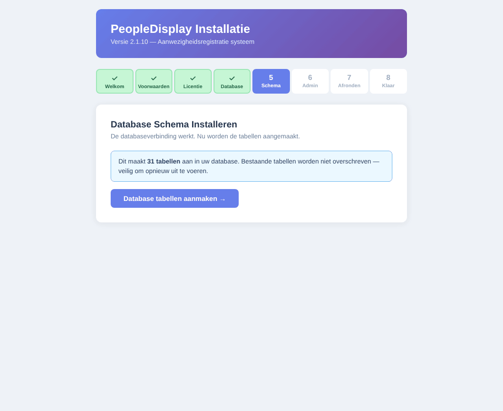
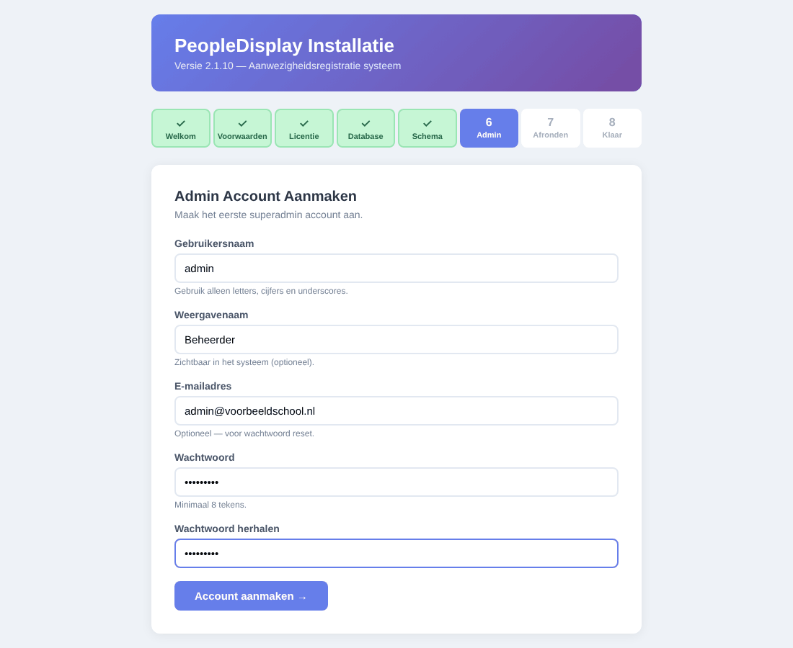
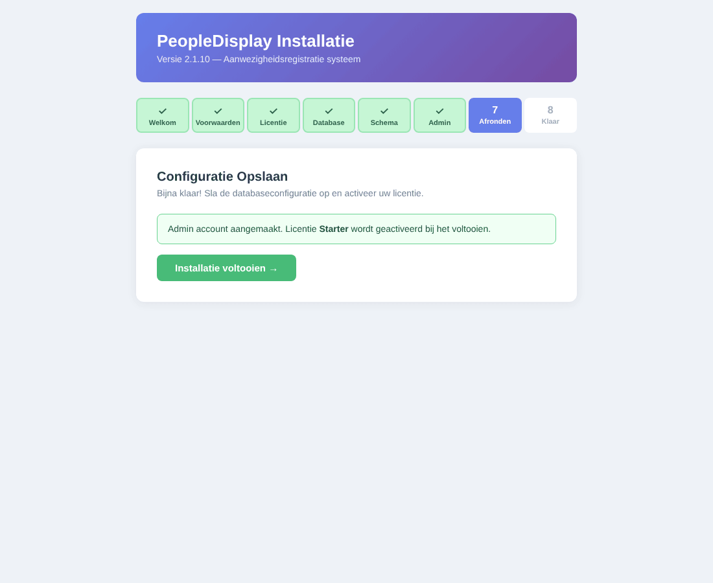
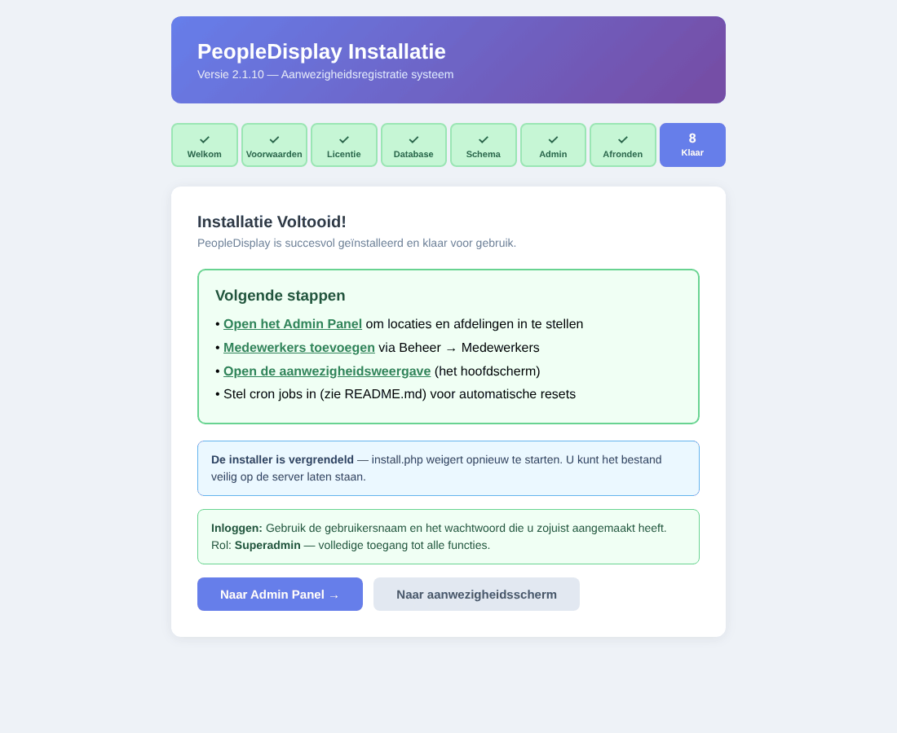

# Introduction

This guide explains how to install PeopleDisplay on your own web hosting, set up the scheduled tasks (cron jobs), activate a licence, update to a new version and move to another hosting provider.

PeopleDisplay runs on ordinary shared hosting, such as Strato, Cloud86, TransIP, Antagonist, cPanel or Plesk packages. You do not need your own server or SSH access: everything is done with FTP and your browser.

> **About the screen labels** — The installer and the PeopleDisplay interface are in Dutch (the terms of use can be shown in English). This guide shows the Dutch label in **bold**, with its meaning where that helps.

# What you need

- Web hosting with **PHP 8.0 or newer** (8.2 or newer recommended), with the extensions `pdo_mysql`, `json`, `curl` and `gd` (for badges and photos).
- A **MySQL 5.7+ or MariaDB 10.3+** database, with its name, username and password at hand.
- **FTP or SFTP access**, for example with FileZilla.
- At least **50 MB** of disk space, plus room for photos and backups.
- Preferably your own (sub)domain with **HTTPS**, for example `checkin.yourschool.com`.

# Step 1 — Download

Download the latest version from [peopledisplay.nl/download.php](https://peopledisplay.nl/download.php). The Starter version is free. You get the file `peopledisplay-starter.zip`.

All versions are also on GitHub: [github.com/peopledisplaynl-coder/peopledisplay/releases](https://github.com/peopledisplaynl-coder/peopledisplay/releases).

# Step 2 — Create a database

Create a new database in your hosting control panel. Write down:

- the **database server** (often `localhost`; some hosting providers use their own address, shown with the database details),
- the **database name**,
- the **username** and **password**.

# Step 3 — Upload the files

1. Unzip `peopledisplay-starter.zip` on your computer.
2. Connect to your hosting with FTP and open the folder of the (sub)domain where PeopleDisplay should run.
3. Upload **all** files and folders from the ZIP to that folder. The files `index.php` and `install.php` must be directly in the domain's folder.
4. Make sure the folders `admin`, `uploads/profiles`, `logs`, `tmp` (with `tmp/badge_photos` and `tmp/sessions`) and `backups` are writable (permissions 755). On most hosting packages they already are; the wizard checks this in step 1.

# Step 4 — The installation wizard

Open `https://yourdomain.com/install.php` in your browser. The wizard takes you through eight steps.

## 1. Welkom (welcome) — system check

The wizard checks the PHP version, the required extensions and the write permissions. If a folder shows **LET OP** (attention), make it writable by FTP (permissions 755) and reload the page. Then click **Volgende: Voorwaarden** (next: terms).



## 2. Voorwaarden (terms of use)

Read the terms of use (Dutch or English), tick that you agree and click **Akkoord & Verder: Licentie** (agree and continue).



## 3. Licentie (licence)

Do you have a licence key (for Professional up to Unlimited)? Enter it and click **Valideer & Verder** (validate and continue). For the free Starter version, click **Doorgaan als Starter (gratis)** (continue as Starter, free). You can also activate a licence later.



## 4. Database

Enter the database details from step 2 and click **Verbinding testen & Volgende** (test connection and continue). If the database does not exist yet, the wizard tries to create it.



## 5. Schema

Click **Database tabellen aanmaken** (create database tables). The wizard creates all tables. Existing tables are not overwritten.



## 6. Admin

Create the first administrator account: username, display name, email address and a password of at least 8 characters (twice). Click **Account aanmaken** (create account). This account gets the **SuperAdmin** role.



## 7. Afronden (finish)

Click **Installatie voltooien** (complete installation). The wizard writes the database connection to `admin/db_config.php` and activates your licence.



> **The wizard cannot write `admin/db_config.php`?** It then shows the contents. Create that file yourself by FTP and click **Voltooien** (finish).

## 8. Klaar (done)

PeopleDisplay is installed. The wizard locks itself: `install.php` cannot be started again.



# Step 5 — First setup

Log in with the administrator account. You arrive at the admin dashboard. Then set up PeopleDisplay in this order (see the Administrator Guide):

1. **Locaties** (locations) — your sites.
2. **Afdelingen** (departments) — your teams or departments.
3. **Medewerkers** (staff members) — by hand or with **Import CSV**.
4. **Gebruikers** (users) — accounts for colleagues and for shared screens, with the right locations and features.
5. **Systeemconfiguratie** — the names of the extra buttons.
6. Optionally **kiosk tokens** for tablets and screens.

# Step 6 — Scheduled tasks (cron jobs)

Some tasks must run at fixed times: resetting extra statuses whose end date has passed, setting everyone to OUT in the evening, checking out visitors and cleaning up old data. Without cron jobs PeopleDisplay still works, but these things do not happen automatically.

| Script | When | What it does |
|---|---|---|
| `cron/cron_reset_expired_sub_status.php` | every 5 minutes | Resets extra statuses whose end date has passed |
| `cron/daily_reset_cron.php` | daily at 23:00 | Sets all staff to OUT |
| `cron/cron_auto_checkout.php` | daily at 23:55 | Checks out visitors (except multi-day visits) |
| `cron/cron_auto_delete.php` | daily at 02:00 | Deletes visitor data after 7 days (GDPR) |
| `cron/cleanup_tokens_cron.php` | daily at 02:00 | Removes expired "stay logged in" tokens |

## In your hosting control panel (recommended)

Almost every hosting provider has a **Cron jobs** or **Scheduled tasks** section. Create one task per script that runs PHP, for example:

```
/usr/bin/php /home/youraccount/checkin.yourschool.com/cron/daily_reset_cron.php
```

Your hosting provider's help pages give the correct path to PHP and to your folder.

## With cron-job.org (if your hosting has no cron jobs)

The free service [cron-job.org](https://cron-job.org) calls the scripts over the internet at fixed times. Create a job per script with its web address, for example:

```
https://checkin.yourschool.com/cron/daily_reset_cron.php?key=YOUR-KEY
```

The key is at the top of the script. Scripts called over the internet refuse a request without the correct key.

# Activating a licence

With the free Starter version there is nothing to do. If you bought a licence:

1. Log in as SuperAdmin and open **Licentiebeheer** (licence management) in the admin dashboard.
2. Click **Nieuwe Licentie Activeren** (activate new licence) and enter your licence key.
3. The licence is bound to this installation's domain.

With an Unlimited or Corporate licence, licence management also shows a **continuity key**. Keep it safe: it lets you take your licence to another domain or hosting provider.

# Updating to a new version

A notice appears on the admin dashboard when a new version is available.

1. First make a **backup** under **Backup aanmaken** (type *Volledige backup*, full backup).
2. Click **Update downloaden** (download update) in the notice. The ZIP file contains only the changed files, in a folder named after the version.
3. Unzip it and upload the contents of that folder by FTP to your PeopleDisplay folder, overwriting the existing files.
4. Open the admin dashboard. Database changes are applied automatically; the top right shows **Migraties toegepast** (migrations applied).

An update never overwrites your settings (`admin/db_config.php`), photos, uploads or data. Open screens and installed apps load the new version by themselves within a few minutes.

# Moving to another hosting provider

`restore.php` restores a full backup on new hosting or a new domain, without outside help.

1. On the old environment, make a **Volledige backup** (full backup) and download the ZIP file.
2. Upload the PeopleDisplay files to the new hosting (as for a new installation), but do **not** run `install.php`.
3. Create an empty database on the new hosting.
4. Open `https://newdomain.com/restore.php`. Choose the backup file, enter the new database details and confirm.
5. Log in and check that everything is there.
6. With an Unlimited or Corporate licence, redeem your **continuity key** at `https://newdomain.com/activate_license.php`. Other licences are activated again in licence management.

`restore.php` only works while there is no installation on the new environment yet, and locks itself afterwards.

# Troubleshooting

**White page or "500 Internal Server Error".**
Look at the PHP error log in your hosting control panel. Check that the PHP version is 8.0 or newer and that the `.htaccess` file was uploaded (it starts with a dot and is sometimes hidden).

**"DB config not found" or "DB error".**
`admin/db_config.php` is missing or contains wrong details. Check the database details with your hosting provider and correct the file by FTP.

**"Too many redirects" or having to log in again and again.**
Clear the site's cookies in your browser. Check that the `tmp/sessions` folder is writable.

**The installer is locked, but I want to install again.**
Delete the file `install/.installed` and `admin/db_config.php` by FTP and empty the database. Note: all data will be lost.

**Status changes are not saved.**
Open the browser's developer tools (F12), *Network* tab, and click IN or OUT. The response of `employees_api.php` should start with `{"success":true`. If PHP warnings come before it, look at the PHP error log.

**Emails do not arrive.**
Check the spam folder and ask your hosting provider whether outgoing email through PHP is allowed.
