# Introduction

PeopleDisplay is a digital check-in board for staff. At a glance you see who is in, at which location, and who is a first-aid/emergency responder (in Dutch: *BHV'er*). Staff check in and out with a single tap on their own card. PeopleDisplay runs in the browser: on a large screen in the hall, on a tablet at the entrance, on a PC or on a phone. You can also install it as an app.

This guide is for everyone who uses PeopleDisplay day to day. Setting up and managing PeopleDisplay is covered in the **Administrator Guide**; installing it on your own hosting in the **Installation Guide**.

> **About the screen labels** — The PeopleDisplay interface is in Dutch. This guide shows the Dutch label in **bold**, followed by its meaning where that helps, for example **UIT** (OUT).

> **About the examples** — The screenshots were taken in a demo environment with fictional names and locations. Which parts you see depends on what your administrator has enabled for your account.

# Logging in

Open the address of your PeopleDisplay environment in your browser, for example `https://mijn.peopledisplay.nl`. You will see the login screen.

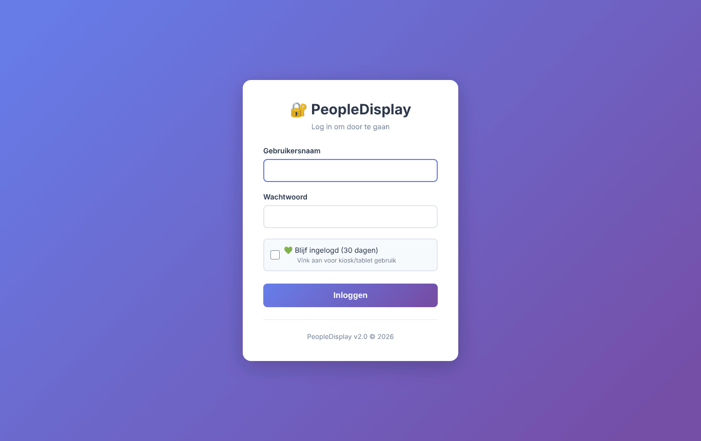

1. Enter your **gebruikersnaam** (username) and **wachtwoord** (password).
2. Tick **Blijf ingelogd** (stay logged in) to stay logged in on this device for 30 days. Only do this on a device nobody else uses.
3. Click **Inloggen** (log in).

After logging in you arrive at the welcome screen. Administrators go straight to the admin dashboard.

> **Forgot your password?** Ask your administrator to set a new one.

# The welcome screen

On the welcome screen you choose where to go.

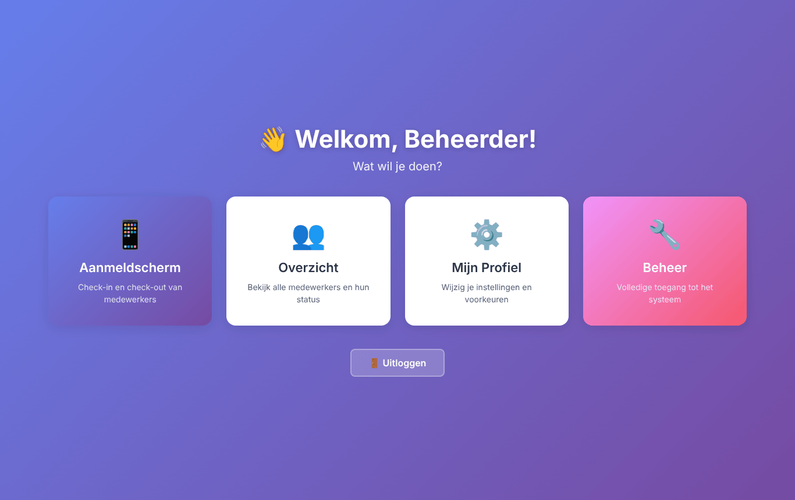

| Tile | What it is for |
|---|---|
| **Aanmeldscherm** (check-in screen) | Checking staff in and out — the main screen |
| **Overzicht** (overview) | A list of everyone who is in, per location |
| **Mijn Profiel** (my profile) | Changing your name, email address, photo and password |
| **Beheer** (management) | Administrators only: the admin dashboard |

At the bottom is the **Uitloggen** (log out) button.

# The check-in screen

The check-in screen is the heart of PeopleDisplay. Every staff member has a card. A **green** card means in (**IN**), a **red** card means out (**UIT**). Cards with an extra status (such as break or holiday) take the colour of that status.

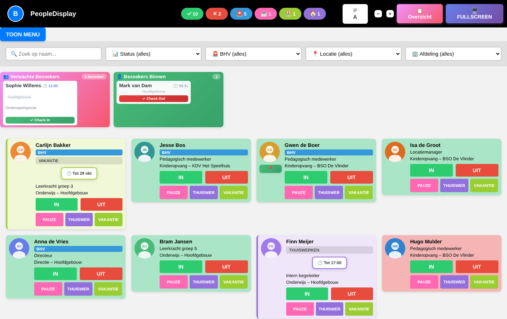

The screen refreshes itself every 30 seconds, so colleagues' changes appear automatically. At the bottom you can see when the screen was last refreshed.

## The top bar

- **Counters** — how many staff are in (✓) and out (✗), how many emergency responders are present (🚨) and how many staff have an extra status (for example ☕ break, 🏖️ holiday, 🏠 working from home).
- **Sort button (A)** — sort the cards by first name or by last name. Your choice is remembered on this device. The button only appears if your administrator enabled it for you.
- **− and +** — make the cards smaller or larger (zoom). Useful on a big screen or a small tablet. Also remembered per device.
- **Overzicht** — opens the overview page.
- **Fullscreen** — shows the check-in screen full screen. Press **Esc** to go back.
- **Your initial** (top left) — opens a menu with **Menu** (welcome screen), **Mijn Profiel** and **Uitloggen**.

## Choosing locations

Working with several locations? Click **TOON MENU** (show menu). A row of buttons appears with every location you are allowed to see.

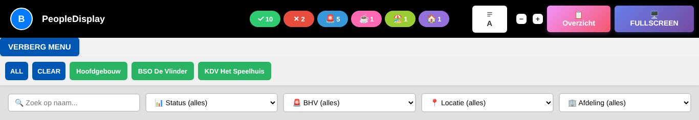

- Click a location to show only that location. Click more locations to combine them.
- **ALL** selects all locations, **CLEAR** clears your selection.
- Click **VERBERG MENU** (hide menu) to fold the row away.

## Searching and filtering

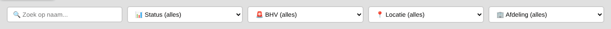

- **Zoek op naam** (search by name) — type part of a name; only matching cards remain.
- **Status** — for example show only who is in or out.
- **BHV** — show only emergency responders, or everyone except them.
- **Locatie** (location) and **Afdeling** (department) — limit the screen to one location or department.

As soon as a filter is active, a **Reset Filters** button appears with the number of active filters. On a shared screen the search and filters are cleared automatically after **1 minute without touching the screen**, so the next colleague sees the full screen again.

# Staff cards

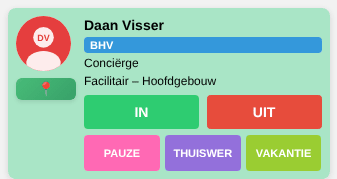

A card can show the following (your administrator decides which are visible):

- **Photo** and **name**
- A **BHV** label if the person is an emergency responder
- **Job title**, **department** and **location**
- The **IN** and **UIT** (out) buttons
- Up to three **extra buttons**, for example PAUZE (break), THUISWERKEN (working from home) and VAKANTIE (holiday)
- A **📍 button** ("Pion") to check in at another location

## Checking in and out

Tap **IN** when you arrive and **UIT** when you leave. The card changes colour immediately and the counters at the top are updated.

## Extra statuses

The extra buttons tell colleagues that you are in but not available right now, or not on site but working. Your administrator decides which buttons exist and what they are called.

For some buttons PeopleDisplay asks **until when** the status applies:

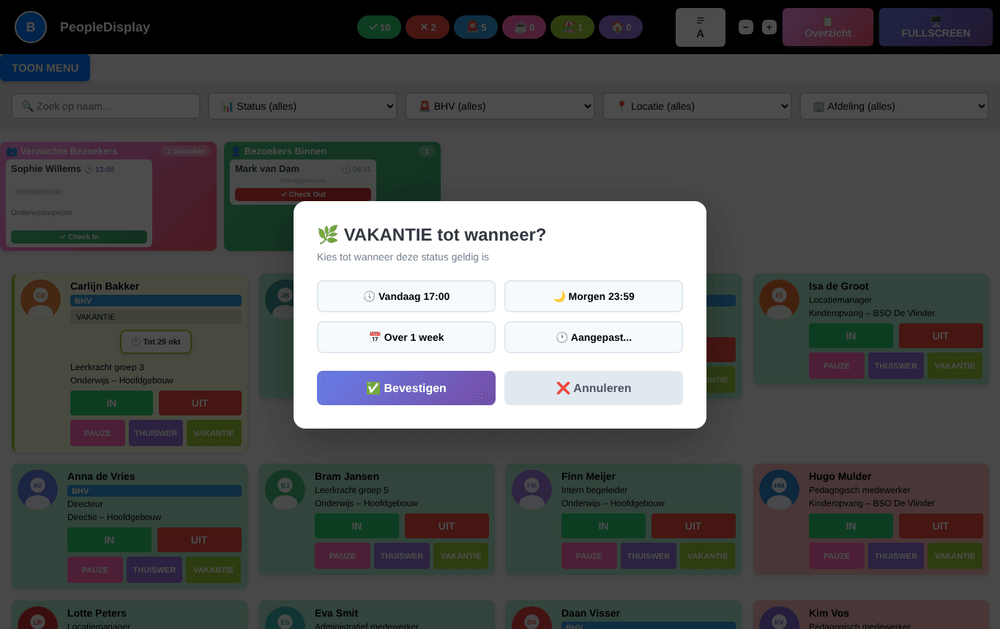

- Choose **Vandaag 17:00** (today 17:00), **Morgen 23:59** (tomorrow 23:59), **Over 1 week** (in one week), or **Aangepast…** (custom) to pick a date and time yourself.
- Click **Bevestigen** (confirm).

The card then shows the status and the end date. At that moment PeopleDisplay resets the status automatically.

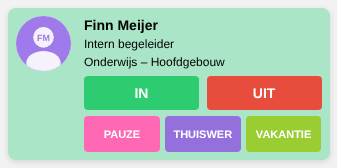

Tap **IN** or **UIT** to end an extra status early.

## Checking in at another location ("Pion")

Working at a different location today? If your administrator enabled this for you, there is a **📍** button below your photo.

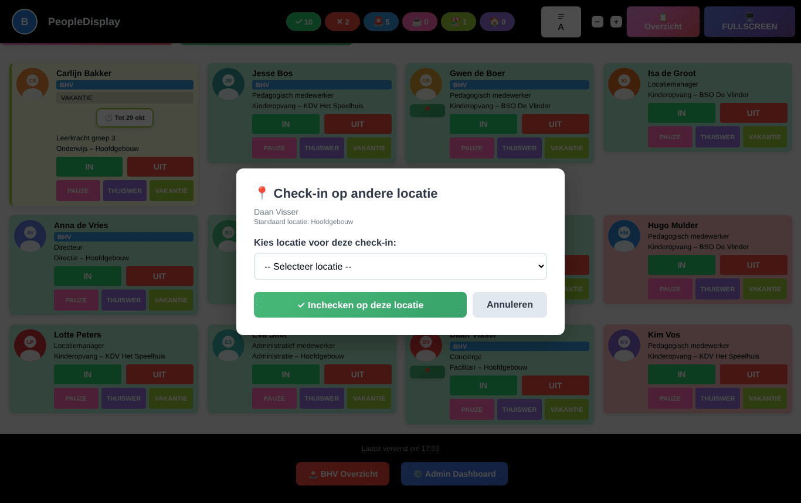

1. Tap **📍**.
2. Choose the location where you are today.
3. Tap **Inchecken op deze locatie** (check in at this location).

Your card now appears at that location. When you check out you automatically return to your regular location.

# Visitors

If visitor registration is enabled, two blocks appear above the cards:

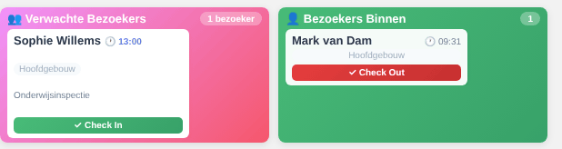

- **Verwachte Bezoekers** (expected visitors) — who registered for today but has not arrived yet. Tap **Check In** when the visitor arrives.
- **Bezoekers Binnen** (visitors inside) — who is in the building now. Tap **Check Out** when the visitor leaves.

## Registering a visitor

Visitors register themselves with the registration form (your administrator can put the link or a QR code at the entrance).

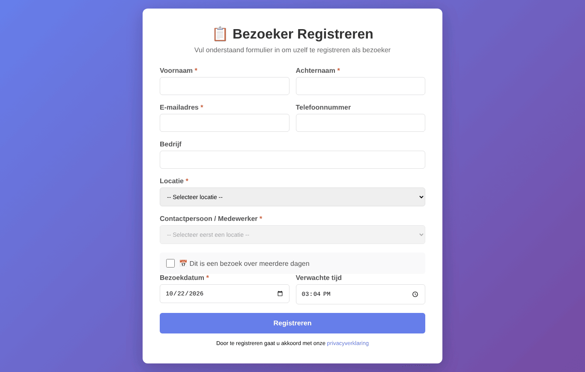

1. Enter first name, last name and email address, and optionally phone number and company.
2. Choose the **location** and then the **contact person**.
3. Choose the visit date and expected time, or tick **multi-day visit**.
4. Click **Registreren** (register).

The contact person receives an email that the visitor has registered.

# Emergency overview (BHV)

Click **🚨 BHV Overzicht** at the bottom of the check-in screen. You see everyone who is currently **IN**, with emergency responders marked. This overview is meant for evacuations and emergencies.

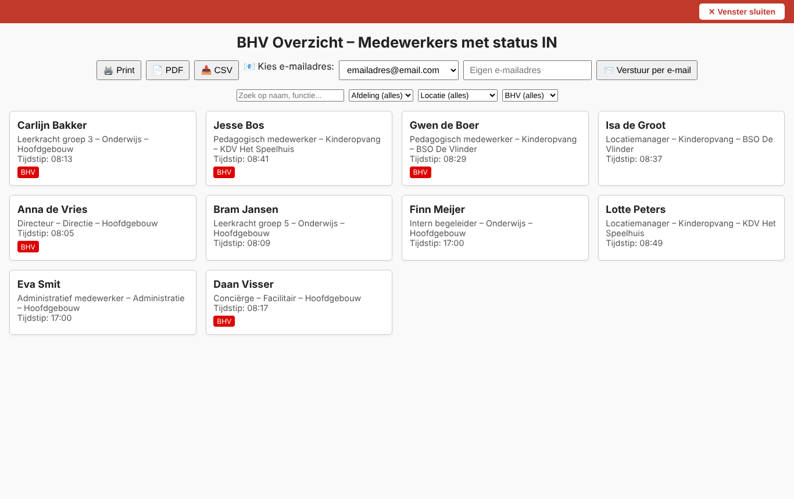

- **Print** or **PDF** — make a paper or digital list.
- **CSV** — download the list for Excel.
- **Versturen per e-mail** (send by email) — send the overview to a chosen or typed email address.
- The filters at the top limit the list to a department, location or emergency responders only.
- **Venster sluiten** (close window, red bar) takes you back — this also works in kiosk mode, where no browser buttons are visible.

# Overview

The overview page lists everyone who is in, grouped by location.

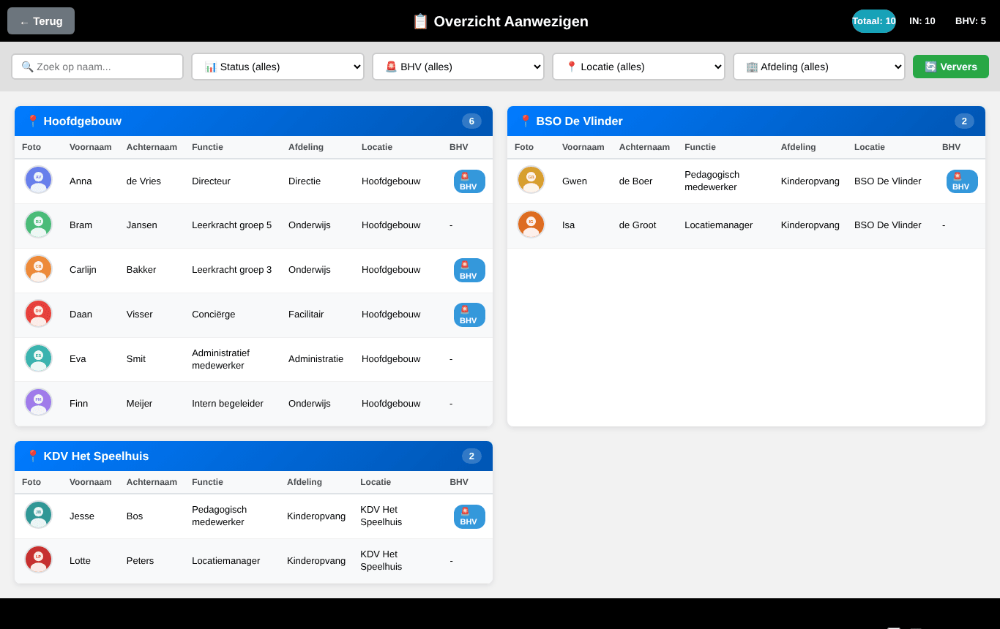

At the top are the total, the number in and the number of emergency responders. You can search and filter as on the check-in screen. With **Auto-refresh** (at the bottom) the page refreshes every 30 seconds; **Ververs** (refresh) does so immediately. **Terug** (back) returns you to the check-in screen.

# IN/OUT board

The IN/OUT board is a simple two-column view: on the left who is **UIT** (out), on the right who is **IN**. It shows only names and a BHV label — ideal for a large screen in the hall.

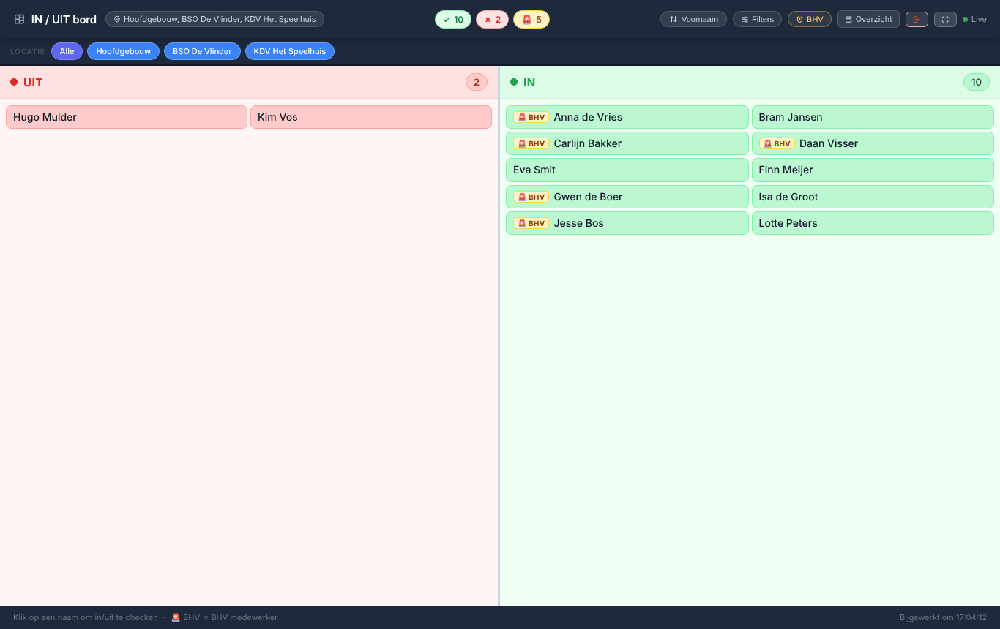

- Click a name to check that person in or out.
- Choose a location at the top, or **Alle** (all).
- The buttons at the top right sort by first or last name, open the filters, show only emergency responders, go to the overview, log out, or put the board in full screen.
- The board refreshes itself every 30 seconds (**Live**).

If your administrator enabled the IN/OUT board for your account, the check-in screen always opens as the IN/OUT board for you.

# My profile

Use **Mijn Profiel** (welcome screen, or the menu under your initial) to change your own details.

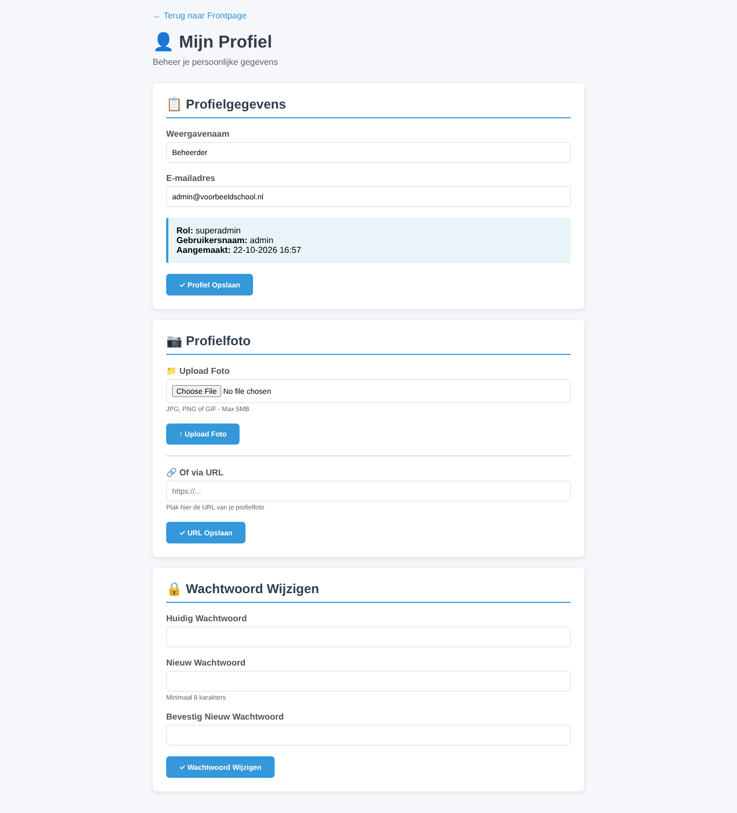

- **Profielgegevens** (profile details) — display name and email address. Your role and username are shown for information.
- **Profielfoto** (profile photo) — upload a JPG, PNG or GIF file (max. 5 MB) or paste a link to a photo.
- **Wachtwoord wijzigen** (change password) — enter your current password and the new one twice (at least 8 characters).

If your administrator allows it, you can also choose your own names for the extra buttons here.

# PeopleDisplay on a phone or tablet

PeopleDisplay adapts to the screen. On a phone the counters, buttons and filters are stacked.

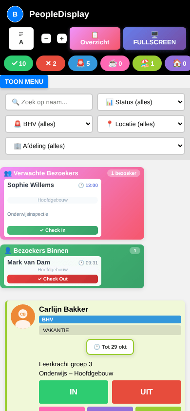

## Installing as an app

You can install PeopleDisplay as an app, so it gets its own icon and opens without an address bar.

- **Android (Chrome)** — tap the three dots and choose **Install app** or **Add to Home screen**.
- **iPhone/iPad (Safari)** — tap the share icon (square with an arrow) and choose **Add to Home Screen**.
- **Windows/Mac (Chrome or Edge)** — click the install icon at the right of the address bar.

After a PeopleDisplay update the app refreshes itself within a few minutes.

## Automatic check-in on Wi-Fi

If your administrator set this up for a location, the installed app offers to check you in automatically as soon as your phone is connected to that location's network. You can always simply tap IN or OUT yourself as well.

# Frequently asked questions

**I can't find my name on the screen.**
Check whether a location or department filter is active (**Reset Filters** button). If your card is still missing, ask your administrator whether you have been added as a staff member, and at which location.

**I don't see the extra buttons, the sort button or the IN/OUT board.**
Your administrator enables these features per user.

**The screen shows old information.**
The screen refreshes every 30 seconds. Reload the page (F5, or swipe down on a tablet) to see the latest state immediately.

**I was logged out automatically.**
An administrator can end sessions remotely, for example when a device is lost. Just log in again.

**My extra status is still shown although I'm back.**
Tap **IN**; the extra status ends immediately.
