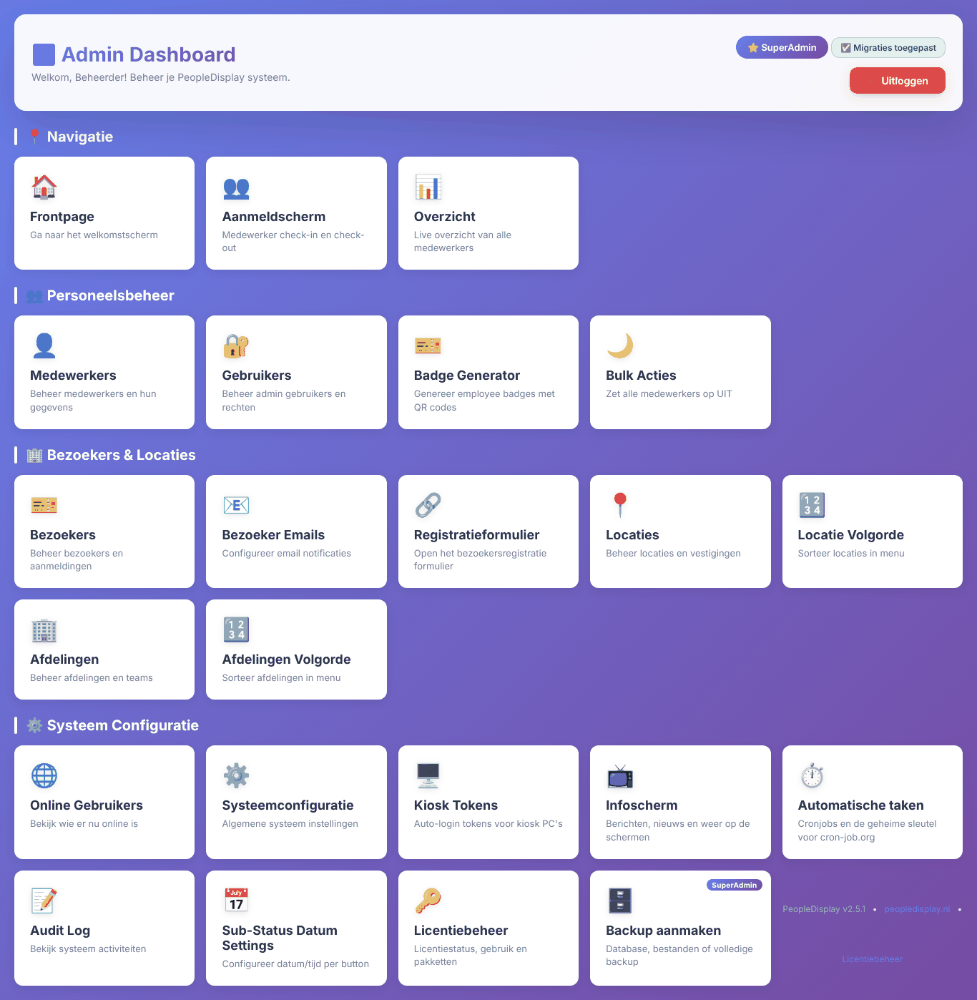
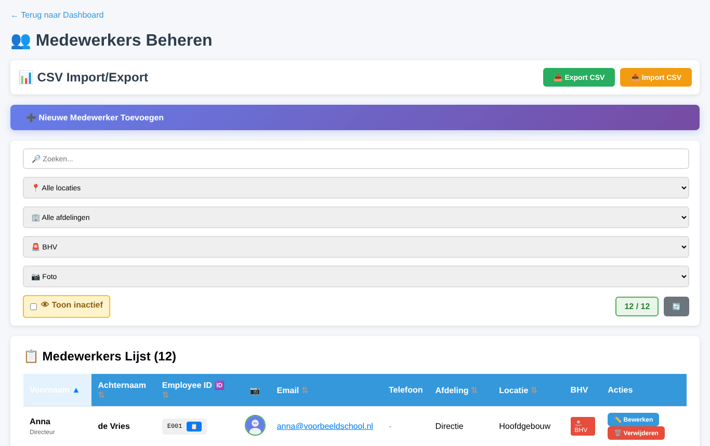
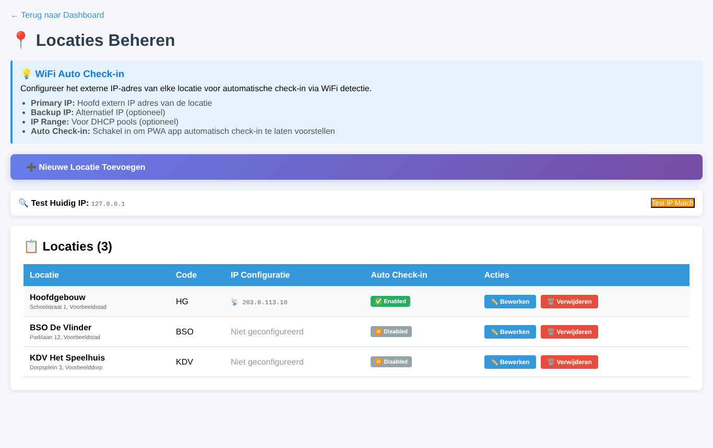
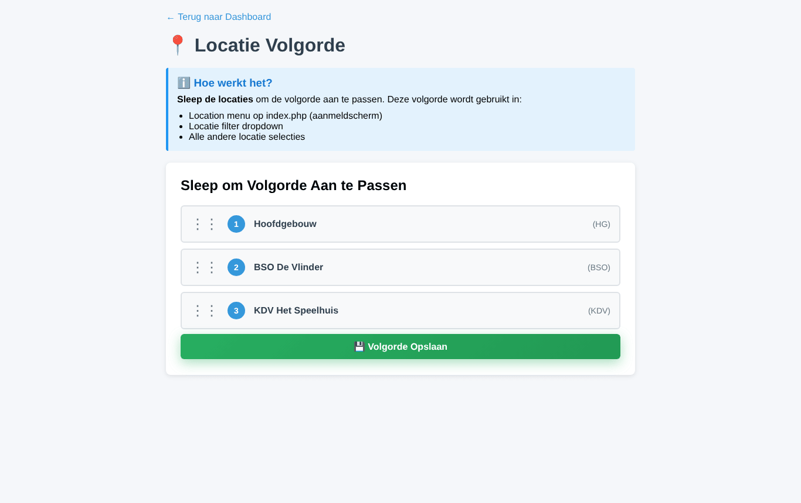
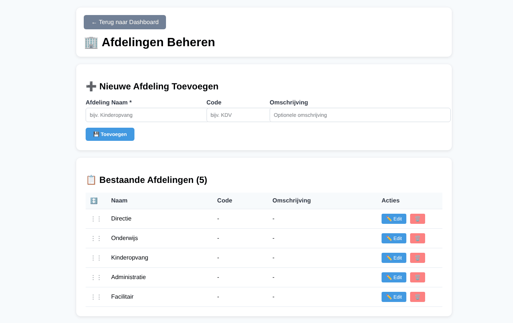
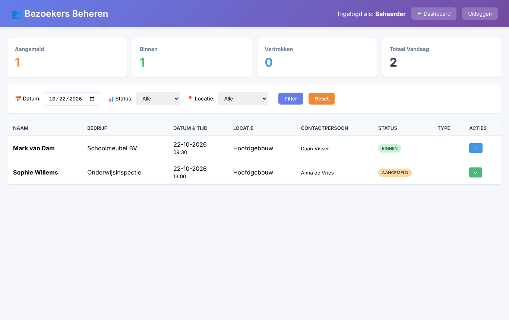
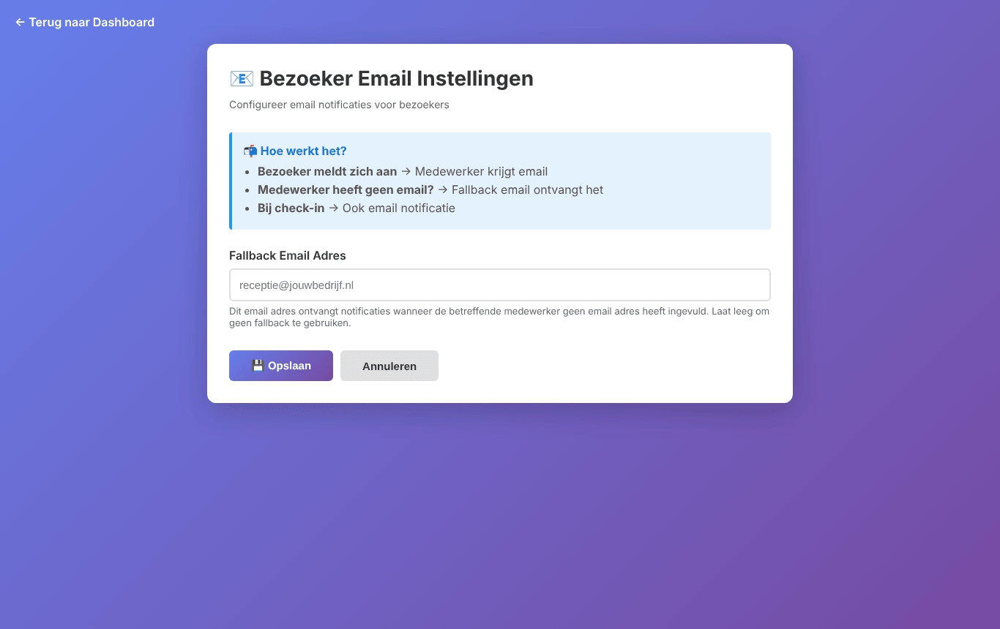
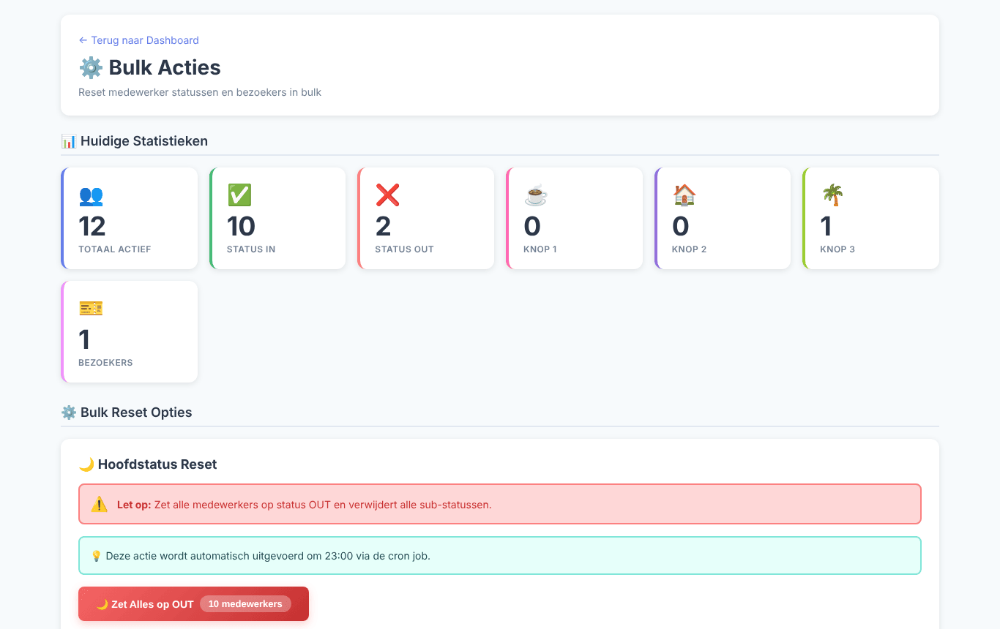
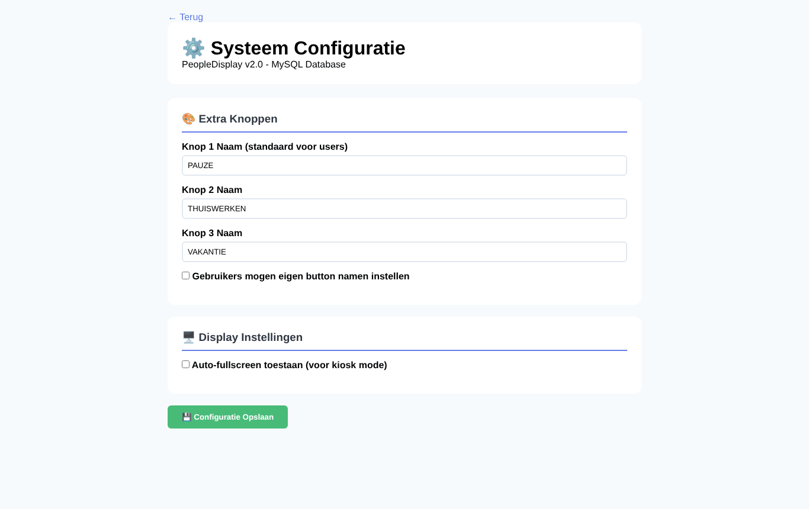
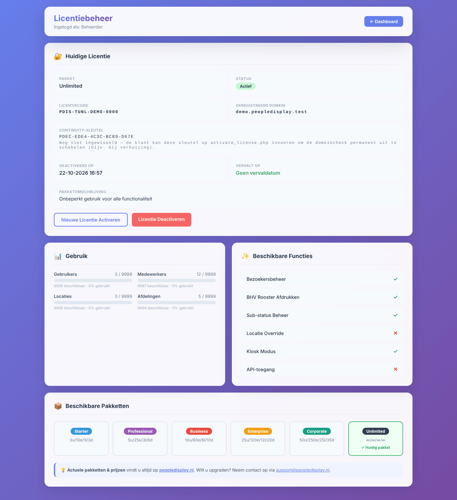

# Introductie

Deze handleiding is voor beheerders van PeopleDisplay: de mensen die medewerkers, gebruikers, locaties en instellingen beheren. Hoe het aanmeldscherm zelf werkt, staat in de **Gebruikershandleiding**. Het installeren en bijwerken op je eigen hosting staat in de **Installatiehandleiding**.

> **Over de voorbeelden** — De screenshots zijn gemaakt in een demo-omgeving met verzonnen namen, locaties en een Unlimited-licentie. Met een Starter-licentie zie je sommige onderdelen niet (zie [Licentie](#licentie)).

## Medewerkers en gebruikers

PeopleDisplay kent twee soorten personen. Het is handig om het verschil goed te kennen:

| | **Medewerker** | **Gebruiker** |
|---|---|---|
| Wat is het? | Iemand met een kaart op het aanmeldscherm | Een account waarmee iemand inlogt |
| Beheren via | **Medewerkers** | **Gebruikers** |
| Voorbeeld | Juf Anna, conciërge Daan | Het account van de receptie, het infoscherm in de hal, de beheerder |

Een gedeeld scherm in de hal is dus één *gebruiker* die de kaarten van veel *medewerkers* toont.

## Rollen

| Rol | Mag |
|---|---|
| **User** | Het aanmeldscherm, overzicht en eigen profiel gebruiken |
| **Medewerker Beheerder** | Daarnaast medewerkers beheren |
| **Gebruiker Beheerder** | Daarnaast medewerkers en gebruikers beheren |
| **Admin** | Het admin-dashboard gebruiken; een SuperAdmin kan per functie beperken wat een admin mag |
| **SuperAdmin** | Alles, inclusief back-ups, licentie en andere beheerders |

# Het admin-dashboard

Beheerders komen na het inloggen direct op het admin-dashboard. Vanaf het aanmeldscherm kom je er via de knop **Admin Dashboard** onderaan, of via **Beheer** op het welkomstscherm.

Het dashboard is verdeeld in vier groepen:

- **Navigatie** — naar het welkomstscherm, het aanmeldscherm en het overzicht.
- **Personeelsbeheer** — medewerkers, gebruikers, de badge generator en bulk acties.
- **Bezoekers & Locaties** — bezoekers, bezoekers-e-mails, het registratieformulier, locaties en afdelingen (en hun volgorde).
- **Systeem Configuratie** — online gebruikers, systeemconfiguratie, kiosk tokens, audit log, sub-status datums, licentiebeheer en back-up.

Rechtsboven zie je je rol en de melding **Migraties toegepast** of **Database schema gecontroleerd**: bij elk bezoek aan het dashboard controleert PeopleDisplay of de database bij de geïnstalleerde versie past, en past die zo nodig zelf aan. Onderaan staat de versie.

Is er een nieuwe versie beschikbaar, dan verschijnt bovenaan een updatemelding (zie [Updates](#updates)).

# Medewerkers

Via **Medewerkers** beheer je alle kaarten op het aanmeldscherm.

Boven de lijst zoek en filter je op naam, locatie, afdeling, BHV en foto. **Toon inactief** laat ook medewerkers zien die zijn verwijderd. Rechts zie je hoeveel medewerkers er getoond worden. Klik op een kolomkop om te sorteren.

## Medewerker toevoegen

Klik op **Nieuwe Medewerker Toevoegen**. Het formulier staat in overzichtelijke blokken: Basisgegevens, Organisatie en Foto naast elkaar, met Zichtbaarheid op locaties daaronder.

1. Vul bij **Basisgegevens** de **voornaam** en **achternaam** in (verplicht), en eventueel e-mailadres, telefoon en functie. Het e-mailadres wordt gebruikt voor bezoekersmeldingen. Vink **BHV'er** aan voor medewerkers met een BHV-taak.
2. Kies bij **Organisatie** de **afdeling** en **locatie** (verplicht).
3. Voeg bij **Foto** een foto toe met **Foto kiezen** — PeopleDisplay comprimeert de foto automatisch — of plak een foto-URL.
4. Bepaal bij **Zichtbaarheid op locaties** waar de kaart verschijnt. Met **Zichtbaar op ALLE locaties** staat de kaart overal, ongeacht de huidige locatie; vink daarbij ook **Mag handmatig locatie kiezen bij check-in** aan als deze medewerker zelf met de Pion (📍) op een andere locatie moet kunnen inchecken.
5. Klik op **Opslaan**.

## Medewerker bewerken

Klik op **Bewerken** in de rij van de medewerker. Het formulier opent direct onder die rij, in dezelfde blokken als bij het toevoegen.

Hier pas je ook de foto aan — upload een nieuwe (automatisch gecomprimeerd) of plak een foto-URL — en stel je in of de medewerker met de **Pion (📍)** op een andere locatie mag inchecken: vink bij **Zichtbaarheid op locaties** eerst **Zichtbaar op ALLE locaties** aan, en daarna **Mag handmatig locatie kiezen bij check-in**.

## Medewerker verwijderen en terugzetten

**Verwijderen** maakt een medewerker inactief: de kaart verdwijnt van alle schermen, maar de gegevens en de geschiedenis blijven bewaard. Vink **Toon inactief** aan en klik op **♻️ Herstellen** om iemand terug te zetten.

## Importeren en exporteren (CSV)

- **Export CSV** downloadt alle medewerkers als CSV-bestand (te openen in Excel).
- **Import CSV** voegt medewerkers in één keer toe. Het bestand moet minimaal de kolommen `voornaam` en `achternaam` hebben; de kolommen `functie`, `afdeling`, `locatie`, `bhv` (Ja/Nee), `foto_url`, `notities` en `status` worden meegenomen als ze er zijn. Kies het bestand onder de lijst en klik op **Importeren**.

> **Tip** — Exporteer eerst de bestaande medewerkers. Zo heb je meteen een voorbeeld met de juiste kolommen.

# Gebruikers

Via **Gebruikers** beheer je alle accounts.

Zoek op naam, gebruikersnaam of e-mail, of filter op rol. Met **+ Nieuwe Gebruiker** maak je een account aan; met **Groepen beheren** maak je groepen om gebruikers te ordenen (bijvoorbeeld per locatie).

## Gebruiker bewerken

Klik op het potlood (✏️) achter een gebruiker. Het bewerkvenster heeft vier tabbladen.

- **Account** — weergavenaam, e-mail, rol, groep, **gekoppelde medewerker** (optioneel: koppelt dit account aan één medewerkerskaart, zodat de gebruiker bij het inloggen meteen die eigen kaart ziet in plaats van de locatieweergave of het admin-dashboard — werkt voor elke rol), een nieuw wachtwoord (leeg laten om niets te wijzigen; minimaal 10 tekens), het vinkje **Gebruiker moet bij de eerstvolgende inlog een nieuw wachtwoord kiezen** en of het account actief is. Hier staat ook het vinkje **Tweestapsverificatie (2FA) verplicht voor deze gebruiker**, en (als de gebruiker 2FA heeft) de knop **🔄 2FA resetten (telefoon kwijt)**; zie *Tweestapsverificatie (2FA)* hieronder.
- **Features** — wat deze gebruiker op het aanmeldscherm ziet en mag (zie hieronder).
- **Presentatie** — een Google Slides-presentatie die automatisch start als het scherm een tijd niet wordt aangeraakt, met het aantal seconden wachttijd. Handig voor een infoscherm in de hal.
- **Scanner** — of de gebruiker badges mag scannen om medewerkers in en uit te checken.

Klik op **Opslaan** om de wijzigingen te bewaren.

## Wachtwoorden en inloggen

- **Verplicht nieuw wachtwoord.** Zet je bij een gebruiker het vinkje *Gebruiker moet bij de eerstvolgende inlog een nieuw wachtwoord kiezen* aan, dan kan die persoon pas verder nadat hij of zij zelf een nieuw wachtwoord heeft gekozen. Het vinkje staat standaard aan als je een wachtwoord instelt of een gebruiker aanmaakt, zodat alleen de gebruiker zelf het wachtwoord kent. In het overzicht zie je welke gebruikers nog moeten wijzigen (🔑 *nieuw ww*) en wanneer iemand voor het laatst is ingelogd.
- **Iedereen tegelijk.** Met de knop **Wachtwoord wijzigen verplichten** bovenin kies je rollen en zet je de verplichting voor alle actieve accounts met die rol aan (of op). Kiosk- en tabletaccounts, dus accounts met een kiosk-token, worden overgeslagen. Wie al is ingelogd, wordt binnen 5 minuten naar de wijzigpagina gestuurd.
- **Wachtwoordbeleid.** Een nieuw wachtwoord bestaat uit minimaal 10 tekens. Een zin van drie of vier woorden is sterk en makkelijk te onthouden.
- **Te veel foute pogingen.** Na 5 foute pogingen met dezelfde gebruikersnaam vanaf hetzelfde adres kan er 15 minuten niet worden ingelogd; bij herhaling duurt het langer (maximaal 24 uur). Ook een goed wachtwoord werkt dan niet tot de wachttijd voorbij is. Andere gebruikers op hetzelfde adres kunnen gewoon inloggen. Alle pogingen worden 90 dagen bewaard (tabel `login_attempts`). Foute codes van tweestapsverificatie tellen daar ook in mee.

## Tweestapsverificatie (2FA)

Met tweestapsverificatie vult een gebruiker bij het inloggen, naast het wachtwoord, een code van 6 cijfers in uit een authenticator-app op de telefoon (Google Authenticator, Microsoft Authenticator, Authy, 1Password en dergelijke). Een gestolen of afgekeken wachtwoord is dan niet genoeg om in te loggen. Gebruikers stellen het zelf in via **Mijn Profiel** → **Tweestapsverificatie** → **Instellen** (zie de Gebruikershandleiding). Dat kost ongeveer twee minuten en er is geen extra abonnement of dienst voor nodig: de QR-code wordt op je eigen server gemaakt. Gebruikers die PeopleDisplay alleen op hun telefoon hebben, kunnen het ook op die telefoon instellen: daar staat in plaats van de QR-code een knop **Open in je authenticator-app** en een knop **Sleutel kopiëren** (zie de Gebruikershandleiding). Noem dit in je aankondiging, zodat niemand denkt dat een computer nodig is.

- **Aanbevolen of verplicht.** Iedere gebruiker kan 2FA zelf aanzetten. Wil je het afdwingen, dan zet je het verplicht, per gebruiker of voor hele rollen (zie hieronder). Wij raden aan 2FA minimaal verplicht te stellen voor alle beheerdersrollen.
- **Per gebruiker verplichten.** Open de gebruiker via ✏️ en vink op het tabblad *Account* **Tweestapsverificatie (2FA) verplicht voor deze gebruiker** aan.
- **Rollen tegelijk verplichten.** Met de knop **🔐 2FA verplichten** bovenin kies je rollen en klik je op **✓ Verplichten** (of **Verplichting opheffen**). Let op: alle rollen staan standaard aangevinkt. Wil je alleen beheerders verplichten, haal dan het vinkje bij **User** weg. Jijzelf valt er ook onder als jouw rol is aangevinkt. Alleen actieve accounts worden meegenomen.
- **7 dagen uitstel.** Wie 2FA verplicht krijgt maar het nog niet heeft, mag het 7 dagen uitstellen. Bij het inloggen krijgt die persoon dan het instelscherm te zien, met de knop **Later instellen** en het aantal resterende dagen (hooguit eens per 24 uur per sessie). Na die 7 dagen komt de gebruiker pas verder als 2FA is ingesteld. Het uitstel begint op het moment dat je het verplicht maakt en wordt niet verlengd als je het later nog eens aanzet. Ook wie *Blijf ingelogd* heeft gekozen, moet na die 7 dagen 2FA instellen.
- **Kiosk- en tabletaccounts doen nooit mee.** Een account met een kiosk-token wordt nooit om 2FA gevraagd, ook niet als het vinkje aan staat; dat scherm heeft immers geen telefoon. In de lijst staat bij zo'n account **📺 kiosk: geen 2FA**.
- **Status in de lijst.** Een badge **🔐 2FA aan** laat zien wie het heeft ingesteld; **🔐 2FA verplicht** betekent verplicht maar nog niet ingesteld (met de einddatum van het uitstel als je er met de muis op staat).
- **Telefoon kwijt of nieuwe telefoon.** Een gebruiker die zijn telefoon kwijt is, logt in met een van de 10 **herstelcodes** die hij bij het instellen heeft gekregen. Elke herstelcode werkt één keer. Zijn de herstelcodes ook weg, dan reset jij 2FA: open de gebruiker via ✏️ en klik op **🔄 2FA resetten (telefoon kwijt)**. De gebruiker kan daarna weer met alleen het wachtwoord inloggen en stelt 2FA opnieuw in (als het verplicht is, met weer 7 dagen uitstel). Een gewone beheerder kan dat niet voor een SuperAdmin doen; dat kan alleen een SuperAdmin.
- **Je zelf buitensluiten.** Kom je zelf niet meer binnen en kan geen andere beheerder je 2FA resetten, maak dan via FTP in de hoofdmap van de site een bestand `twofa_uit.txt` (leeg is goed). Zolang dat bestand er staat is voor niemand een code nodig en toont het inlogscherm een oranje waarschuwing. Log in met je wachtwoord, reset waar nodig 2FA en **verwijder het bestand weer**.
- **Dit apparaat vertrouwen.** Bij het invullen van de code kan een gebruiker *Dit apparaat 30 dagen vertrouwen* aanvinken; op dat apparaat is dan 30 dagen geen code nodig. *Blijf ingelogd* is iets anders en omzeilt 2FA niet: wie 2FA heeft, moet na uitloggen (of als de sessie verloopt) opnieuw een code invullen, tenzij het apparaat vertrouwd is. Een gebruiker kan alle vertrouwde apparaten zelf afmelden; ook een wachtwoordwijziging meldt ze allemaal af.
- **Foute codes.** Een foute code telt mee voor de automatische blokkade (5 pogingen, daarna 15 minuten en langer). Daarnaast geldt een grens van 10 foute codes per 15 minuten per gebruiker, vanaf welk adres dan ook.
- **De klok van de telefoon moet kloppen.** Een code werkt alleen als de tijd op de telefoon klopt (automatische tijd aan). Loopt de klok af, dan krijgt de gebruiker bij het instellen een melding.

> **Belangrijk voor de beheerder (back-up en verhuizen)** — De geheime sleutels van de authenticator-apps staan versleuteld in de database. De sleutel waarmee dat gebeurt staat in het bestand `data/twofa_key.php` op de server. Dit bestand wordt automatisch aangemaakt, zit nooit in updates en is niet bereikbaar via de browser. Een **Volledige backup** neemt de map `data/` vanzelf mee (bewaar dat ZIP-bestand dus veilig: de sleutel zit erin) en `restore.php` zet hem bij het verhuizen weer terug. Back-up of verhuis je handmatig via FTP, kopieer dan de map `data/` zelf mee, samen met de database. Raakt het bestand kwijt, dan werkt 2FA voor niemand meer tot je 2FA per gebruiker reset (of tijdelijk `twofa_uit.txt` zet).

## Features per gebruiker

- **Zichtbare velden** — welke gegevens op de kaarten staan: foto, voornaam, achternaam, functie, afdeling, locatie, status, BHV en tijdstip.
- **Extra knoppen** — welke van de drie extra statusknoppen de gebruiker ziet.
- **Sorteer Toggle Knop** — toont de sorteerknop (A) waarmee de gebruiker zelf tussen voornaam en achternaam kiest.
- **Standaard sorteervolgorde** — geldt altijd, ook zonder sorteerknop: *Voornaam A→Z, status IN eerst*, *Voornaam* of *Achternaam*.
- **Zoomknop tonen** en **Standaard zoomniveau** (50–150%).
- **IN/UIT Bord weergave** — de gebruiker ziet het IN/UIT-bord in plaats van de kaarten. Geschikt voor een groot scherm.
- **Zichtbare locaties** en **Zichtbare afdelingen** — welke kaarten deze gebruiker ziet. Geen afdelingen aangevinkt betekent: alle afdelingen.

Is de rol **Admin**, dan staat hier ook een lijst met beheerfuncties (locaties, afdelingen, kiosk tokens, bezoekers, badges, bulk acties, audit log, systeemconfiguratie, sub-status datums, gebruikers, back-up). Alleen de aangevinkte functies zijn voor die admin beschikbaar.

# Locaties

Via **Locaties** beheer je de vestigingen.

- **Nieuwe Locatie Toevoegen** — naam, korte code en adres.
- **Bewerken** — wijzig een locatie. Een nieuwe naam wordt automatisch bij alle medewerkers van die locatie doorgevoerd.
- **IP-configuratie en Auto Check-in** — vul het externe IP-adres van de locatie in (en eventueel een reserve-IP of IP-bereik) en zet **Auto Check-in** aan. Medewerkers die PeopleDisplay als app op hun telefoon hebben, krijgen dan voorgesteld om automatisch in te checken zodra ze op het netwerk van die locatie zijn. Met **Test IP Match** controleer je welk IP-adres je nu hebt.

## Volgorde van locaties

Via **Locatie Volgorde** bepaal je in welke volgorde de locaties in het menu en de filters staan. Sleep de locaties in de gewenste volgorde en sla op.

# Afdelingen

Via **Afdelingen** beheer je de afdelingen of teams. Op het aanmeldscherm kan op afdeling worden gefilterd. Een nieuwe naam wordt automatisch bij alle medewerkers doorgevoerd. Via **Afdelingen Volgorde** zet je ze in de gewenste volgorde.

# Bezoekers

## Bezoekers beheren

Via **Bezoekers** zie je wie er vandaag is aangemeld, binnen is of al is vertrokken.

Filter op datum, status en locatie. Met de knop in de kolom **Acties** check je een bezoeker in (✓) of uit (→).

## Het registratieformulier

Met **Registratieformulier** open je het formulier waarmee bezoekers zich zelf aanmelden (`/visitor_register.php`). Zet de link op je website of hang een QR-code met die link bij de ingang. Het formulier staat beschreven in de Gebruikershandleiding.

## E-mails voor bezoekers

Bij een aanmelding en bij het inchecken krijgt de contactpersoon een e-mail. Via **Bezoeker Emails** stel je een **fallback-adres** in (bijvoorbeeld de receptie) dat de melding krijgt als de contactpersoon geen e-mailadres heeft.

> **Let op** — PeopleDisplay verstuurt e-mail via de mailfunctie van je hosting. Komen er geen e-mails aan, controleer dan de spammap en vraag je hostingpartij of uitgaande e-mail is toegestaan.

# Badge Generator

Met de **Badge Generator** maak je naambadges met QR-code of barcode, bijvoorbeeld voor de scanner.

1. Kies een sjabloon: **Professional**, **Colorful**, **Minimalist** of **Emergency (BHV)**.
2. Kies welke gegevens op de badge komen.
3. Selecteer de medewerkers.
4. Download de badges als **PDF** om te printen, of als **PNG**-afbeeldingen in een ZIP-bestand.

# Bulk acties

Met **Bulk Acties** zet je in één keer statussen terug.

- **Zet Alles op OUT** — alle medewerkers op UIT en alle extra statussen gewist. Dit gebeurt ook elke avond automatisch om 23:00, als de cronjob is ingesteld (zie de Installatiehandleiding).
- **Sub-Status Reset** — wis alleen de extra status van knop 1, 2 of 3, zonder IN/UIT te wijzigen.
- **Bezoekers Reset** — zet alle bezoekers op vertrokken.

Bovenaan zie je de huidige aantallen.

# Systeemconfiguratie

## Extra knoppen en weergave

Via **Systeemconfiguratie** geef je de drie extra knoppen een naam (standaard PAUZE, THUISWERKEN en VAKANTIE). Vink **Gebruikers mogen eigen button namen instellen** aan als gebruikers die namen in hun profiel zelf mogen kiezen. **Auto-fullscreen toestaan** laat kiosk-schermen automatisch op volledig scherm openen.

## Datum en tijd bij extra knoppen

Via **Sub-Status Datum Settings** bepaal je per extra knop of PeopleDisplay vraagt **tot wanneer** de status geldt. De status wordt op dat moment automatisch teruggezet (via de cronjob). Bovenaan zie je hoeveel statussen een einddatum hebben, nog actief zijn of verlopen zijn.

## Naamweergave

Via **Naam Weergave Configuratie** kies je hoe namen op de kaarten staan: volledige naam, alleen voornaam, alleen achternaam, of initiaal + achternaam.

# Kiosk tokens

Een kiosk token is een vaste inloglink voor een scherm zonder toetsenbord, zoals een tablet bij de ingang. Het scherm opent PeopleDisplay daarmee automatisch, ook na een herstart.

## Een kiosk token maken

1. Maak eerst een **gebruiker** voor het scherm, met de juiste locaties en features.
2. Klik op **Nieuwe Kiosk Token**.
3. Kies die gebruiker, geef een omschrijving (bijvoorbeeld *Tablet ontvangstbalie*), en stel eventueel een **IP-beperking** en een verloopdatum in.
4. Klik op **Kopieer URL** of **Toon QR-Code** en open die link op het scherm.

Met **Deactiveren** of **Verwijderen** werkt de link direct niet meer, bijvoorbeeld als een tablet kwijt is.

> **Tip voor een vaste kioskpc** — Start Chrome met `--kiosk` gevolgd door de token-URL. Chrome opent dan op volledig scherm, zonder adresbalk. Het BHV-overzicht heeft een eigen knop **Venster sluiten**, zodat je ook in kiosk-modus terugkomt.

# Online gebruikers

Via **Online Gebruikers** zie je wie er nu is ingelogd, op welk apparaat, met welke browser, vanaf welk IP-adres en hoe lang al.

- **Online** = actief in de laatste minuut, **Idle** = langer dan 1 minuut niets gedaan, **Away** = langer dan 5 minuten.
- Met **Uitloggen** beëindig je een sessie op afstand, bijvoorbeeld bij een kwijtgeraakte tablet. De gebruiker ziet binnen enkele seconden een melding en komt op het inlogscherm. Daarna kan hij gewoon opnieuw inloggen.

# Audit log

Het **Audit Log** houdt bij wie wat heeft gewijzigd: toegevoegde, gewijzigde en verwijderde medewerkers en statuswijzigingen, met tijdstip, oude en nieuwe waarde, wie het deed en vanaf welk IP-adres.

Filter op actie (toegevoegd, gewijzigd, status, verwijderd), periode en naam of medewerkernummer. De regels **MIGRATION** zijn de automatische databasecontroles bij het openen van het dashboard.

# Licentie

Via **Licentiebeheer** zie je welk pakket actief is, voor welk domein, hoeveel je gebruikt en welke functies beschikbaar zijn.

- **Starter** is gratis en werkt zonder licentiecode: maximaal 10 medewerkers, 1 locatie en 3 gebruikers. Bezoekersbeheer, kiosk-modus, bulk acties en het audit log zitten in de betaalde pakketten.
- **Nieuwe Licentie Activeren** — vul een licentiecode in (formaat `PDIS-…`). De licentie wordt gekoppeld aan het domein van deze installatie.
- **Licentie Deactiveren** — maakt de koppeling los, bijvoorbeeld voor een verhuizing. Daarna gelden de Starter-limieten tot je opnieuw activeert.
- **Continuity-sleutel** (Unlimited en Corporate) — met deze sleutel blijft je licentie werken na een verhuizing naar een ander domein of andere hosting, ook zonder hulp van peopledisplay.nl. Bewaar hem op een veilige plek. Je wisselt hem in via `activate_license.php` op de nieuwe omgeving.

Actuele pakketten en prijzen staan op [peopledisplay.nl](https://peopledisplay.nl).

# Back-up

Alleen een SuperAdmin kan via **Backup aanmaken** een back-up downloaden als ZIP-bestand.

- **Database only** — alle tabellen en gegevens als `.sql`-bestand.
- **Bestanden only** — alle programmabestanden (zonder `tmp/`, `logs/` en `install/`).
- **Volledige backup** (aanbevolen) — database én bestanden, met herstelinstructies. Hiermee verhuis je PeopleDisplay naar een andere server.

Een volledige back-up van een grote installatie kan 1 tot 3 minuten duren. Sluit het venster niet voordat de download start. Hoe je een back-up terugzet, staat in de Installatiehandleiding.

# Updates

PeopleDisplay controleert zelf of er een nieuwe versie is. Is die er, dan verschijnt bovenaan het dashboard een melding met het versienummer en de belangrijkste wijzigingen.

1. Klik op **Wat is nieuw?** voor alle wijzigingen.
2. Klik op **Update downloaden**. Je krijgt een klein ZIP-bestand met alleen de gewijzigde bestanden.
3. Pak het bestand uit en upload de inhoud met FTP naar je PeopleDisplay-map. Overschrijf de bestaande bestanden. Je instellingen, foto's en gegevens blijven staan.
4. Open het admin-dashboard. Eventuele databasewijzigingen worden automatisch doorgevoerd.

Met het kruisje verberg je de melding tot de volgende versie. Open schermen en geïnstalleerde apps laden de nieuwe versie binnen enkele minuten vanzelf.

# Veelgestelde vragen

**Een medewerker staat niet op het scherm van een bepaalde gebruiker.**
Controleer bij die gebruiker de tabbladen *Features* → *Zichtbare locaties* en *Zichtbare afdelingen*, en bij de medewerker de locatie en *Zichtbaar op locaties*.

**Ik kan geen medewerkers, locaties of gebruikers meer toevoegen.**
Je zit aan de limiet van je pakket. Zie **Licentiebeheer** voor je gebruik.

**De extra statussen worden niet automatisch teruggezet.**
Dat gebeurt via cronjobs. Controleer of die zijn ingesteld (zie de Installatiehandleiding).

**Hoe zet ik het wachtwoord van een gebruiker opnieuw?**
Open de gebruiker via ✏️, vul op het tabblad *Account* een nieuw wachtwoord in en klik op **Opslaan**.

**Een gebruiker is zijn telefoon kwijt en heeft geen herstelcodes meer.**
Open de gebruiker via ✏️ en klik op **🔄 2FA resetten (telefoon kwijt)**. Daarna kan die persoon weer met alleen het wachtwoord inloggen en stelt 2FA opnieuw in. Zie *Tweestapsverificatie (2FA)*.

**Ik kom zelf niet meer binnen door 2FA.**
Maak via FTP in de hoofdmap van de site een leeg bestand `twofa_uit.txt`. Log in met je wachtwoord, reset 2FA en verwijder het bestand weer.

**De code uit de app werkt niet.**
Meestal loopt de klok van de telefoon af: zet de automatische tijd aan. In Google Authenticator kan dat via *Instellingen → Tijdcorrectie voor codes → Nu synchroniseren*. Staan er twee accounts met bijna dezelfde naam in de app (van een eerdere poging), gebruik dan het account dat bij de huidige QR-code hoort en verwijder het oude.

**Hoe verhuis ik PeopleDisplay naar een andere hosting?**
Maak een volledige back-up en zet die op de nieuwe hosting terug met `restore.php` (zie de Installatiehandleiding). Heb je een Unlimited- of Corporate-licentie, wissel dan daarna je continuity-sleutel in.
