# Introductie

PeopleDisplay is een digitaal aanmeldscherm voor medewerkers. In één oogopslag zie je wie er aanwezig is, op welke locatie, en wie er BHV'er is. Medewerkers melden zich aan en af met één tik op hun eigen kaart. PeopleDisplay werkt in de browser: op een groot scherm in de hal, op een tablet bij de ingang, op een pc of op een telefoon. Je kunt het ook als app installeren.

Deze handleiding is voor iedereen die PeopleDisplay dagelijks gebruikt. Voor het inrichten en beheren is er de **Beheerdershandleiding**; voor het installeren op je eigen hosting de **Installatiehandleiding**.

> **Over de voorbeelden** — De screenshots in deze handleiding zijn gemaakt met een demo-omgeving met verzonnen namen en locaties. Welke onderdelen jij ziet, hangt af van wat de beheerder voor jouw account heeft aangezet.

# Inloggen

Open het adres van jouw PeopleDisplay-omgeving in de browser, bijvoorbeeld `https://mijn.peopledisplay.nl`. Je komt dan op het inlogscherm.

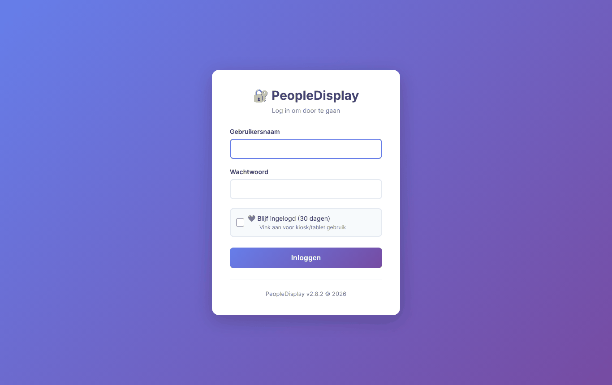

1. Vul je **gebruikersnaam** en **wachtwoord** in.
2. Vink **Blijf ingelogd** aan als je op dit apparaat ingelogd wilt blijven (30 dagen). Doe dit alleen op een apparaat dat niet door anderen wordt gebruikt.
3. Klik op **Inloggen**.
4. Heb je tweestapsverificatie aan, dan vraagt PeopleDisplay nu om de code uit je authenticator-app (zie het hoofdstuk *Tweestapsverificatie*).

Na het inloggen kom je op het welkomstscherm. Beheerders komen direct in het admin-dashboard.

> **Wachtwoord vergeten?** Vraag je beheerder om een nieuw wachtwoord in te stellen. Je kiest dan bij de eerstvolgende inlog zelf een nieuw wachtwoord.
>
> **Te veel foute pogingen?** Na 5 keer een verkeerd wachtwoord kun je een tijdje niet inloggen (eerst 15 minuten). Wacht even en probeer het opnieuw. Ook een paar keer een foute code uit de app telt mee.

# Het welkomstscherm

Op het welkomstscherm kies je waar je naartoe wilt.

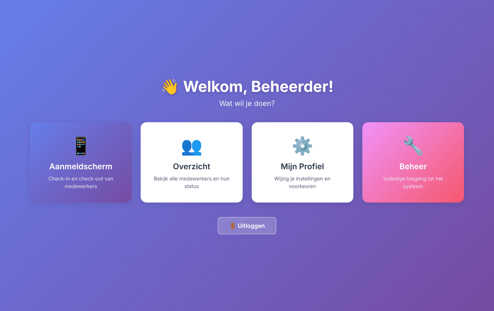

| Tegel | Wat je daar doet |
|---|---|
| **Aanmeldscherm** | Medewerkers in- en uitchecken (het hoofdscherm) |
| **Overzicht** | Een lijst van iedereen die aanwezig is, per locatie |
| **Mijn Profiel** | Je naam, e-mailadres, foto en wachtwoord aanpassen |
| **Infoscherm-berichten** | Alleen als de beheerder dat voor je heeft aangezet: berichten op het infoscherm plaatsen voor jouw locaties |
| **Beheer** | Alleen zichtbaar voor beheerders: het admin-dashboard |

Onderaan staat de knop **Uitloggen**, met daaronder het versienummer van PeopleDisplay.

# Het aanmeldscherm

Het aanmeldscherm is het hart van PeopleDisplay. Elke medewerker heeft een eigen kaart. Een **groene** kaart betekent aanwezig (IN), een **rode** kaart afwezig (UIT). Kaarten met een extra status (zoals pauze of vakantie) hebben de kleur van die status.

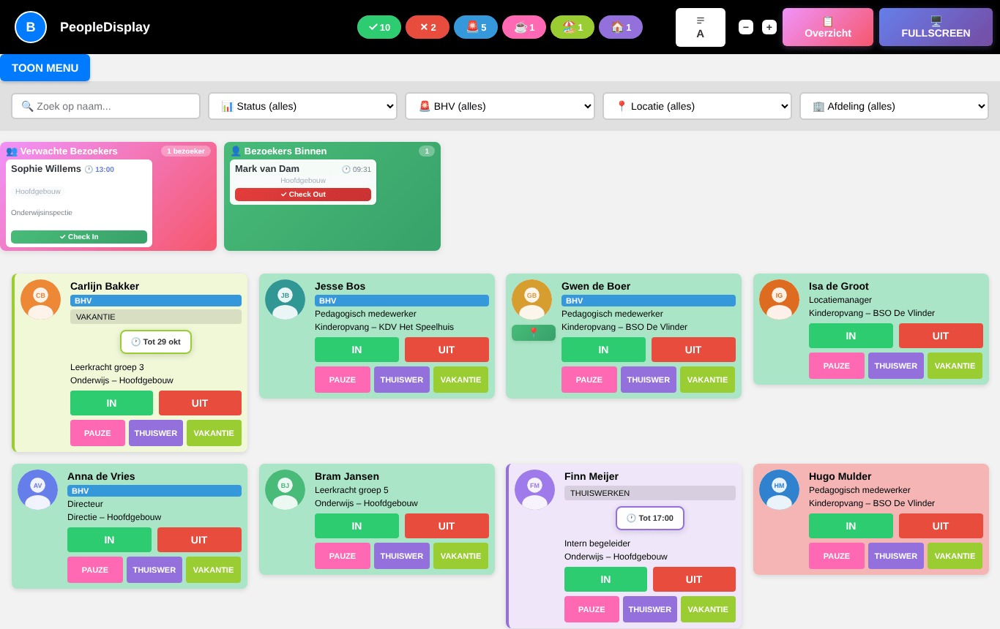

Het scherm ververst zichzelf elke 30 seconden, dus wijzigingen van collega's verschijnen vanzelf. Onderaan zie je hoe laat het scherm voor het laatst is ververst.

## Eigen kaart bij een gekoppeld account

Heeft de beheerder jouw account gekoppeld aan je eigen medewerkerskaart? Dan zie je in plaats van het volledige aanmeldscherm alleen je eigen kaart, met daarboven je status: **📍 Ingecheckt op locatie "…"** of **⚪ (Nog) niet ingecheckt**. De zoek- en filterbalk en het locatiemenu worden dan niet getoond. Mag je zelf een andere locatie kiezen, dan staat er onder je kaart een knop met **🔄 Klik om een andere locatie te kiezen**.

## De bovenbalk

- **Tellers** — hoeveel medewerkers er IN (✓) en UIT (✗) zijn, hoeveel BHV'ers er aanwezig zijn (🚨) en hoeveel medewerkers een extra status hebben (bijvoorbeeld ☕ pauze, 🏖️ vakantie, 🏠 thuiswerken).
- **Sorteerknop (A)** — kies of de kaarten op voornaam of achternaam worden gesorteerd. Je keuze wordt op dit apparaat onthouden. De knop is alleen zichtbaar als de beheerder hem voor je heeft aangezet.
- **− en +** — maak de kaarten kleiner of groter (zoomen). Handig op een groot scherm of juist op een kleine tablet. Ook dit wordt per apparaat onthouden.
- **Overzicht** — opent de overzichtspagina.
- **Fullscreen** — toont het aanmeldscherm over het hele scherm. Druk op **Esc** om terug te gaan.
- **Je initiaal** (linksboven) — opent een menu met **Menu** (welkomstscherm), **Mijn Profiel** en **Uitloggen**. Onderaan het menu staat het versienummer; handig als de beheerder of helpdesk vraagt welke versie je hebt.

## Locaties kiezen

Werk je met meerdere locaties? Klik op **TOON MENU**. Er verschijnt een rij knoppen met alle locaties die je mag zien.

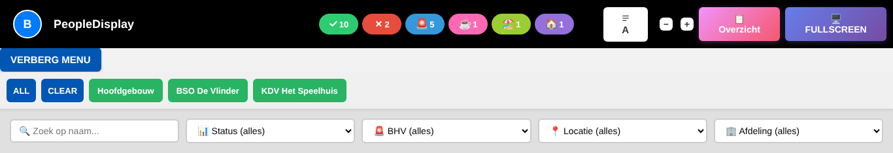

- Klik op een locatie om alleen die locatie te tonen. Klik op meer locaties om ze te combineren.
- **ALL** selecteert alle locaties, **CLEAR** wist je keuze.
- Klik op **VERBERG MENU** om de rij weer in te klappen.

## Zoeken en filteren

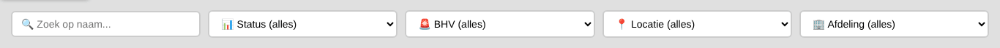

- **Zoek op naam** — typ een deel van een naam; alleen de kaarten die passen blijven staan.
- **Status** — toon bijvoorbeeld alleen wie IN of UIT is.
- **BHV** — toon alleen BHV'ers, of juist iedereen behalve de BHV'ers.
- **Locatie** en **Afdeling** — beperk het scherm tot één locatie of afdeling.

Zodra er een filter actief is, verschijnt de knop **Reset Filters** met het aantal actieve filters. Op een gedeeld scherm worden zoekopdracht en filters na **1 minuut zonder aanraking** automatisch gewist, zodat de volgende collega weer het hele scherm ziet.

# Medewerkerkaarten

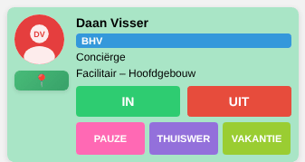

Een kaart kan de volgende onderdelen hebben (de beheerder bepaalt welke zichtbaar zijn):

- **Foto** en **naam**
- **BHV**-label als de medewerker BHV'er is
- **Functie**, **afdeling** en **locatie**
- De knoppen **IN** en **UIT**
- Tot drie **extra knoppen**, bijvoorbeeld PAUZE, THUISWERKEN en VAKANTIE
- Een **📍-knop** (Pion) om op een andere locatie in te checken

## In- en uitchecken

Tik op **IN** als je binnenkomt en op **UIT** als je weggaat. De kaart verandert direct van kleur en de tellers bovenaan worden bijgewerkt.

## Extra statussen

Met de extra knoppen geef je aan dat je er wel bent maar even niet beschikbaar, of juist niet op locatie maar wel aan het werk. Welke knoppen er zijn en hoe ze heten, stelt de beheerder in.

Bij sommige knoppen vraagt PeopleDisplay **tot wanneer** de status geldt:

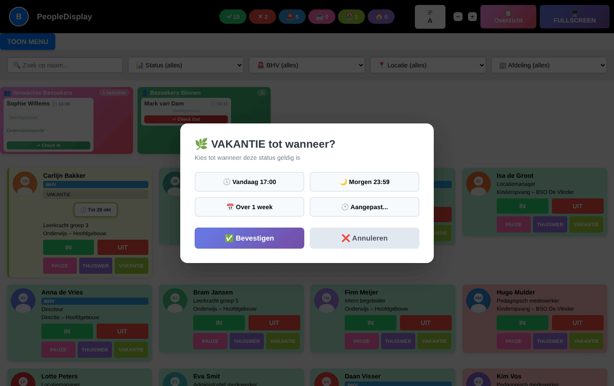

- Kies **Vandaag 17:00**, **Morgen 23:59**, **Over 1 week**, of **Aangepast…** voor een eigen datum en tijd.
- Klik op **Bevestigen**.

De kaart toont daarna de status en de einddatum. Op het afgesproken moment zet PeopleDisplay de status automatisch terug.

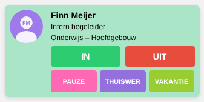

Tik op **IN** of **UIT** om een extra status eerder te beëindigen.

## Inchecken op een andere locatie (Pion)

Werk je vandaag op een andere locatie dan normaal? Als de beheerder dit voor jou heeft aangezet, staat er een **📍**-knop onder je foto.

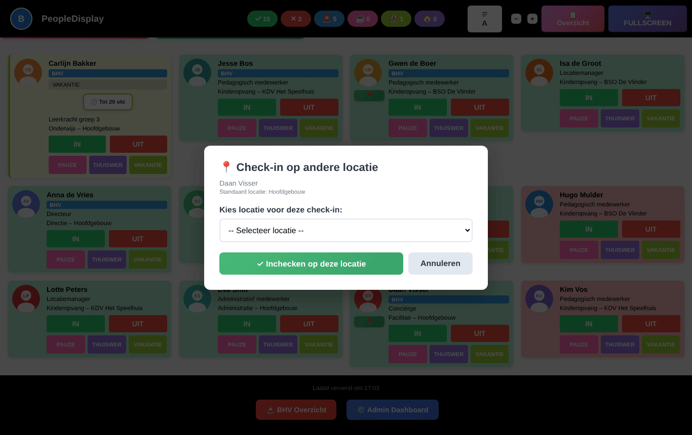

1. Tik op **📍**.
2. Kies de locatie waar je vandaag bent.
3. Tik op **Inchecken op deze locatie**.

Je kaart verschijnt nu bij die locatie. Bij het uitchecken ga je automatisch terug naar je vaste locatie.

# Bezoekers

Als bezoekersregistratie aan staat, zie je boven de kaarten twee blokken:

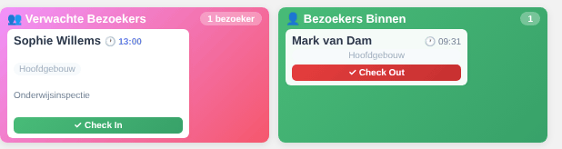

- **Verwachte Bezoekers** — wie zich vandaag heeft aangemeld maar nog niet binnen is. Tik op **Check In** als de bezoeker arriveert.
- **Bezoekers Binnen** — wie nu in het gebouw is. Tik op **Check Out** als de bezoeker vertrekt.

## Een bezoeker aanmelden

Bezoekers melden zich zelf aan via het registratieformulier (de beheerder kan de link of een QR-code bij de ingang hangen).

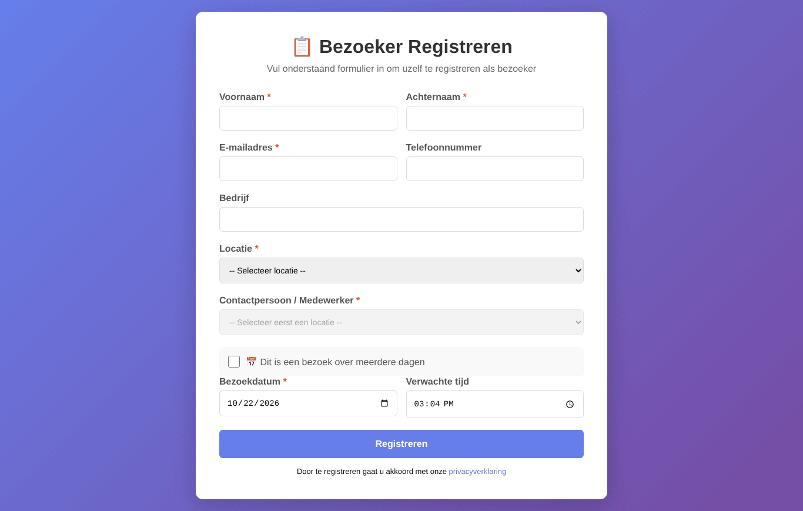

1. Vul voornaam, achternaam en e-mailadres in, en eventueel telefoonnummer en bedrijf.
2. Kies de **locatie** en daarna de **contactpersoon**.
3. Kies de bezoekdatum en verwachte tijd, of vink **bezoek over meerdere dagen** aan.
4. Klik op **Registreren**.

De contactpersoon krijgt een e-mail dat de bezoeker is aangemeld.

# BHV-overzicht

Klik onderaan het aanmeldscherm op **🚨 BHV Overzicht**. Je ziet dan alle medewerkers die nu **IN** zijn, met de BHV'ers gemarkeerd. Dit overzicht is bedoeld voor ontruimingen en noodsituaties.

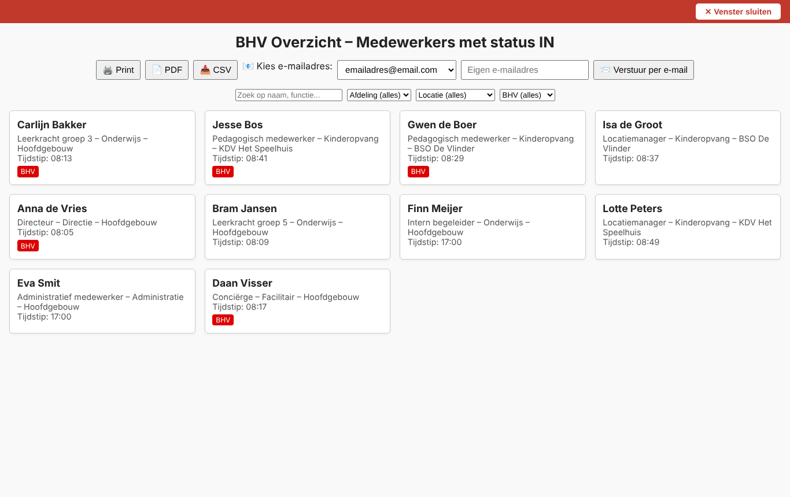

- **Print** of **PDF** — maak een papieren of digitale lijst.
- **CSV** — download de lijst voor Excel.
- **Versturen per e-mail** — stuur het overzicht naar een gekozen of zelf ingevuld e-mailadres.
- Met de filters bovenaan beperk je de lijst tot een afdeling, locatie of alleen BHV'ers.
- Met **Venster sluiten** (rode balk) ga je terug — dat werkt ook in kiosk-modus, waar geen browserknoppen zichtbaar zijn.

# Overzicht

De overzichtspagina toont alle aanwezige medewerkers als lijst, gegroepeerd per locatie.

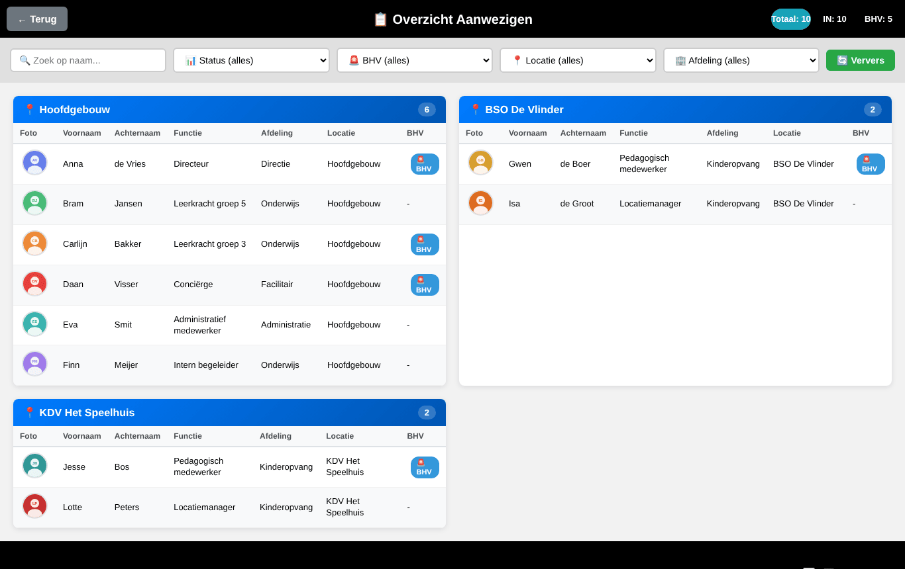

Bovenaan staan het totaal, het aantal IN en het aantal BHV'ers. Je kunt zoeken en filteren zoals op het aanmeldscherm. Met **Auto-refresh** (onderaan) ververst de pagina zich elke 30 seconden; **Ververs** doet dat direct. **Terug** brengt je naar het aanmeldscherm.

# IN/UIT-bord

Het IN/UIT-bord is een eenvoudige weergave met twee kolommen: links wie er **UIT** is, rechts wie er **IN** is. Er staan alleen namen en een BHV-label op — ideaal voor een groot scherm in de hal.

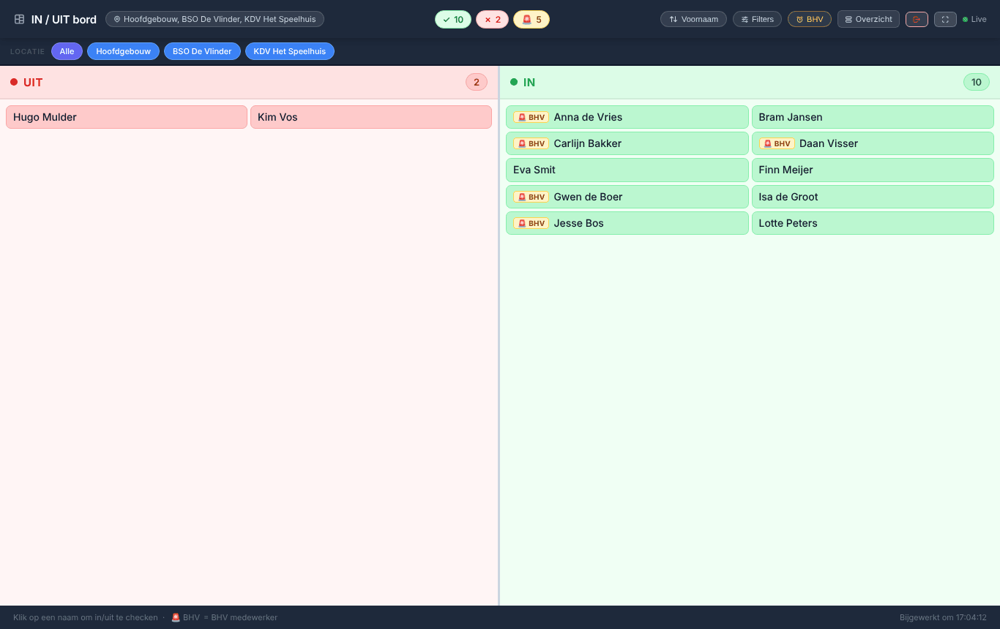

- Klik op een naam om die medewerker in of uit te checken.
- Kies bovenaan een locatie, of **Alle**.
- Met de knoppen rechtsboven sorteer je op voor- of achternaam, open je de filters, toon je alleen BHV'ers, ga je naar het overzicht, log je uit of zet je het bord op volledig scherm.
- Het bord ververst zichzelf elke 30 seconden (**Live**).

Heeft de beheerder het IN/UIT-bord voor jouw account aangezet, dan opent het aanmeldscherm voor jou altijd als IN/UIT-bord.

# Infoscherm-berichten

Heeft de beheerder je **redacteur** gemaakt (bijvoorbeeld als receptie of conciërge), dan staat op het welkomstscherm de knop **📝 Infoscherm-berichten**. Daarmee zet je berichten op het infoscherm, alleen voor **jouw locaties**. Welke dat zijn, staat bovenaan in het groene vak.

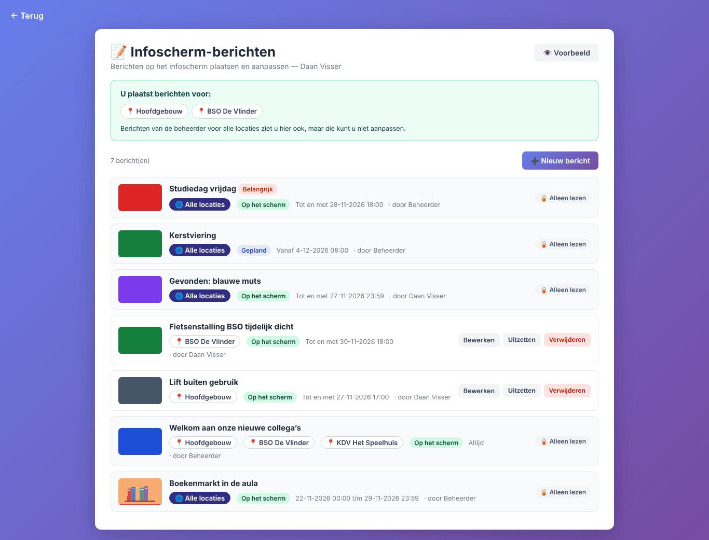

1. Klik op **Nieuw bericht**.
2. Vul een **titel** en een korte **tekst** in, en kies eventueel een afbeelding en een achtergrondkleur. Onder de tekst staat hoeveel tekens je gebruikt; houd je aan het advies, dan blijft de tekst groot en goed leesbaar.
3. Vink bij **Op welke locaties?** aan waar het bericht moet verschijnen. Je ziet alleen jouw eigen locaties.
4. Kies eventueel **Tonen vanaf** en **Tonen tot en met**. Leeg betekent: direct, en blijft staan tot je het uitzet.
5. Vink **Belangrijk** aan als het bericht vaker in beeld moet en ook in de nieuwsbalk. Klik op **Opslaan**.

Je eigen berichten kun je **bewerken**, **uitzetten** en **verwijderen**. Berichten van de beheerder voor **🌐 Alle locaties**, en berichten die ook op andere locaties staan, zie je met **🔒 Alleen lezen**: die past de beheerder aan. Met **Voorbeeld** bekijk je hoe het scherm eruitziet.

# Mijn profiel

Via **Mijn Profiel** (welkomstscherm of het menu onder je initiaal) pas je je eigen gegevens aan.

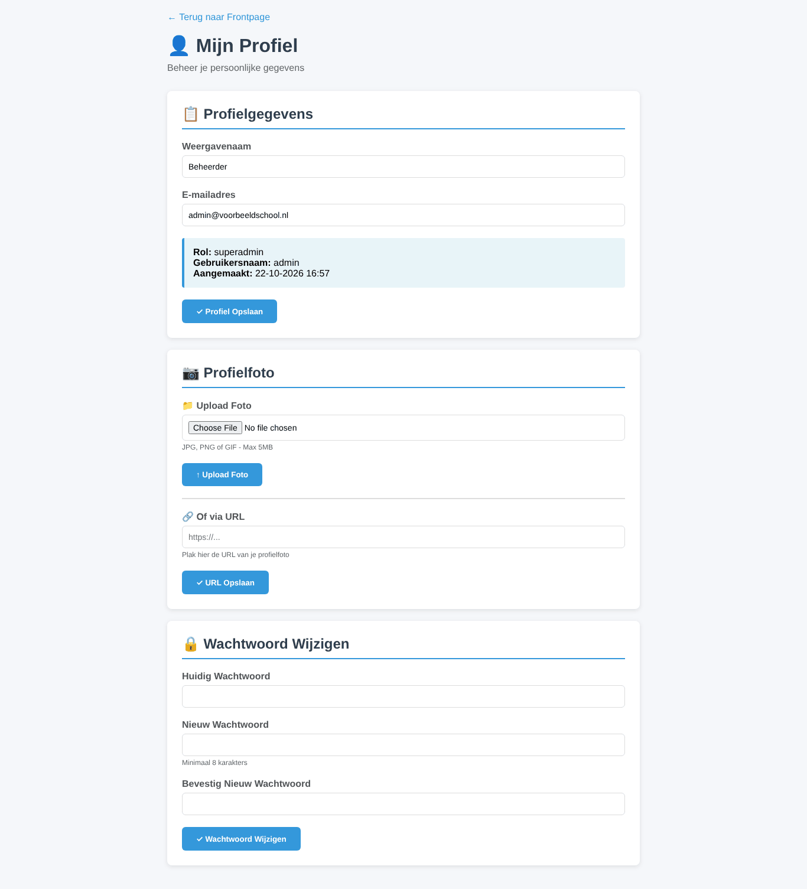

- **Profielgegevens** — weergavenaam en e-mailadres. Je rol en gebruikersnaam zie je ter informatie.
- **Profielfoto** — upload een JPG-, PNG- of GIF-bestand (maximaal 5 MB) of plak de link naar een foto.
- **Wachtwoord wijzigen** — vul je huidige wachtwoord in en twee keer het nieuwe (minimaal 10 tekens). Kies bij voorkeur een zin van drie of vier woorden.
- **Tweestapsverificatie** — zet de extra beveiliging met een app op je telefoon aan of beheer die (zie het volgende hoofdstuk).

Als de beheerder dat toestaat, kun je hier ook je eigen namen voor de extra knoppen instellen.

# Tweestapsverificatie (extra beveiliging)

Een wachtwoord alleen is kwetsbaar: iemand kan het afkijken, raden of via een phishingmail bemachtigen. Met **tweestapsverificatie** (2FA) heb je daarom bij het inloggen naast je wachtwoord ook een code van 6 cijfers nodig uit een app op je telefoon. Zonder jouw telefoon kan niemand met alleen je wachtwoord inloggen. Heeft je beheerder 2FA verplicht gesteld, dan krijg je bij het inloggen een melding om het in te stellen. Je hebt dan 7 dagen de tijd (via **Later instellen** stel je het uit). Ook als het niet verplicht is, raden we het aan.

## 2FA instellen

Je hebt hiervoor je telefoon nodig en ongeveer twee minuten.

1. Installeer een authenticator-app op je telefoon, bijvoorbeeld **Google Authenticator**, **Microsoft Authenticator**, **Authy** of **1Password**. Heb je al zo'n app, dan kun je die gebruiken.
2. Ga in PeopleDisplay naar **Mijn Profiel** en klik bij **Tweestapsverificatie** op **Instellen**.
3. Kies in de app **Account toevoegen** en scan de QR-code op het scherm. Lukt scannen niet, kies dan *handmatig invoeren* en typ de sleutel over die onder de QR-code staat. In de app verschijnt een account met de naam die op het scherm staat.
4. Vul de code van 6 cijfers uit de app in en klik op **Bevestigen en aanzetten**.
5. Je krijgt nu **10 herstelcodes** te zien. Bewaar die op een veilige plek, bijvoorbeeld in je wachtwoordmanager of uitgeprint (knoppen **Printen**, **Kopiëren** en **Downloaden**). Ze worden daarna niet meer getoond. Vink aan dat je ze hebt bewaard en klik op **Verder naar PeopleDisplay**.

> **Let op:** zorg dat de tijd op je telefoon automatisch wordt ingesteld. Loopt de klok af, dan werken de codes niet.

### Instellen op dezelfde telefoon (geen computer bij de hand)

Gebruik je PeopleDisplay alleen op je telefoon of tablet, dan kun je de QR-code niet scannen: je kunt hem niet op hetzelfde scherm zien en scannen. Dat hoeft ook niet. Op een telefoon laat PeopleDisplay in stap 3 in plaats van de QR-code twee knoppen zien:

- **Open in je authenticator-app.** Tik erop: je authenticator-app gaat open en voegt het account zelf toe. Controleer of het account in de app staat en ga terug naar PeopleDisplay.
- **Sleutel kopiëren.** Werkt de eerste knop niet (dat verschilt per telefoon en app, vooral op een iPhone), tik dan hierop, open de app, kies *Setup-sleutel invoeren* (of *handmatig invoeren*), plak de sleutel en kies **tijdgebaseerd**. Geef het account een herkenbare naam, bijvoorbeeld PeopleDisplay.

Wil je toch de QR-code zien, tik dan op **Toch de QR-code tonen**. Ga daarna verder met stap 4: de code van 6 cijfers uit de app invullen. Het kan ook op een computer: open PeopleDisplay daar, laat de QR-code zien en scan hem met je telefoon.

## Inloggen met 2FA

1. Vul je gebruikersnaam en wachtwoord in, zoals altijd.
2. Er verschijnt een scherm **Tweede stap**. Open de app, kijk naar de code van PeopleDisplay en vul die in. De code verandert elke 30 seconden.
3. Klik op **Inloggen**.

Vink je **Dit apparaat 30 dagen vertrouwen** aan, dan hoef je op dat apparaat 30 dagen geen code meer in te vullen. Doe dit alleen op je eigen computer of telefoon. **Blijf ingelogd** is iets anders en omzeilt de code niet: na uitloggen vraagt PeopleDisplay opnieuw om een code, tenzij het apparaat vertrouwd is.

## Telefoon kwijt of geen toegang?

Vul in plaats van de code uit de app een van je **herstelcodes** in (bijvoorbeeld `ABCDE-FGHIJ`). Elke herstelcode werkt één keer. Zijn er nog maar drie of minder over, dan stelt PeopleDisplay voor nieuwe te maken. Heb je je telefoon én je herstelcodes niet meer, vraag dan je beheerder om je 2FA te resetten. Daarna kun je weer met je wachtwoord inloggen en stel je 2FA opnieuw in.

## 2FA beheren

Via **Mijn Profiel** → **Tweestapsverificatie** → **Beheren** kun je:

- **nieuwe herstelcodes maken** (je wachtwoord is nodig; de oude codes werken daarna niet meer);
- **alle vertrouwde apparaten afmelden**, bijvoorbeeld als je een apparaat kwijt bent;
- **2FA uitzetten** (je wachtwoord is nodig). Dat kan niet als je beheerder 2FA voor jouw account verplicht heeft gesteld.

Heb je een nieuwe telefoon? Zet dan 2FA eerst uit en weer aan, of vraag je beheerder om een reset, en scan de nieuwe QR-code met je nieuwe telefoon. Een nieuw wachtwoord melden alle vertrouwde apparaten af.

# PeopleDisplay op telefoon of tablet

PeopleDisplay past zich aan het scherm aan. Op een telefoon staan de tellers, knoppen en filters onder elkaar.

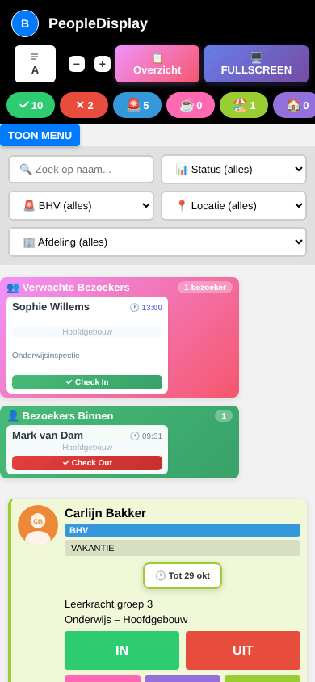

## Installeren als app

Je kunt PeopleDisplay installeren als app, zodat het een eigen pictogram krijgt en zonder adresbalk opent.

- **Android (Chrome)** — tik op de drie puntjes en kies **App installeren** of **Toevoegen aan startscherm**.
- **iPhone/iPad (Safari)** — tik op het deel-pictogram (vierkant met pijl) en kies **Zet op beginscherm**.
- **Windows/Mac (Chrome of Edge)** — klik op het installatiepictogram rechts in de adresbalk.

Na een update van PeopleDisplay ververst de app zichzelf binnen enkele minuten.

## Automatisch inchecken via wifi

Als de beheerder dit voor een locatie heeft ingesteld, stelt de geïnstalleerde app voor om je automatisch in te checken zodra je telefoon verbonden is met het netwerk van die locatie. Je kunt altijd ook gewoon zelf op IN of UIT tikken.

# Veelgestelde vragen

**Ik zie mijn naam niet op het scherm.**
Controleer of er een locatie- of afdelingsfilter aan staat (knop **Reset Filters**). Staat je kaart er nog steeds niet, vraag dan de beheerder of je als medewerker bent toegevoegd en op welke locatie.

**Ik zie de extra knoppen, de sorteerknop of het IN/UIT-bord niet.**
Deze functies zet de beheerder per gebruiker aan of uit.

**Het scherm laat oude informatie zien.**
Het scherm ververst elke 30 seconden. Vernieuw de pagina (F5, of op een tablet naar beneden vegen) als je direct de nieuwste stand wilt zien.

**Ik ben automatisch uitgelogd.**
Een beheerder kan sessies op afstand beëindigen, bijvoorbeeld als een apparaat kwijt is. Log gewoon opnieuw in.

**De code uit de app werkt niet.**
Controleer of de tijd op je telefoon automatisch wordt ingesteld. In Google Authenticator kan dat via *Instellingen → Tijdcorrectie voor codes → Nu synchroniseren*. Staan er twee accounts met bijna dezelfde naam in je app (van een eerdere poging om in te stellen), gebruik dan het juiste account en verwijder het oude.

**Ik ben mijn telefoon kwijt.**
Log in met een herstelcode. Heb je die niet meer, vraag dan je beheerder om je 2FA te resetten.

**Mijn extra status staat er nog, terwijl ik terug ben.**
Tik op **IN**; daarmee vervalt de extra status direct.
